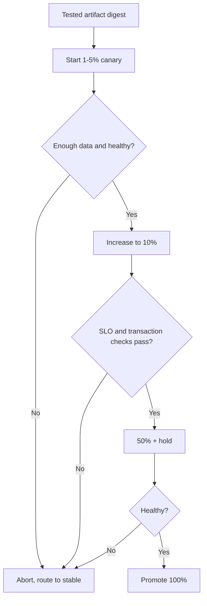
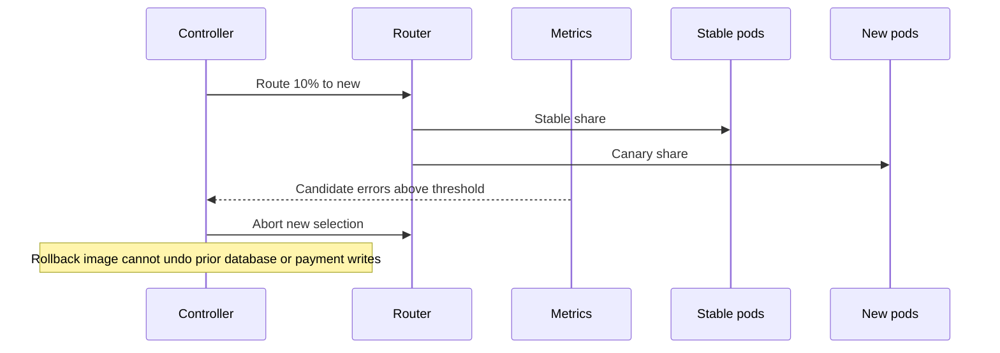

# Progressive Delivery: Canary, Blue-Green, Analysis and Cutback

> **Engineering focus:** A release looks good in staging but fails under a subset of production payments. Design controlled rollout with objective abort decisions. Why does rolling back application code not always recover the system?

## Release changes are experiments with blast radius

A rollout strategy defines **who receives the new behavior, how rapidly the population grows, how the candidate is measured, and what happens when it fails**. A readiness probe can establish that a Pod responds; it cannot establish transaction correctness. A metric gate should compare candidate and stable traffic, account for sample size, and inspect business outcomes.

| Strategy | Strength | Limitation |
| --- | --- | --- |
| Rolling | Native and simple | Coarse traffic control; mixed versions |
| Blue-green | Fast frontend switch | Double capacity and backend-state compatibility |
| Canary | Gradual exposure | Routing/metrics integration and statistical noise |
| Feature flags | Decouple exposure from deploy | Runtime flags, debt and audit |



### Argo Rollouts canary example

```yaml
apiVersion: argoproj.io/v1alpha1
kind: Rollout
metadata: {name: catalog, namespace: marketplace}
spec:
  replicas: 8
  selector:
    matchLabels: {app: catalog}
  template:
    metadata:
      labels: {app: catalog}
    spec:
      containers:
        - name: catalog
          image: registry.example.com/catalog@sha256:REPLACE_WITH_REAL_DIGEST
          ports: [{containerPort: 8080}]
  strategy:
    canary:
      steps:
        - setWeight: 10
        - pause: {duration: 5m}
        - analysis:
            templates:
              - templateName: catalog-slo
        - setWeight: 50
        - pause: {}
```

This requires an installed controller, a real AnalysisTemplate and a compatible routing integration. Without explicit traffic routing support, percentage rollout may approximate weights through replica counts rather than providing exact traffic shares. Long-lived sessions and uneven request costs can invalidate naive assumptions about traffic split.

### Objective gates

Define before deployment:
- Candidate error ratio versus stable control and absolute SLO burn.
- Endpoint-specific p95/p99 with appropriate histogram aggregation.
- Duplicate business effects, failed writes, stale reads and event lag.
- Sample count and statistical confidence. A five-minute hold with three requests proves little.
- Resource saturation, queue length, node and database health.
- Operator override, abort action, escalation and maximum duration.

### Code rollback is not state rollback

An old image may not understand a new database schema. Even if the service is rolled back, external payments, emitted events and irreversible migrations remain. Use **expand-contract** migration: first add backward-compatible fields, deploy dual-compatible application versions, migrate data, then remove legacy fields only after all consumers are updated. Version event contracts for mixed workloads.



## Failure drill

A checkout canary returns duplicate payment callbacks only after a delayed response. Conventional HTTP error rate remains low. Gate on idempotency violations and per-operation reconciliation, abort candidate routing, preserve audit records, and reconcile affected transaction IDs. Fix retry semantics, not merely Pod count.

```bash
kubectl argo rollouts get rollout catalog -n marketplace --watch
kubectl argo rollouts abort catalog -n marketplace
kubectl argo rollouts history catalog -n marketplace
```

**Key takeaways**

> “Choose a progressive strategy with pre-agreed abort gates for latency, errors and business correctness. Validate that the ingress actually enforces the traffic split and that the sample is meaningful. If the candidate fails, cut new traffic back to stable while reconciling side effects. Never promise a one-command rollback of database schemas or external transactions; compatibility and compensating procedures must be part of the release design.”

**References:** [Argo Rollouts analysis](https://argoproj.github.io/argo-rollouts/features/analysis/) · [Canary deployment](https://argoproj.github.io/argo-rollouts/features/canary/)
