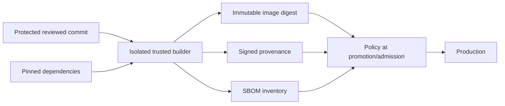

# Software Supply Chain, SBOM, Signing and Provenance

> **Engineering focus:** How do you prevent a compromised dependency, GitHub Actions workflow or build runner from delivering malicious code to production? Distinguish source review, signatures, SBOMs, provenance and deployment enforcement.

## Threat model the artifact path

An attacker may control untrusted PR code, package registry releases, an action dependency, build cache, CI token, signer or registry permissions. A vulnerability scanner does not prove the released bytes match reviewed source. A signature proves who signed a digest under its trust model, **not** that the contents are benign. Provenance records structured build claims; it is valuable only if the builder/issuer and verification policy are trustworthy.



### Defense in depth

1. Protected branches, CODEOWNERS and reviewed releases with minimized bypass permissions.
2. No high-privilege token exposure to scripts from untrusted forks. Avoid dangerous pull_request_target checkout behavior.
3. Pin third-party CI actions to reviewed full commit SHAs. Update through controlled review.
4. Lock direct and transitive dependencies where ecosystem supports it. Watch for package takeover and install scripts.
5. Prefer ephemeral isolated runners. Segregate caches and network access by trust level.
6. Use OIDC short-lived cloud credentials scoped to repo, environment, branch and audience. No static account keys in CI.
7. Generate SBOM, provenance attestations and immutable artifact digests.
8. Enforce expected signer/builder, source revision and artifact digest before deployment.
9. Apply runtime restrictions and vulnerability prioritization based on exposure and exploitability.
10. Preserve auditable release records and a tested incident inventory by digest.

### GitHub Actions least privilege example

```yaml
permissions:
  contents: read
jobs:
  verify:
    runs-on: ubuntu-latest
    steps:
      - uses: actions/checkout@v4
      - run: echo "Run isolated verification"
```

For a cloud deployment job, configure `id-token: write` only when needed and restrict the cloud trust conditions. This event-less workflow fragment is illustrative and not independently runnable as a full Actions workflow.

### Admission policy concept

```text
permit production promotion when
  artifact digest is immutable and exists
  AND approved source revision matches provenance
  AND builder/issuer identity is trusted
  AND security exception policy is satisfied
  AND production approval recorded
```

Use Sigstore/Cosign, trusted attestation verification and admission controls where appropriate. Avoid treating signature validation as a substitute for review or least privilege.

### Supply-chain incident

A recently updated package's install hook reads tokens from the CI environment. Freeze new promotions, revoke exposed identities, isolate affected runners, enumerate builds by dependency version/digest, rebuild with clean trusted infrastructure and verify deployed identities. Deleting a tag will not revoke stolen credentials or remove an already running artifact. Communicate scope based on evidence rather than asserting all deployments are compromised.

```bash
git log --oneline -n 5
git diff HEAD~1 -- package-lock.json
kubectl get deployments -A \
  -o custom-columns='NAMESPACE:.metadata.namespace,NAME:.metadata.name,IMAGES:.spec.template.spec.containers[*].image'
```

### Key takeaways

> Secure the chain from a reviewed commit to immutable runtime bytes. That means isolated builders, pinned dependencies and actions, OIDC instead of long-lived credentials, artifact digests, SBOM and trusted provenance. Deployment should verify the source and build identity, not only a tag or a green scan. Also keep a digest-based inventory so we can contain a compromised build and rotate affected credentials quickly.

**References:** [SLSA specification](https://slsa.dev/spec/) · [GitHub artifact attestations](https://docs.github.com/en/actions/concepts/security/artifact-attestations) · [GitHub Actions security](https://docs.github.com/en/actions/security-guides/security-hardening-for-github-actions)
