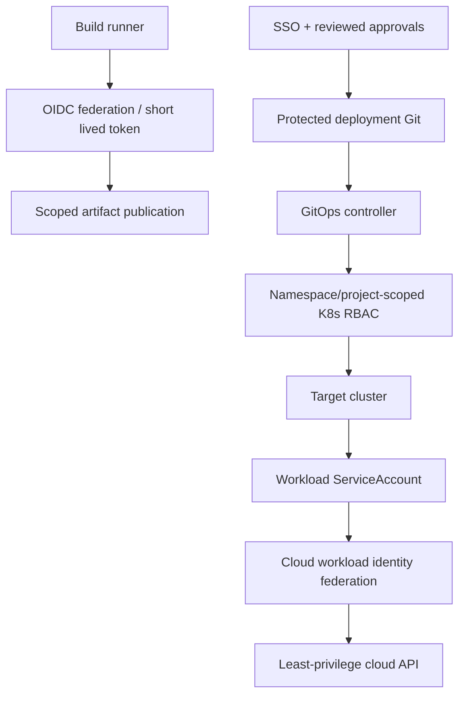

# Q5 · Identity, Secrets, Multi-Environment Isolation and Deployment Authority

> **Interviewer:** Multiple teams deploy to separate staging and production clusters on AWS or Google Cloud. How should CI, GitOps and workloads authenticate? Why is a namespace or cluster-admin ServiceAccount insufficient as a security model?

## Distinguish four identities

**Human identity:** authenticated SSO principals/groups with reviewed production access.  
**CI builder identity:** may read source and publish approved artifacts, but generally cannot deploy production directly.  
**CD controller identity:** can reconcile a bounded set of namespaces and resource kinds in the target cluster.  
**Runtime workload identity:** uses the minimum Kubernetes and cloud API permissions its application needs.



### No static secrets in manifests

Base64 encoding Kubernetes Secrets isn't encryption. Secrets can leak through Git history, CI logs, `kubectl get` output, environment dumps and backups. Use managed secret storage, encryption at rest, narrow RBAC and a rotation model. Prefer external secret references where operationally justified; understand that synchronization controllers often materialize Kubernetes Secret objects, so at-rest and access control still matter.

### Cloud federation specifics

- GitHub Actions OIDC: trust the exact repository/branch/environment and audience claims; grant `id-token: write` only to the intended job.
- AWS IRSA/EKS Pod Identity and GKE Workload Identity Federation have different trust and admission semantics. Model cloud IAM and Kubernetes RBAC separately.
- A Pod can be allowed to call an object-store API without being allowed to read cluster Secrets.
- An ingress controller, secrets operator and Argo CD may each require different permissions; do not share one privileged cloud identity.

### RBAC sample

```yaml
apiVersion: rbac.authorization.k8s.io/v1
kind: Role
metadata: {name: rollout-reader, namespace: marketplace}
rules:
  - apiGroups: ["apps"]
    resources: ["deployments"]
    verbs: ["get", "list", "watch"]
---
apiVersion: rbac.authorization.k8s.io/v1
kind: RoleBinding
metadata: {name: rollout-reader, namespace: marketplace}
subjects:
  - kind: ServiceAccount
    name: release-observer
    namespace: marketplace
roleRef: {kind: Role, name: rollout-reader, apiGroup: rbac.authorization.k8s.io}
```

Provision the referenced ServiceAccount separately. Reading Deployments doesn't permit deploying or accessing Secrets. Workload creation and `pods/exec` also create indirect privilege paths, so assess effective permissions rather than RBAC labels alone.

## Environment isolation

Use accounts/projects and clusters/namespace boundaries appropriate for trust: staging must not possess credentials that can mutate production. Separate remote state, artifact promotion rights, encryption keys and audit trails. Namespace isolation alone cannot contain a compromised cluster-admin controller or shared node privilege escape. Consider quotas, Pod Security Admission, NetworkPolicy and cloud IAM.

## Failure scenario: OIDC trust too broad

A CI workflow accepts tokens from any branch of a repository and can impersonate a production cloud role. An attacker with permission to push a development branch obtains deployment authority. First revoke/limit role trust, inspect cloud audit logs for issued sessions, rotate any downstream credentials, and test exact subject/audience/environment conditions. Avoid reintroducing permanent static keys as a workaround.

```bash
kubectl auth can-i get deployments -n marketplace \
  --as=system:serviceaccount:marketplace:release-observer
kubectl get serviceaccounts -n marketplace
kubectl get rolebindings -n marketplace
```

### Spoken answer

> “I'd separate people, CI, CD and runtime identity. CI publishes signed immutable artifacts; a constrained deployment controller reconciles reviewed configuration. Each workload has its own short-lived cloud identity and minimal Kubernetes RBAC. Secrets remain outside public Git and are rotated. I would enforce environment boundaries at both cloud IAM and cluster scope so a compromised test workflow cannot become production administration.”

**References:** [GitHub OIDC cloud deployments](https://docs.github.com/en/actions/security-for-github-actions/security-hardening-your-deployments/configuring-openid-connect-in-cloud-providers) · [Kubernetes RBAC](https://kubernetes.io/docs/reference/access-authn-authz/rbac/)
