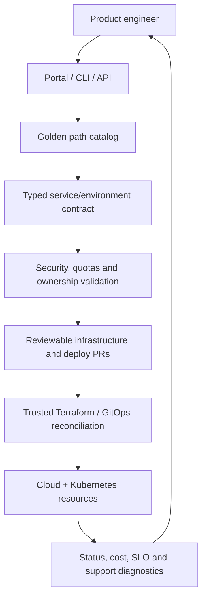
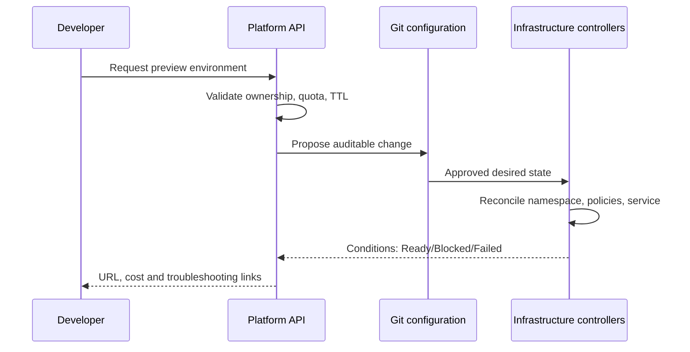

# Q6 · Internal Developer Platforms, Golden Paths and Self-Service APIs

> **Interviewer:** Engineers wait several days for an environment or an ingress rule. Design an internal developer platform that reduces toil without becoming another central bottleneck.

## Platform as a product

Platform engineering creates supported capabilities and clear contracts for users of the platform, usually application engineers. An internal developer portal is a user interface; it is not the entire platform. The platform comprises APIs, templates, policy, automation, documentation, observability and a support model. The objective is to shorten safe time-to-value, not maximize the number of Kubernetes abstractions exposed.



### Define the platform API before choosing tools

```yaml
apiVersion: platform.example.com/v1alpha1
kind: ServiceEnvironment
metadata:
  name: catalog-preview
spec:
  owner: product-catalog
  class: ephemeral
  region: europe-region-a
  exposure: internal
  ttlHours: 24
  resources:
    cpuRequest: 500m
    memoryRequest: 512Mi
```

This is a **hypothetical platform custom resource**, not a built-in Kubernetes API. A real implementation needs CRD schema, RBAC, reconciler, status conditions, failure cleanup, cost attribution and idempotent creation/deletion. A developer should not be able to request arbitrary privileged host mounts through the contract.

### Golden paths versus paved roads

Offer a recommended safe default for common service types (HTTP API, async worker, scheduled job) including CI, observability, resources, identity and rollout policy. Provide documented escape hatches for exceptional workloads, backed by review and clear ownership. Mandatory golden paths that cannot meet product needs incentivize shadow infrastructure.

### Onboarding flow



### API design and error behavior

An asynchronous API should return a resource identity and status, not pretend an environment is ready when provisioning is still in progress. Use `observedGeneration`, conditions, stable request IDs, explicit reconciliation backoff and finalizers for external cleanup. Handle partial failures: namespace exists but database provisioning failed, or DNS creation succeeded while access-policy setup failed. Retry idempotently; do not leak abandoned preview resources.

## Product metrics

Measure median and p90 time from request to usable environment; support ticket volume; time-to-first-deploy; developer task completion rate; security exceptions; platform availability; cost per environment; and adoption among eligible teams. Add qualitative usability research. “Services onboarded” is a vanity metric if teams still maintain hand-written deployment YAML.

### Trade-offs

Backstage, a custom CLI, Crossplane, Terraform modules and Kubernetes operators solve different problems. Choose based on supported workflow and team maintenance capacity. A small, well-maintained set of templates can be more useful than an enormous portal with fragile automation.

## Failure scenario

A preview environment cleanup controller is down for a week. TTL resources remain running and cost spikes. First restore cleanup safely, inspect finalizer conditions and downstream ownership, then reconcile stale resources through controlled deletion. Post-incident, alert on aged environments and quantify unowned cost.

```bash
kubectl get customresourcedefinitions
kubectl get events -A --sort-by=.lastTimestamp
kubectl get namespaces -L platform.example.com/owner
# Query controller status and preview environment age via platform metrics
```

### Spoken answer

> “I'd treat the platform as a product. I'd identify the few repeated developer journeys that cause the most wait time, define typed self-service contracts and automate them through reviewed infrastructure and GitOps workflows. I'd expose honest asynchronous status and safe cleanup, provide default security and cost boundaries, and measure time-to-usable-environment rather than just portal adoption. Exceptions need a governed path so the platform enables rather than blocks teams.”

**References:** [CNCF platform engineering white paper](https://tag-app-delivery.cncf.io/whitepapers/platforms/) · [Kubernetes operator pattern](https://kubernetes.io/docs/concepts/extend-kubernetes/operator/)
