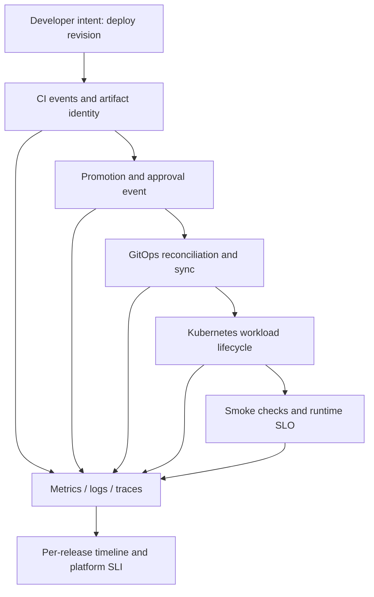

# Observability, Engineering Effectiveness and Platform SLOs

> **Engineering focus:** Your internal platform has 95% uptime, but developers report slow deployments and frequent confusing errors. What would you measure, and how would you prove that the platform improves engineering productivity?

## User journeys define platform reliability

A successful platform API response isn't enough. Measure whether a developer can **create an environment, deploy a reviewed change, observe it, recover it and delete it** within agreed targets. Platform SLOs are separate from product runtime SLOs: a deployment control plane can be degraded while existing applications continue serving.

| Platform journey | SLI example | Reliability question |
| --- | --- | --- |
| Preview environment | Successful usable environment within 10 minutes | Can developer start work? |
| CI feedback | Valid source check completes under agreed wait | Can developer learn quickly? |
| CD promotion | Approved artifact reaches expected environment | Can team ship safely? |
| Rollback/cutback | Recovery to known-good behavior within deadline | Can team recover? |
| Developer docs | Task-completion success and support contact rate | Is self-service understandable? |

Never blindly maximize deployment frequency. Use DORA metrics such as lead time for changes, deployment frequency, change failure rate, and recovery time as contextual trends; measure over consistent definitions and avoid using them as individual performance rankings. Focus on customer impact, not reward for gaming events.

## Three observability signals, one correlation model

Metrics quantify rate, errors, duration and saturation. Logs record structured state transitions with trace/release/owner identifiers and explicit error reasons. Distributed traces isolate where time is spent across services. Correlation requires consistent trace context and time alignment, but traces may sample low-volume failures away; preserve critical error events independently.



### Useful cardinality and cost controls

Avoid placing unique user IDs, commit hashes or PR IDs directly on every high-frequency Prometheus time series. Use those as trace/log attributes or in exemplars with careful retention. Metrics should aggregate on stable service, environment, status and outcome labels. Limit log payloads, redact tokens and personal data, apply trace sampling deliberately, and allocate observability storage cost by usage.

### PromQL example: CI request success

```promql
sum(rate(platform_operation_total{operation="create_preview",outcome="succeeded"}[30m]))
/
clamp_min(sum(rate(platform_operation_total{operation="create_preview"}[30m])), 1e-9)
```

This requires that `platform_operation_total` counts each eligible operation exactly once when reaching a terminal outcome; a metric increment at both start and finish corrupts the denominator. Separately track still-pending operations and oldest pending age.

### Observability architecture trade-offs

A single shared metrics cluster can be a failure domain and a cost bottleneck; complete per-tenant isolation makes fleet-wide detection harder. Set retention, cardinality budgets, query limits and access policy. Prefer consistent OpenTelemetry semantic conventions where supported, but don't assume a migration is free or that sampling preserves every distributed trace.

## Incident scenario

A deployment platform reports Sync=True, but 30% of teams cannot reach newly deployed preview URLs. Correlate Git desired revision, Argo health, target ingress registration, DNS propagation and synthetic user-journey checks. A green controller metric is insufficient. Add a post-deploy URL reachability SLI and scoped alerting; avoid an expensive full end-to-end test on every reconcile event.

```bash
argocd app get catalog-preview
kubectl get pods,svc,ingress -n catalog-preview
kubectl get endpointslices -n catalog-preview
kubectl get events -n catalog-preview --sort-by=.lastTimestamp
```

## Key takeaways

> Treat developers as platform customers and measure the success and duration of their actual journeys, not only controller availability. Correlate source revision, build artifact, GitOps sync, Kubernetes readiness and user-facing checks using consistent identifiers. Then combine SLOs with DORA-style delivery metrics and qualitative feedback, taking care not to create misleading individual performance scores or runaway telemetry costs. The platform is successful when safe changes and recovery become predictably easier.

**References:** [Google SRE monitoring](https://sre.google/sre-book/monitoring-distributed-systems/) · [DORA research](https://dora.dev/) · [OpenTelemetry](https://opentelemetry.io/docs/)
