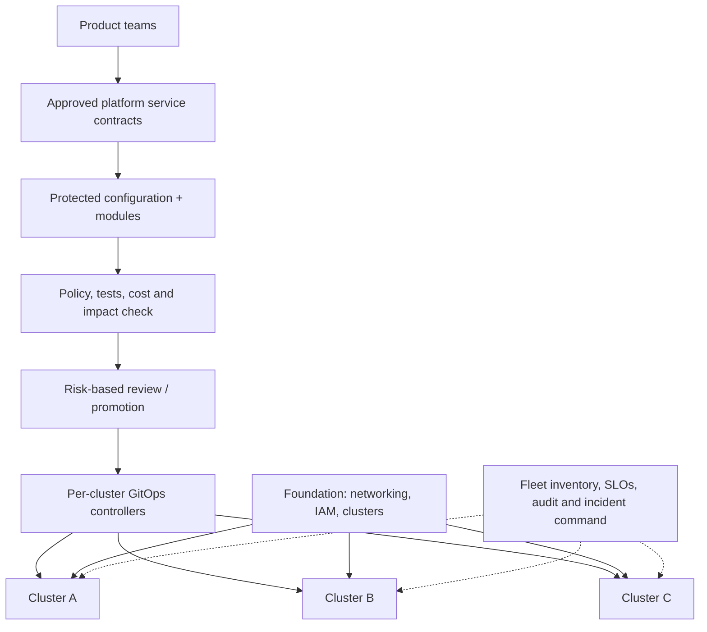
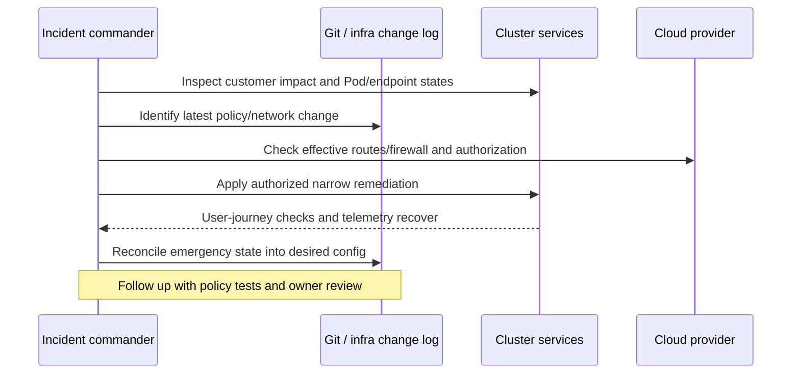

# Multi-Cluster Platform Governance, Recovery and Technical Leadership

> **Engineering focus:** Your company has ten Kubernetes clusters, dozens of teams and multiple cloud providers. Design ownership, disaster recovery, infrastructure change control and production incident processes for a reliable internal platform.

## Start with responsibility boundaries

Separate shared foundation teams from application ownership. Platform teams own supported service contracts, GitOps controllers, runner infrastructure, policies, cluster upgrades and incident tooling. Product teams own business SLOs, application correctness and compatibility. The boundary is negotiated through contracts and documented escalation, not implied by who can type `kubectl`.



### Platform architecture decisions

- **Fleet boundaries:** isolate production from nonproduction using sufficiently strong cloud/project, account and cluster boundaries. Classify shared versus dedicated clusters by blast radius and compliance.
- **GitOps ownership:** each cluster has explicit application destinations, AppProjects and workload trust policy. Bootstrap documented recovery credentials because the GitOps controller can itself fail.
- **Infrastructure management:** Terraform owns cloud resources, GitOps owns Kubernetes manifests, operators own their CRDs. Avoid two tools owning the same field/resource. Define cross-layer contracts.
- **Secrets:** OIDC/federation, workload identity, rotation and breach inventory; do not replicate global production credentials across all clusters.
- **Upgrades:** release channels/version-skew checks, compatibility matrix for CSI/CNI/webhooks, canary node pools, PDB/readiness and rollback/forward-recovery procedures.
- **Disaster recovery:** backup external state and platform desired configuration, test clean-room reconstruction and keep control-plane recovery paths independent of the broken control plane.
- **Cost:** attribute nodes, idle preview namespaces, observability and data egress to owners; combine cost controls with safety headroom.

## Change risk and blast radius

A one-line edit to a shared cloud firewall rule can be more dangerous than 100 application updates. Approval should depend on potential reach, reversibility, security, storage/data-loss risk and SLO impact, not YAML size.

### Model incident: cluster fails after a policy change



Do not delete all NetworkPolicies or force-unlock every Terraform backend as a first step. Preserve state and identify which control plane owns the change. If GitOps self-heal is active, address the desired configuration or suspend the correct owner under break-glass controls.

### Safe incident operating model

1. Declare severity and command roles from actual customer/developer impact.
2. Assign investigative workstreams by failure boundary.
3. Keep one timeline of evidence, changes and decisions.
4. Freeze risky concurrent writes to the affected infrastructure.
5. Apply a narrow, reversible mitigation with a named owner.
6. Verify application outcome, identity security and workload health.
7. Reconcile emergency drift, rotate emergency access and document follow-ups.
8. Run a game day to prove the fix and rollback/failover mechanisms.

```bash
kubectl config get-contexts
kubectl get nodes -o wide
kubectl get events -A --sort-by=.lastTimestamp
kubectl get validatingwebhookconfigurations
kubectl get applications -A
terraform plan -refresh-only
```

The `terraform plan -refresh-only` command should be used only with correct workspace, credentials and backend state; it is read-focused but can still trigger provider reads and expose sensitive information. Don't apply destructive changes as part of discovery.

## Team success measures

Track platform task lead time, SLO burn, production incident recovery time, change failure rate, module/template adoption, policy escape hatches, ownership coverage, cost allocation and recurring support toil. Prioritize improvements based on user pain and risk; a platform that centralizes approvals without creating self-service may harm delivery.

## Key takeaways

> Establish clear ownership across cloud foundations, GitOps, application teams and security. Each cluster should have least-privilege delivery authority, audited configuration and a rehearsed recovery path independent of the healthy day-to-day control plane. Assess changes by blast radius, not line count, and use canary upgrades and policy tests. During an incident identify the failed boundary, contain it safely, reconcile state afterward and turn repeated support work into durable platform capabilities.

**References:** [CNCF platform engineering](https://tag-app-delivery.cncf.io/whitepapers/platforms/) · [Kubernetes multi-tenancy](https://kubernetes.io/docs/concepts/security/multi-tenancy/) · [Google SRE incident management](https://sre.google/sre-book/managing-incidents/)
