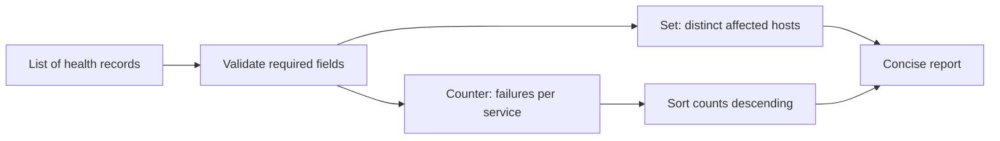

# Q1. Python Fundamentals for Infrastructure Automation

> **Interviewer:** You receive a list of service-health events. Which Python data structures would you use to count unhealthy services, remove duplicate hosts and report the worst offenders? Explain your approach and its complexity.

## Start with the data contract

Platform scripts typically transform API responses, log records or configuration, rather than invent a new algorithm. Clarify the schema, input size, missing fields, duplicates, ordering, and intended output before writing code.

Use Python's standard library wherever reasonable:

| Structure | Good for | Typical operations |
| --- | --- | --- |
| `list` | Ordered records, repeated values | Append amortized O(1), scan O(n) |
| `dict` | Lookups and grouping by key | Expected lookup/update O(1) |
| `set` | Membership and deduplication | Expected membership/add O(1) |
| `tuple` | Small immutable records, multiple returns | Fixed-size structure |
| `Counter` | Counts per key | Expected O(n) over input |
| `defaultdict` | Groups or nested buckets | Expected O(n) over input |

These are *average/expected* costs for hashing, not a guarantee for adversarial hashing or every operation. Sorting n records costs O(n log n). Memory complexity matters as much as time when input grows.



## Working solution

```python
from collections import Counter

events = [
    {"service": "api", "host": "node-a", "status": "error"},
    {"service": "api", "host": "node-a", "status": "error"},
    {"service": "worker", "host": "node-b", "status": "ok"},
    {"service": "checkout", "host": "node-c", "status": "error"},
]

def summarize_failures(records: list[dict]) -> tuple[list[tuple[str, int]], int]:
    failures = Counter()
    hosts = set()

    for record in records:
        if not isinstance(record, dict):
            raise ValueError("each event must be an object")
        service = record.get("service")
        host = record.get("host")
        status = record.get("status")
        if not all(isinstance(v, str) and v for v in (service, host, status)):
            raise ValueError("service, host and status must be non-empty strings")
        if status == "error":
            failures[service] += 1
            hosts.add(host)

    ranked = sorted(failures.items(), key=lambda item: (-item[1], item[0]))
    return ranked, len(hosts)

print(summarize_failures(events))
# ([('api', 2), ('checkout', 1)], 2)
```

### Reasoning and edge cases

The script counts *events*, not unique failures. The duplicate record for node-a produces two failures while the set counts node-a once. If duplicates represent retry delivery and should not count twice, require an event ID and deduplicate before counting. A host count is across all failing services; if the question asks for per-service distinct hosts, use a dictionary of sets instead.

Time is O(n + k log k), where n is the number of records and k the number of distinct failing services. Auxiliary space is O(k + h), for distinct services and hosts.

### Interview follow-ups

- **Why not a list for membership?** A list scan is O(n), while a set normally gives expected O(1) membership checks.
- **Is `dict` insertion order guaranteed?** Modern Python preserves insertion order, but sorting is required for count ranking.
- **What if `status` has new values?** Define acceptable statuses; either reject unknown values or explicitly classify them, rather than silently treating all unknown states as healthy.
- **What if input is a generator?** The `for` loop works without materializing the entire iterable, although the return annotation could be broadened to `Iterable[dict]`.

## Practical test cases

```python
assert summarize_failures([]) == ([], 0)
assert summarize_failures([{"service":"s","host":"h","status":"ok"}]) == ([], 0)
assert summarize_failures([{"service":"s","host":"h","status":"error"}]) == ([("s", 1)], 1)
```

## Spoken answer

> “I would first confirm whether failures are counted per event or per unique incident. A Counter handles frequency, and a set tracks distinct hosts without repeated linear scans. I'd validate the record shape so a malformed response doesn't produce misleading statistics. The scan is linear and only sorting the distinct services adds a logarithmic factor. I'd test empty input, duplicates and unknown statuses.”

**Reference:** [Python collections](https://docs.python.org/3/library/collections.html)
