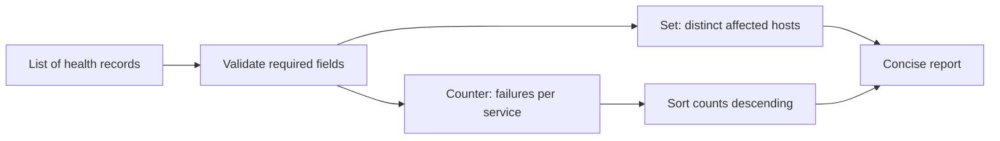
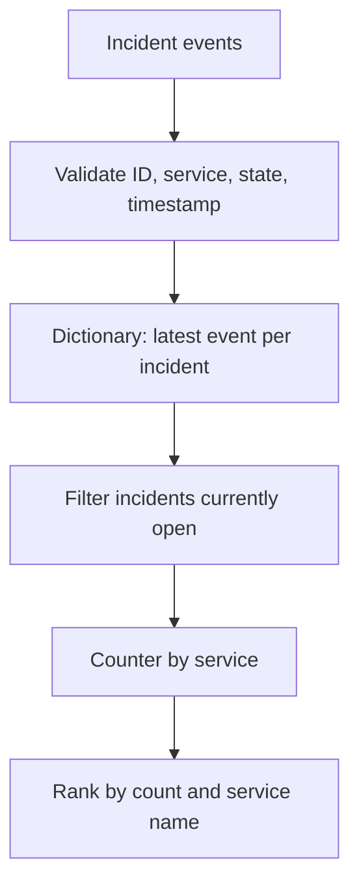

# Q1. Core Python, Collections, Sorting and Deduplication

This chapter covers the Python concepts used most often in operational scripts. Work through both examples, then practice explaining record identity, grouping, complexity, input validation and deterministic output.

## Q1. Python Fundamentals for Infrastructure Automation

> **Interviewer:** You receive a list of service-health events. Which Python data structures would you use to count unhealthy services, remove duplicate hosts and report the worst offenders? Explain your approach and its complexity.

### Start with the data contract

Platform scripts typically transform API responses, log records or configuration, rather than invent a new algorithm. Clarify the schema, input size, missing fields, duplicates, ordering, and intended output before writing code.

Use Python's standard library wherever reasonable:

| Structure | Good for | Typical operations |
| --- | --- | --- |
| `list` | Ordered records, repeated values | Append amortized O(1), scan O(n) |
| `dict` | Lookups and grouping by key | Expected lookup/update O(1) |
| `set` | Membership and deduplication | Expected membership/add O(1) |
| `tuple` | Small immutable records, multiple returns | Fixed-size structure |
| `Counter` | Counts per key | Expected O(n) over input |
| `defaultdict` | Groups or nested buckets | Expected O(n) over input |

These are *average/expected* costs for hashing, not a guarantee for adversarial hashing or every operation. Sorting n records costs O(n log n). Memory complexity matters as much as time when input grows.



### Working solution

```python
from collections import Counter

events = [
    {"service": "api", "host": "node-a", "status": "error"},
    {"service": "api", "host": "node-a", "status": "error"},
    {"service": "worker", "host": "node-b", "status": "ok"},
    {"service": "checkout", "host": "node-c", "status": "error"},
]

def summarize_failures(records: list[dict]) -> tuple[list[tuple[str, int]], int]:
    failures = Counter()
    hosts = set()

    for record in records:
        if not isinstance(record, dict):
            raise ValueError("each event must be an object")
        service = record.get("service")
        host = record.get("host")
        status = record.get("status")
        if not all(isinstance(v, str) and v for v in (service, host, status)):
            raise ValueError("service, host and status must be non-empty strings")
        if status == "error":
            failures[service] += 1
            hosts.add(host)

    ranked = sorted(failures.items(), key=lambda item: (-item[1], item[0]))
    return ranked, len(hosts)

print(summarize_failures(events))
## ([('api', 2), ('checkout', 1)], 2)
```

#### Reasoning and edge cases

The script counts *events*, not unique failures. The duplicate record for node-a produces two failures while the set counts node-a once. If duplicates represent retry delivery and should not count twice, require an event ID and deduplicate before counting. A host count is across all failing services; if the question asks for per-service distinct hosts, use a dictionary of sets instead.

Time is O(n + k log k), where n is the number of records and k the number of distinct failing services. Auxiliary space is O(k + h), for distinct services and hosts.

#### Interview follow-ups

- **Why not a list for membership?** A list scan is O(n), while a set normally gives expected O(1) membership checks.
- **Is `dict` insertion order guaranteed?** Modern Python preserves insertion order, but sorting is required for count ranking.
- **What if `status` has new values?** Define acceptable statuses; either reject unknown values or explicitly classify them, rather than silently treating all unknown states as healthy.
- **What if input is a generator?** The `for` loop works without materializing the entire iterable, although the return annotation could be broadened to `Iterable[dict]`.

### Practical test cases

```python
assert summarize_failures([]) == ([], 0)
assert summarize_failures([{"service":"s","host":"h","status":"ok"}]) == ([], 0)
assert summarize_failures([{"service":"s","host":"h","status":"error"}]) == ([("s", 1)], 1)
```

### Spoken answer

> “I would first confirm whether failures are counted per event or per unique incident. A Counter handles frequency, and a set tracks distinct hosts without repeated linear scans. I'd validate the record shape so a malformed response doesn't produce misleading statistics. The scan is linear and only sorting the distinct services adds a logarithmic factor. I'd test empty input, duplicates and unknown statuses.”

**Reference:** [Python collections](https://docs.python.org/3/library/collections.html)


---

## Q6. Filtering, Grouping, Sorting and Deduplication

> **Interviewer:** A monitoring API sends duplicate incident updates. For each service, keep the latest incident status and return the services with the highest number of still-open incidents. How do you make the result deterministic?

### Define record identity separately from arrival order

If records have an `incident_id`, a later update should replace an earlier update for the **same incident**. A `service` name alone is not a unique incident ID. If timestamps tie, define a deterministic tie-breaking rule rather than letting API page order decide.

This example accepts only valid incident updates. The latest event is selected by timestamp, with status as a tie-breaker for this exercise. Real event sources should instead provide a monotonic revision or event sequence number; two conflicting updates with the same timestamp may be genuinely ambiguous.



### Working solution

```python
from collections import Counter
from datetime import datetime, timezone

def summarize_open_incidents(records: list[dict]) -> list[tuple[str, int]]:
    latest = {}

    for index, record in enumerate(records):
        if not isinstance(record, dict):
            raise ValueError(f"record {index} must be an object")
        ident = record.get("incident_id")
        service = record.get("service")
        state = record.get("state")
        stamp = record.get("updated_at")
        if not isinstance(ident, str) or not ident:
            raise ValueError("missing incident_id")
        if not isinstance(service, str) or not service:
            raise ValueError("missing service")
        if state not in ("open", "resolved"):
            raise ValueError("invalid incident state")
        if not isinstance(stamp, str):
            raise ValueError("invalid timestamp")
        try:
            time = datetime.fromisoformat(stamp.replace("Z", "+00:00"))
        except ValueError as exc:
            raise ValueError("invalid timestamp") from exc
        if time.tzinfo is None or time.utcoffset() is None:
            raise ValueError("timestamp must contain a timezone")
        order = (time.astimezone(timezone.utc), state)
        current = latest.get(ident)
        if current is None or order > current[0]:
            latest[ident] = (order, service, state)

    counts = Counter(
        service for _, service, state in latest.values() if state == "open"
    )
    return sorted(counts.items(), key=lambda item: (-item[1], item[0]))

events = [
    {"incident_id":"i1","service":"api","state":"open",
     "updated_at":"2026-01-01T10:00:00Z"},
    {"incident_id":"i2","service":"worker","state":"open",
     "updated_at":"2026-01-01T10:02:00Z"},
    {"incident_id":"i1","service":"api","state":"resolved",
     "updated_at":"2026-01-01T10:05:00Z"},
]
print(summarize_open_incidents(events))
## [('worker', 1)]
```

#### Why use a dictionary?

The dictionary stores only one candidate state per incident, so duplicate updates don't count twice. After the pass, group the currently-open latest states. This avoids repeated O(n) scanning per incident. For n updates and i incidents, the scan is expected O(n), with O(i) memory; sorting s services is O(s log s).

#### Validation and semantics

If the API permits a service reassignment, which service owns the incident for historical reporting? For a current-state dashboard, the last event's service is suitable; for chargeback/audit reports the service identity may need to be immutable and validation should reject conflicting owners.

#### Edge cases

- Empty records returns an empty list.
- Duplicate identical records do not change counts.
- Out-of-order records still work because selection compares timestamps.
- An older `open` event cannot reopen a newer `resolved` incident.
- Conflicting equal-timestamp events are not reliably resolved by alphabetic state ordering. A real API should supply revision numbers.

### Spoken answer

> “I'd identify an incident by its stable ID, not its service. I would keep the latest update for each incident, filter those still open and count them per service. A dictionary makes deduplication efficient and sorting makes output stable. I'd ask what defines latest when timestamps tie and whether incident ownership can change, because those details determine correctness more than the Python syntax.”

**Reference:** [Python sorting how-to](https://docs.python.org/3/howto/sorting.html)

