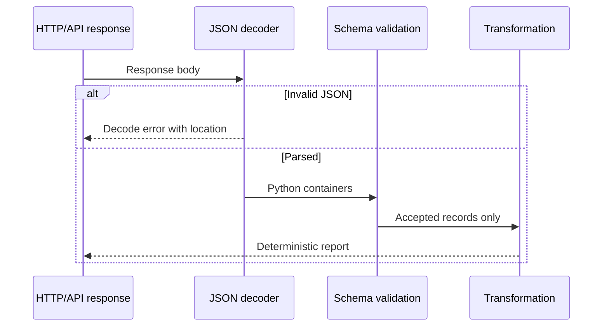

# Q2. Parsing JSON and Validating Nested API Responses

> **Interviewer:** An API returns a JSON document containing Kubernetes-like workloads. Print every unhealthy workload by namespace. How will you handle missing fields, unexpected types, invalid JSON and partial API failures?

## A parser has two responsibilities

**Syntax parsing** converts bytes/text into Python objects. **Schema validation** checks that objects have the expected meaning. Successful `json.loads()` does not imply the response contains `items`, that `items` is a list, or that `readyReplicas` is a useful integer.

The standard library returns Python `dict`, `list`, `str`, `int`, `float`, `bool` and `None`. JSON booleans become Python booleans. Python `bool` is a subclass of `int`, so use `type(value) is int` when rejecting boolean replica counts.



## Reference solution

```python
import json

sample = """{
  "items": [
    {"metadata": {"name": "api", "namespace": "store"},
     "spec": {"replicas": 3}, "status": {"readyReplicas": 2}},
    {"metadata": {"name": "worker", "namespace": "jobs"},
     "spec": {"replicas": 1}, "status": {"readyReplicas": 1}}
  ]
}"""

def find_unready(payload: str) -> list[str]:
    try:
        document = json.loads(payload)
    except json.JSONDecodeError as exc:
        raise ValueError(f"invalid JSON at position {exc.pos}") from exc

    if not isinstance(document, dict) or not isinstance(document.get("items"), list):
        raise ValueError("expected an object containing an items list")

    result = []
    for index, item in enumerate(document["items"]):
        if not isinstance(item, dict):
            raise ValueError(f"item {index} must be an object")
        metadata = item.get("metadata")
        spec = item.get("spec")
        status = item.get("status", {})
        if not isinstance(metadata, dict) or not isinstance(spec, dict):
            raise ValueError(f"item {index} lacks metadata/spec objects")
        if not isinstance(status, dict):
            raise ValueError(f"item {index} has invalid status")

        name = metadata.get("name")
        namespace = metadata.get("namespace", "default")
        desired = spec.get("replicas", 1)
        ready = status.get("readyReplicas", 0)

        if not isinstance(name, str) or not name:
            raise ValueError(f"item {index} lacks a workload name")
        if not isinstance(namespace, str) or not namespace:
            raise ValueError(f"item {index} has invalid namespace")
        if type(desired) is not int or type(ready) is not int or min(desired, ready) < 0:
            raise ValueError(f"item {index} has invalid replica counts")

        if ready < desired:
            result.append(f"{namespace}/{name}: {ready}/{desired} ready")

    return sorted(result)

print(find_unready(sample))
# ['store/api: 2/3 ready']
```

This is a **simplified workload report**, not a universal definition of Kubernetes deployment health. During rollouts, fields such as available replicas, observed generation, conditions and old ReplicaSets matter. A real client also has to account for authorization errors, pagination and resource-version consistency.

## Strict versus lenient parsing

Strict failure is appropriate for a small authoritative config or security-sensitive decision. For a noisy batch log with thousands of independent records, collecting validation errors and continuing may be preferable. State the behavior explicitly and return errors alongside successful records instead of quietly dropping malformed input.

### Common mistakes

- `item["metadata"]["name"]` without validating object shape raises confusing exceptions.
- `str(item.get("name"))` turns missing data into the literal name `"None"`.
- `except Exception: pass` hides provider outages and malformed records.
- Treating `status.readyReplicas` missing as healthy instead of zero can mask unready workloads.

## Tests and reasoning

```python
assert find_unready('{"items": []}') == []
assert find_unready(sample) == ["store/api: 2/3 ready"]
try:
    find_unready('{"items": "not-a-list"}')
except ValueError:
    pass
else:
    raise AssertionError("expected validation failure")
```

Time is O(n + k log k) because the report sorts k unready workloads after inspecting n items. Space includes the decoded JSON tree; for very large JSON use paged APIs or newline-delimited JSON where available rather than forcing the whole payload into memory.

## Spoken answer

> “I would decode JSON, then validate its expected structure before reading nested keys. I wouldn't assume the API always returns the same shape or that a missing readiness field means healthy. I'd define whether malformed records stop the operation or are collected separately. Finally, I'd test valid, empty, missing, malformed and partially unhealthy data. For large responses I'd handle pagination and memory limits.”

**Reference:** [Python json](https://docs.python.org/3/library/json.html)
