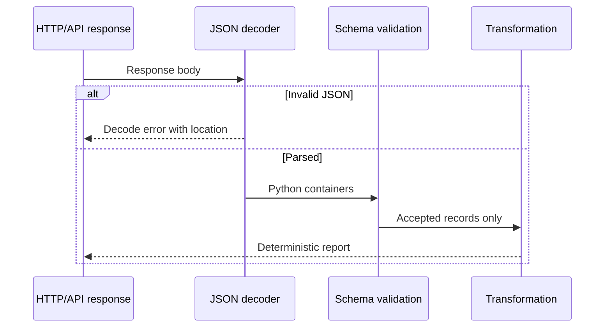
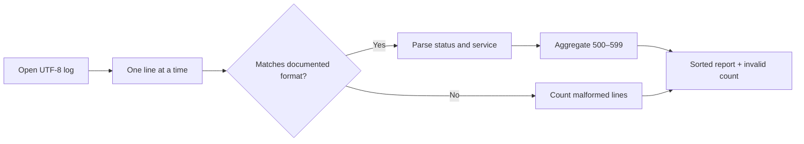
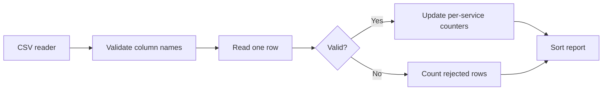

# Q2. Real-World JSON, Logs and CSV Parsing

This chapter combines structured API validation, unstructured log parsing and streaming CSV aggregation. Compare failure policies and choose the simplest parser for each input contract. Retain complete exercise implementations instead of writing one universal parser.

## Q2. Parsing JSON and Validating Nested API Responses

> **Interviewer:** An API returns a JSON document containing Kubernetes-like workloads. Print every unhealthy workload by namespace. How will you handle missing fields, unexpected types, invalid JSON and partial API failures?

### A parser has two responsibilities

**Syntax parsing** converts bytes/text into Python objects. **Schema validation** checks that objects have the expected meaning. Successful `json.loads()` does not imply the response contains `items`, that `items` is a list, or that `readyReplicas` is a useful integer.

The standard library returns Python `dict`, `list`, `str`, `int`, `float`, `bool` and `None`. JSON booleans become Python booleans. Python `bool` is a subclass of `int`, so use `type(value) is int` when rejecting boolean replica counts.



### Reference solution

```python
import json

sample = """{
  "items": [
    {"metadata": {"name": "api", "namespace": "store"},
     "spec": {"replicas": 3}, "status": {"readyReplicas": 2}},
    {"metadata": {"name": "worker", "namespace": "jobs"},
     "spec": {"replicas": 1}, "status": {"readyReplicas": 1}}
  ]
}"""

def find_unready(payload: str) -> list[str]:
    try:
        document = json.loads(payload)
    except json.JSONDecodeError as exc:
        raise ValueError(f"invalid JSON at position {exc.pos}") from exc

    if not isinstance(document, dict) or not isinstance(document.get("items"), list):
        raise ValueError("expected an object containing an items list")

    result = []
    for index, item in enumerate(document["items"]):
        if not isinstance(item, dict):
            raise ValueError(f"item {index} must be an object")
        metadata = item.get("metadata")
        spec = item.get("spec")
        status = item.get("status", {})
        if not isinstance(metadata, dict) or not isinstance(spec, dict):
            raise ValueError(f"item {index} lacks metadata/spec objects")
        if not isinstance(status, dict):
            raise ValueError(f"item {index} has invalid status")

        name = metadata.get("name")
        namespace = metadata.get("namespace", "default")
        desired = spec.get("replicas", 1)
        ready = status.get("readyReplicas", 0)

        if not isinstance(name, str) or not name:
            raise ValueError(f"item {index} lacks a workload name")
        if not isinstance(namespace, str) or not namespace:
            raise ValueError(f"item {index} has invalid namespace")
        if type(desired) is not int or type(ready) is not int or min(desired, ready) < 0:
            raise ValueError(f"item {index} has invalid replica counts")

        if ready < desired:
            result.append(f"{namespace}/{name}: {ready}/{desired} ready")

    return sorted(result)

print(find_unready(sample))
## ['store/api: 2/3 ready']
```

This is a **simplified workload report**, not a universal definition of Kubernetes deployment health. During rollouts, fields such as available replicas, observed generation, conditions and old ReplicaSets matter. A real client also has to account for authorization errors, pagination and resource-version consistency.

### Strict versus lenient parsing

Strict failure is appropriate for a small authoritative config or security-sensitive decision. For a noisy batch log with thousands of independent records, collecting validation errors and continuing may be preferable. State the behavior explicitly and return errors alongside successful records instead of quietly dropping malformed input.

#### Common mistakes

- `item["metadata"]["name"]` without validating object shape raises confusing exceptions.
- `str(item.get("name"))` turns missing data into the literal name `"None"`.
- `except Exception: pass` hides provider outages and malformed records.
- Treating `status.readyReplicas` missing as healthy instead of zero can mask unready workloads.

### Tests and reasoning

```python
assert find_unready('{"items": []}') == []
assert find_unready(sample) == ["store/api: 2/3 ready"]
try:
    find_unready('{"items": "not-a-list"}')
except ValueError:
    pass
else:
    raise AssertionError("expected validation failure")
```

Time is O(n + k log k) because the report sorts k unready workloads after inspecting n items. Space includes the decoded JSON tree; for very large JSON use paged APIs or newline-delimited JSON where available rather than forcing the whole payload into memory.

### Spoken answer

> “I would decode JSON, then validate its expected structure before reading nested keys. I wouldn't assume the API always returns the same shape or that a missing readiness field means healthy. I'd define whether malformed records stop the operation or are collected separately. Finally, I'd test valid, empty, missing, malformed and partially unhealthy data. For large responses I'd handle pagination and memory limits.”

**Reference:** [Python json](https://docs.python.org/3/library/json.html)


---

## Q3. Log Parsing with Strings and Regular Expressions

> **Interviewer:** Given a large application log, count 5xx responses per service. The file contains invalid lines, unusual paths and missing fields. How would you solve it without crashing or loading the entire file?

### Prefer structured logs when available

JSON Lines (one JSON object per line) is easier to validate than free-form text. When the input is legacy text, establish a **documented format** before using regular expressions. Do not write a giant regex that guesses every conceivable log layout.

Sample log contract:

```text
2026-10-25T10:00:00Z service=api status=200 path=/items
2026-10-25T10:00:01Z service=checkout status=503 path=/pay
2026-10-25T10:00:02Z service=checkout status=502 path=/pay
bad line
```



### Working solution with bounded memory

```python
import re
from collections import Counter
from io import StringIO
from typing import TextIO

PATTERN = re.compile(
    r"^(?P<time>\S+)\s+service=(?P<service>[a-zA-Z0-9_-]+)"
    r"\s+status=(?P<status>\d{3})\s+path=(?P<path>\S+)$"
)

def count_server_errors(stream: TextIO) -> tuple[Counter[str], int]:
    failures: Counter[str] = Counter()
    malformed = 0
    for line in stream:
        match = PATTERN.fullmatch(line.strip())
        if match is None:
            malformed += 1
            continue
        status = int(match.group("status"))
        if not 100 <= status <= 599:
            malformed += 1
            continue
        if 500 <= status <= 599:
            failures[match.group("service")] += 1
    return failures, malformed

test_log = StringIO(
    "2026-10-25T10:00:00Z service=api status=200 path=/items\n"
    "2026-10-25T10:00:01Z service=checkout status=503 path=/pay\n"
    "2026-10-25T10:00:02Z service=checkout status=502 path=/pay\n"
    "bad line\n"
)
counts, malformed = count_server_errors(test_log)
print(counts, malformed)
## Counter({'checkout': 2}) 1
```

The regular expression validates only the described *text format*. It does **not** validate that `time` is a real RFC 3339 timestamp or that the path represents a valid URL. If those are requirements, parse/validate them separately.

#### Reading a real file

```python
from pathlib import Path

with Path("app.log").open("r", encoding="utf-8", errors="replace") as log:
    errors, malformed = count_server_errors(log)
    for service, count in errors.most_common():
        print(f"{service}: {count}")
    print(f"malformed lines: {malformed}")
```

This expects an existing local file. `errors="replace"` is a deliberate best-effort choice for untrusted log bytes; for audit-critical inputs, reject invalid encoding or report replacement counts instead.

### Complexity and safety

Processing is O(number of lines × matching cost), with memory O(distinct services) plus the current line. `re.compile` avoids recompiling each iteration. Avoid catastrophic-backtracking expressions with nested ambiguous quantifiers on attacker-controlled long lines. Cap accepted line length for network-delivered logs. Do not log full raw payloads if they may include tokens or personal information.

#### Follow-ups

- **Regex or split?** For simple `key=value` tokens, splitting can be clearer; regex is useful when a defined structure needs capture groups.
- **Why use `fullmatch`?** It prevents ignoring trailing junk as a valid log line.
- **What if `path` contains spaces?** Change the input contract to quote/escape values or use structured logs rather than hoping this pattern parses every line.
- **What if the log is gigabytes?** Stream; if reporting by minute, maintain bounded time buckets and expire old ones.

### Spoken answer

> “I would ask whether the logs have a documented schema. If they are structured, I'd parse JSON Lines. Otherwise I'd match only the supported format and count malformed lines separately. I'd iterate over the file instead of reading it into memory, aggregate with a Counter and verify that 5xx boundaries are correct. If the input is untrusted I'd also bound line size and avoid exposing sensitive payloads in diagnostics.”

**Reference:** [Python re](https://docs.python.org/3/library/re.html)


---

## Q4. CSV Data Processing and Streaming Aggregations

> **Interviewer:** You receive a CSV export of HTTP requests from several services. Report each service's request count, error count and average latency. Some rows have missing or invalid numbers. Make the solution practical for a large file.

### Begin with an explicit input schema

Assume the CSV columns are `service,status,latency_ms`. A well-behaved script separates **row parsing**, **validation**, **aggregation** and **presentation**. It must say whether malformed rows are skipped with diagnostics or cause the job to fail.



### Standard-library solution

```python
import csv
from collections import defaultdict
from io import StringIO
from typing import TextIO

def summarize_requests(stream: TextIO) -> tuple[list[dict], int]:
    reader = csv.DictReader(stream)
    expected = {"service", "status", "latency_ms"}
    if not reader.fieldnames or not expected.issubset(reader.fieldnames):
        raise ValueError("missing required CSV columns")

    data = defaultdict(lambda: {"requests": 0, "errors": 0, "latency_sum": 0.0})
    bad_rows = 0

    for row in reader:
        try:
            service = row["service"]
            if not isinstance(service, str) or not service.strip():
                raise ValueError("invalid service")
            status = int(row["status"])
            latency = float(row["latency_ms"])
            if not 100 <= status <= 599:
                raise ValueError("invalid HTTP status")
            if not 0 <= latency < float("inf"):
                raise ValueError("invalid latency")
        except (TypeError, ValueError):
            bad_rows += 1
            continue

        bucket = data[service.strip()]
        bucket["requests"] += 1
        bucket["errors"] += int(status >= 500)
        bucket["latency_sum"] += latency

    output = []
    for service, bucket in sorted(data.items()):
        output.append({
            "service": service,
            "requests": bucket["requests"],
            "errors": bucket["errors"],
            "avg_latency_ms": round(
                bucket["latency_sum"] / bucket["requests"], 2
            ),
        })
    return output, bad_rows

demo = StringIO(
    "service,status,latency_ms\n"
    "api,200,15\n"
    "api,503,35\n"
    "worker,200,10\n"
    "worker,200,not-a-number\n"
)
print(summarize_requests(demo))
## ([{'service': 'api', 'requests': 2, 'errors': 1,
##    'avg_latency_ms': 25.0},
##   {'service': 'worker', 'requests': 1, 'errors': 0,
##    'avg_latency_ms': 10.0}], 1)
```

The result is computed incrementally: it never accumulates every input row. For truly critical records, silently continuing is inappropriate; change the contract to fail closed or emit an error report containing row numbers and reasons.

### Why not read all rows?

```python
## Avoid for very large files when not needed:
all_rows = list(csv.DictReader(stream))
```

A list grows with the size of input. The streaming solution uses memory proportional to the number of unique services, not number of requests. With r rows and s distinct services, running time is O(r + s log s), storage O(s).

#### Floating point and percentiles

A running sum/count is adequate for approximate mean latency, but does not give p95/p99. Calculating an exact percentile across all events requires retaining values or using an external sorting strategy. A streaming sketch/histogram can approximate percentiles with bounded memory; select it only when the requirement calls for it. For currency, use decimal/integer minor units rather than float.

#### Further considerations

- Quoted commas and newlines: `csv` handles these; naive `line.split(",")` does not.
- CSV injection: if re-exported for spreadsheets, cells starting with formula characters can be risky.
- Corrupt encoding: choose fail-fast or report the replacement strategy.
- Missing columns: reject before processing any rows.
- Zero rows: return an empty report without division by zero.

### Spoken answer

> “I'd use csv.DictReader so quoted values work correctly and validate headers before processing. A dictionary of counters lets me aggregate each row in one pass without keeping the whole file. I'd count invalid rows separately, compute the averages after aggregation, and sort by service to make the output deterministic. I'd explain what we lose by not retaining every latency sample, especially exact percentiles.”

**Reference:** [Python csv](https://docs.python.org/3/library/csv.html)

