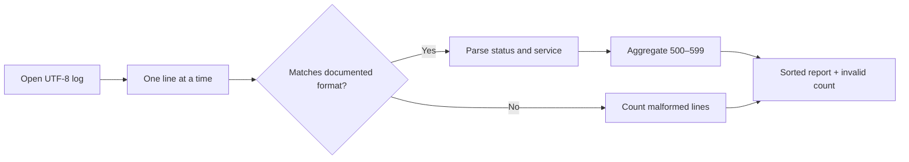

# Q3. Log Parsing with Strings and Regular Expressions

> **Interviewer:** Given a large application log, count 5xx responses per service. The file contains invalid lines, unusual paths and missing fields. How would you solve it without crashing or loading the entire file?

## Prefer structured logs when available

JSON Lines (one JSON object per line) is easier to validate than free-form text. When the input is legacy text, establish a **documented format** before using regular expressions. Do not write a giant regex that guesses every conceivable log layout.

Sample log contract:

```text
2026-10-25T10:00:00Z service=api status=200 path=/items
2026-10-25T10:00:01Z service=checkout status=503 path=/pay
2026-10-25T10:00:02Z service=checkout status=502 path=/pay
bad line
```



## Working solution with bounded memory

```python
import re
from collections import Counter
from io import StringIO
from typing import TextIO

PATTERN = re.compile(
    r"^(?P<time>\S+)\s+service=(?P<service>[a-zA-Z0-9_-]+)"
    r"\s+status=(?P<status>\d{3})\s+path=(?P<path>\S+)$"
)

def count_server_errors(stream: TextIO) -> tuple[Counter[str], int]:
    failures: Counter[str] = Counter()
    malformed = 0
    for line in stream:
        match = PATTERN.fullmatch(line.strip())
        if match is None:
            malformed += 1
            continue
        status = int(match.group("status"))
        if not 100 <= status <= 599:
            malformed += 1
            continue
        if 500 <= status <= 599:
            failures[match.group("service")] += 1
    return failures, malformed

test_log = StringIO(
    "2026-10-25T10:00:00Z service=api status=200 path=/items\n"
    "2026-10-25T10:00:01Z service=checkout status=503 path=/pay\n"
    "2026-10-25T10:00:02Z service=checkout status=502 path=/pay\n"
    "bad line\n"
)
counts, malformed = count_server_errors(test_log)
print(counts, malformed)
# Counter({'checkout': 2}) 1
```

The regular expression validates only the described *text format*. It does **not** validate that `time` is a real RFC 3339 timestamp or that the path represents a valid URL. If those are requirements, parse/validate them separately.

### Reading a real file

```python
from pathlib import Path

with Path("app.log").open("r", encoding="utf-8", errors="replace") as log:
    errors, malformed = count_server_errors(log)
    for service, count in errors.most_common():
        print(f"{service}: {count}")
    print(f"malformed lines: {malformed}")
```

This expects an existing local file. `errors="replace"` is a deliberate best-effort choice for untrusted log bytes; for audit-critical inputs, reject invalid encoding or report replacement counts instead.

## Complexity and safety

Processing is O(number of lines × matching cost), with memory O(distinct services) plus the current line. `re.compile` avoids recompiling each iteration. Avoid catastrophic-backtracking expressions with nested ambiguous quantifiers on attacker-controlled long lines. Cap accepted line length for network-delivered logs. Do not log full raw payloads if they may include tokens or personal information.

### Follow-ups

- **Regex or split?** For simple `key=value` tokens, splitting can be clearer; regex is useful when a defined structure needs capture groups.
- **Why use `fullmatch`?** It prevents ignoring trailing junk as a valid log line.
- **What if `path` contains spaces?** Change the input contract to quote/escape values or use structured logs rather than hoping this pattern parses every line.
- **What if the log is gigabytes?** Stream; if reporting by minute, maintain bounded time buckets and expire old ones.

## Spoken answer

> “I would ask whether the logs have a documented schema. If they are structured, I'd parse JSON Lines. Otherwise I'd match only the supported format and count malformed lines separately. I'd iterate over the file instead of reading it into memory, aggregate with a Counter and verify that 5xx boundaries are correct. If the input is untrusted I'd also bound line size and avoid exposing sensitive payloads in diagnostics.”

**Reference:** [Python re](https://docs.python.org/3/library/re.html)
