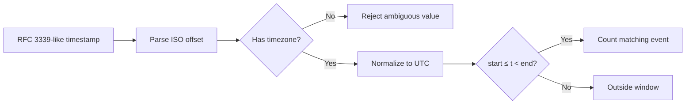
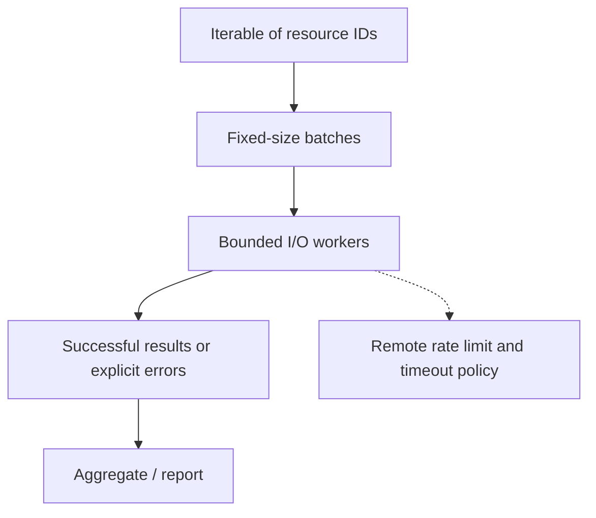

# Q3. Timestamps, Streaming, Batches and Bounded Concurrency

This chapter connects UTC-aware time windows to memory-conscious processing and safe I/O parallelism. Start with correctness and only introduce concurrency when the system's latency budget and rate limits justify it.

## Part A. Timestamps, Time Zones and Operational Time Windows

> **Interviewer:** From timestamped API errors, report how many errors each service had during a fixed UTC interval. Why can time-zone and boundary mistakes cause incorrect incident reports?

### The dangerous assumptions

Operational events may arrive in UTC, local time or with explicit offsets. Comparing naive datetimes to timezone-aware datetimes raises errors, and assuming all naive timestamps are UTC can silently corrupt counts. Normalize aware values to UTC before comparing.

An interval should define whether endpoints are included. The conventional half-open `[start, end)` excludes exactly `end`, allowing adjacent windows without double counting.



### Working solution

```python
from datetime import datetime, timezone
from collections import Counter

def utc_datetime(text: str) -> datetime:
    if not isinstance(text, str):
        raise ValueError("timestamp must be a string")
    try:
        value = datetime.fromisoformat(text.replace("Z", "+00:00"))
    except ValueError as exc:
        raise ValueError("invalid ISO timestamp") from exc
    if value.tzinfo is None or value.utcoffset() is None:
        raise ValueError("timestamp must include UTC or an offset")
    return value.astimezone(timezone.utc)

def errors_in_window(records: list[dict], start: str, end: str) -> Counter:
    begin, finish = utc_datetime(start), utc_datetime(end)
    if finish <= begin:
        raise ValueError("end must be later than start")
    counts = Counter()
    for record in records:
        if not isinstance(record, dict):
            raise ValueError("event must be an object")
        service = record.get("service")
        if not isinstance(service, str) or not service:
            raise ValueError("invalid service")
        when = utc_datetime(record.get("timestamp"))
        if begin <= when < finish and record.get("level") == "ERROR":
            counts[service] += 1
    return counts

events = [
    {"service":"api", "timestamp":"2026-01-01T10:00:00Z", "level":"ERROR"},
    {"service":"api", "timestamp":"2026-01-01T11:30:00+01:00", "level":"ERROR"},
    {"service":"api", "timestamp":"2026-01-01T11:00:00Z", "level":"ERROR"},
]
print(errors_in_window(events, "2026-01-01T10:00:00Z",
                              "2026-01-01T11:00:00Z"))
## Counter({'api': 2})
```

The second event is 10:30 UTC, so it is counted; the event at 11:00 UTC is excluded.

### What about logs arriving late?

An event's **event time** may differ from ingestion time. For a batch report, define the window based on event timestamps and whether late events are included. For streaming monitors, late-arrival tolerance and when a bucket is considered complete need separate policy. A five-minute processing window is not necessarily the same as five minutes of event time.

#### Common interview traps

- `datetime.now()` is typically local/naive. Prefer `datetime.now(timezone.utc)` where a UTC-aware timestamp is required.
- `Z` indicates UTC. Explicit `+02:00` represents another offset; both can refer to the same instant.
- DST transitions can make local clock times ambiguous; UTC comparisons avoid this.
- Unix seconds versus milliseconds differ by a factor of 1000, not a time zone.
- Never sort human-readable non-ISO timestamp strings and assume chronological order.
- Check boundary equality cases in tests.

### Practical tests

```python
assert utc_datetime("2026-01-01T11:00:00+01:00") == \
       utc_datetime("2026-01-01T10:00:00Z")
assert utc_datetime("2026-01-01T10:00:00Z").tzinfo is not None
try:
    utc_datetime("2026-01-01T10:00:00")
except ValueError:
    pass
else:
    raise AssertionError("naive timestamp should fail")
```

### Complexity and trade-offs

For n events, O(n) time and O(s) count storage for s matching service names, independent of whether input is sorted. If input is chronologically sorted, an early exit can help after crossing `end`, but only when the contract guarantees ordering. Don't build a complex windowing engine for a small batch.

### Spoken answer

> “I'd first agree on event time versus ingestion time and whether the time window includes its end. I prefer aware UTC datetimes, reject ambiguous timestamps and use a half-open interval. I'd test offset-equivalent times, exact boundaries and malformed timestamps. The actual counting is a linear scan; the tricky part is the time contract rather than the loop.”

**Reference:** [Python datetime](https://docs.python.org/3/library/datetime.html)


---

## Part B. Generators, Batch Processing and Safe Concurrency

> **Interviewer:** You have 10,000 resource IDs and need to query a rate-limited service. Would you use async Python, threads or a simple loop? Explain your choice and show safe bounded processing.

### Match concurrency to the workload

A basic loop is often good enough for hundreds of calls. Generators let a script produce items without materializing the entire input. Threads can reduce wall-clock time for independent blocking I/O, but the concurrency limit must respect remote rate limits and downstream capacity. The GIL and thread overhead mean a thread pool isn't automatically faster for CPU-heavy Python.



### Build a streaming batcher

```python
from itertools import islice
from collections.abc import Iterable, Iterator

def batches(items: Iterable[str], size: int) -> Iterator[list[str]]:
    if size < 1:
        raise ValueError("batch size must be positive")
    it = iter(items)
    while batch := list(islice(it, size)):
        yield batch

assert list(batches(["a", "b", "c", "d", "e"], 2)) == [
    ["a", "b"], ["c", "d"], ["e"]
]
```

This holds only one batch at a time if the caller consumes the iterator incrementally. The input iterable may itself be a large list or lazy generator.

### Simple bounded thread pool

```python
from concurrent.futures import ThreadPoolExecutor

def query_status(resource_id: str) -> dict:
    # Simulated blocking I/O. Replace with an injected API client in real use.
    return {"id": resource_id, "healthy": resource_id != "b"}

def collect_statuses(resource_ids: list[str], workers: int = 4) -> list[dict]:
    if not 1 <= workers <= 16:
        raise ValueError("workers must be between 1 and 16")
    output = []
    with ThreadPoolExecutor(max_workers=workers) as pool:
        for group in batches(resource_ids, 20):
            # Process one bounded batch before submitting more work.
            output.extend(pool.map(query_status, group))
    return output

assert [x["id"] for x in collect_statuses(["a", "b"])] == ["a", "b"]
```

Unlike submitting thousands of futures at once, processing fixed batches caps work submitted at one time. `Executor.map` yields results in input order; if the first operation stalls, a later completed result can wait for it. Ensure individual API operations have timeouts and cancellation policies. In newer Python versions, `map` offers additional buffering controls, but an explicit batch remains easy to explain.

#### Rate limits are not concurrency limits

Four workers can still exceed 60 requests/minute if each call is fast. A token bucket or central rate limiter controls *rate*; the thread pool caps *in-flight count*. When the service responds 429, honor its retry policy and use backoff. Ten independent requests cannot assume they will all be successful just because they were started concurrently.

### Trade-offs

| Approach | Best fit | Limit |
| --- | --- | --- |
| Sequential loop | Small tasks, easy debugging | Latency adds per call |
| Generator + batch | Large data, bounded memory | May not shorten I/O time |
| Thread pool | Blocking independent I/O | Ordering, exceptions, rate limits |
| `asyncio` | Large-scale supported async I/O | More complex control flow |
| Multiprocessing | CPU-bound work | Process startup, serialization |

Do not introduce `asyncio` solely to demonstrate sophistication in a basic platform automation task. Choose the simplest approach meeting throughput and reliability targets.

### Production scenario

A fleet collector suddenly doubles its worker count and triggers 429 responses, then retries every failure immediately. More threads make progress slower. Fix by lowering concurrency, using a shared rate budget, honoring the API retry instructions and recording per-page errors. Verify that partial results aren't misreported as a complete inventory.

### Spoken answer

> “I'd start sequentially to prove correctness, then measure whether calls are limited by I/O. If latency matters, a small thread pool works for blocking independent requests. I'd limit submitted work in batches, add per-request timeouts, rate-limit separately and make failures visible. I'd prefer this over a complex async architecture unless measurements show it is needed.”

**Reference:** [concurrent.futures](https://docs.python.org/3/library/concurrent.futures.html)

