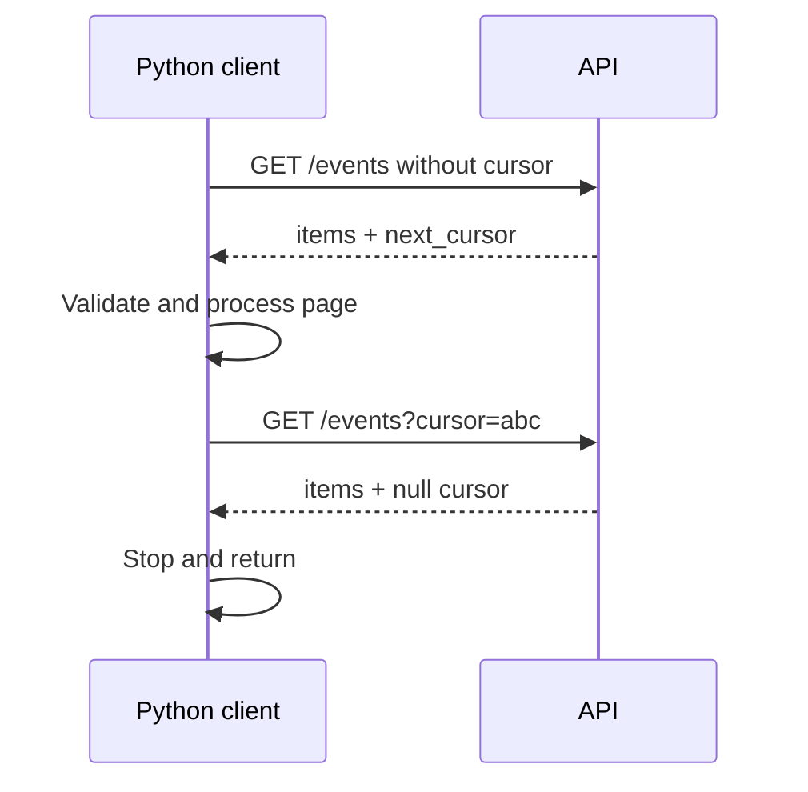

# APIs, Pagination, Retry Discipline and Reliability

This chapter covers platform automation against paginated APIs, error categories and timeout handling. The important skill is not just writing HTTP calls, but keeping failures bounded, input assumptions explicit and tests independent of network services.

## Part A. Working with APIs: Pagination, Timeouts and Retry Safety

> **reviewer:** A monitoring endpoint returns 100 records per page. Write a function that fetches every page, validates responses and does not retry permanent failures forever.

### Know the API contract before coding

Ask how the endpoint indicates the next page: page number, offset, cursor token or an HTTP Link header. Does each request return an immutable snapshot? What if records change during pagination? The example uses an opaque cursor, a `next_cursor` key and an `items` list. It limits pages to protect against a buggy endpoint returning the same cursor indefinitely.



### Testable pagination independent of HTTP library

```python
from collections.abc import Callable

def collect_pages(fetch: Callable[[str | None], dict], max_pages: int = 20) -> list:
    if max_pages < 1:
        raise ValueError("max_pages must be positive")
    all_items = []
    seen_cursors = set()
    cursor = None

    for _ in range(max_pages):
        page = fetch(cursor)
        if not isinstance(page, dict) or not isinstance(page.get("items"), list):
            raise ValueError("invalid API response shape")
        all_items.extend(page["items"])
        next_cursor = page.get("next_cursor")
        if next_cursor is None:
            return all_items
        if not isinstance(next_cursor, str) or not next_cursor:
            raise ValueError("invalid next_cursor")
        if next_cursor in seen_cursors:
            raise ValueError("API cursor loop detected")
        seen_cursors.add(next_cursor)
        cursor = next_cursor

    raise RuntimeError("maximum page limit reached")

def fake_api(cursor):
    pages = {
        None: {"items": [{"id": 1}], "next_cursor": "second"},
        "second": {"items": [{"id": 2}], "next_cursor": None},
    }
    return pages[cursor]

assert collect_pages(fake_api) == [{"id": 1}, {"id": 2}]
```

This function returns a list and therefore stores all records. If the task only needs counts or aggregation, process each page immediately and return a compact summary. It intentionally separates transport from business logic, making tests independent of real credentials and network access.

### Transport example using the standard library

```python
import json
import urllib.error
import urllib.parse
import urllib.request

def fetch_page(cursor: str | None) -> dict:
    base = "https://example.org/api/events"
    query = urllib.parse.urlencode({"cursor": cursor}) if cursor else ""
    url = base + ("?" + query if query else "")
    request = urllib.request.Request(url, headers={"Accept": "application/json"})
    try:
        with urllib.request.urlopen(request, timeout=5) as response:
            body = response.read(2_000_001)
    except urllib.error.HTTPError as exc:
        raise RuntimeError(f"HTTP status {exc.code}") from exc
    except urllib.error.URLError as exc:
        raise RuntimeError("API connection failure") from exc
    if len(body) > 2_000_000:
        raise ValueError("API response too large")
    return json.loads(body)
```

This is a generic transport illustration, not intended to contact the illustrative domain. In production, use configured authenticated endpoints and only send credentials to trusted hosts. Add explicit HTTP status handling, response-content limits and observability appropriate for the API.

### Retry design

Safe retries require:
- A retryable error classification (timeouts, 429 or selected 5xx versus most permanent 4xx).
- An end-to-end deadline and finite attempt limit.
- Exponential backoff with jitter; honor `Retry-After` if the API requires it.
- Idempotency awareness: GET usually is safe to repeat, but a timed-out POST may already have succeeded.
- Metrics counting both original logical operations and attempt volume.

Never write `while True: try: ... except: pass` around an API call.

### Production scenario

A server bug always returns `next_cursor="second"`. Without cursor tracking the client may fetch forever, exhaust rate limits and become the outage source. A guard detects the repeated cursor and reports a clear error. For changing datasets, ask the API for snapshot tokens/consistent pagination if correctness depends on not missing or duplicating records.

### Spoken answer

> “I'd read the pagination contract, then separate HTTP fetching from parsing and aggregation so I can test it without a network. Every page needs schema validation; I'd cap requests and detect repeated cursors. I would set a timeout and retry only known transient failures with bounded backoff. For very large datasets, I'd process pages as they arrive instead of collecting them in a huge list.”

**References:** [urllib.request](https://docs.python.org/3/library/urllib.request.html) · [Python json](https://docs.python.org/3/library/json.html)

