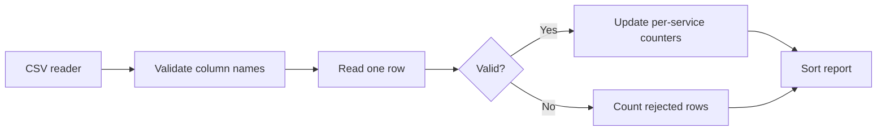

# Q4. CSV Data Processing and Streaming Aggregations

> **Interviewer:** You receive a CSV export of HTTP requests from several services. Report each service's request count, error count and average latency. Some rows have missing or invalid numbers. Make the solution practical for a large file.

## Begin with an explicit input schema

Assume the CSV columns are `service,status,latency_ms`. A well-behaved script separates **row parsing**, **validation**, **aggregation** and **presentation**. It must say whether malformed rows are skipped with diagnostics or cause the job to fail.



## Standard-library solution

```python
import csv
from collections import defaultdict
from io import StringIO
from typing import TextIO

def summarize_requests(stream: TextIO) -> tuple[list[dict], int]:
    reader = csv.DictReader(stream)
    expected = {"service", "status", "latency_ms"}
    if not reader.fieldnames or not expected.issubset(reader.fieldnames):
        raise ValueError("missing required CSV columns")

    data = defaultdict(lambda: {"requests": 0, "errors": 0, "latency_sum": 0.0})
    bad_rows = 0

    for row in reader:
        try:
            service = row["service"]
            if not isinstance(service, str) or not service.strip():
                raise ValueError("invalid service")
            status = int(row["status"])
            latency = float(row["latency_ms"])
            if not 100 <= status <= 599:
                raise ValueError("invalid HTTP status")
            if not 0 <= latency < float("inf"):
                raise ValueError("invalid latency")
        except (TypeError, ValueError):
            bad_rows += 1
            continue

        bucket = data[service.strip()]
        bucket["requests"] += 1
        bucket["errors"] += int(status >= 500)
        bucket["latency_sum"] += latency

    output = []
    for service, bucket in sorted(data.items()):
        output.append({
            "service": service,
            "requests": bucket["requests"],
            "errors": bucket["errors"],
            "avg_latency_ms": round(
                bucket["latency_sum"] / bucket["requests"], 2
            ),
        })
    return output, bad_rows

demo = StringIO(
    "service,status,latency_ms\n"
    "api,200,15\n"
    "api,503,35\n"
    "worker,200,10\n"
    "worker,200,not-a-number\n"
)
print(summarize_requests(demo))
# ([{'service': 'api', 'requests': 2, 'errors': 1,
#    'avg_latency_ms': 25.0},
#   {'service': 'worker', 'requests': 1, 'errors': 0,
#    'avg_latency_ms': 10.0}], 1)
```

The result is computed incrementally: it never accumulates every input row. For truly critical records, silently continuing is inappropriate; change the contract to fail closed or emit an error report containing row numbers and reasons.

## Why not read all rows?

```python
# Avoid for very large files when not needed:
all_rows = list(csv.DictReader(stream))
```

A list grows with the size of input. The streaming solution uses memory proportional to the number of unique services, not number of requests. With r rows and s distinct services, running time is O(r + s log s), storage O(s).

### Floating point and percentiles

A running sum/count is adequate for approximate mean latency, but does not give p95/p99. Calculating an exact percentile across all events requires retaining values or using an external sorting strategy. A streaming sketch/histogram can approximate percentiles with bounded memory; select it only when the requirement calls for it. For currency, use decimal/integer minor units rather than float.

### Further considerations

- Quoted commas and newlines: `csv` handles these; naive `line.split(",")` does not.
- CSV injection: if re-exported for spreadsheets, cells starting with formula characters can be risky.
- Corrupt encoding: choose fail-fast or report the replacement strategy.
- Missing columns: reject before processing any rows.
- Zero rows: return an empty report without division by zero.

## Spoken answer

> “I'd use csv.DictReader so quoted values work correctly and validate headers before processing. A dictionary of counters lets me aggregate each row in one pass without keeping the whole file. I'd count invalid rows separately, compute the averages after aggregation, and sort by service to make the output deterministic. I'd explain what we lose by not retaining every latency sample, especially exact percentiles.”

**Reference:** [Python csv](https://docs.python.org/3/library/csv.html)
