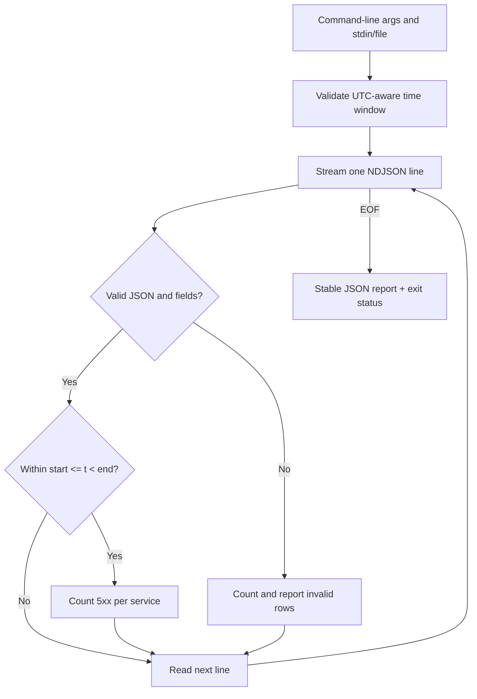

# Q5. Building Maintainable Automation: CLIs, Errors, Tests and End-to-End Practice

> **Practical task:** Write a small command-line program that reads newline-delimited JSON events, validates timestamps and fields, counts HTTP 5xx errors by service within a time window, and produces a machine-readable report. The result must be safe in a pipeline and testable without real infrastructure.

## What makes this platform engineering rather than algorithm practice?

A correct script is more than a loop. It needs a documented input contract, a bounded resource model, useful validation errors, deterministic output, meaningful exit status and tests that cover realistic failures. The standard library is normally enough.

This is a sample of the expected input format:

```json
{"service":"catalog","timestamp":"2026-01-01T10:02:00Z","status":200}
{"service":"payments","timestamp":"2026-01-01T10:02:10Z","status":503}
{"service":"catalog","timestamp":"2026-01-01T10:03:00+00:00","status":502}
```

The script accepts **one JSON object per physical line**. This is NDJSON, not a single JSON array. Every record must have `service`, `timestamp` and `status`. The reporter counts server-error events (500–599), not unique incidents or retry-deduplicated transactions.



## Reference implementation

Save as `event_report.py`. Requires only Python 3.10 or later.

```python
#!/usr/bin/env python3
"""Stream a small operational NDJSON report with explicit validation."""

import argparse
import json
import sys
from collections import Counter
from datetime import datetime, timezone
from pathlib import Path
from typing import TextIO


def parse_time(value: str) -> datetime:
    if not isinstance(value, str):
        raise ValueError("timestamp must be a string")
    try:
        parsed = datetime.fromisoformat(value.replace("Z", "+00:00"))
    except ValueError as exc:
        raise ValueError("invalid ISO timestamp") from exc
    if parsed.tzinfo is None or parsed.utcoffset() is None:
        raise ValueError("timestamp needs an explicit offset")
    return parsed.astimezone(timezone.utc)


def parse_event(line: str) -> tuple[str, datetime, int]:
    try:
        event = json.loads(line)
    except json.JSONDecodeError as exc:
        raise ValueError("invalid JSON") from exc
    if not isinstance(event, dict):
        raise ValueError("event must be an object")

    service = event.get("service")
    status = event.get("status")
    if not isinstance(service, str) or not service.strip():
        raise ValueError("service must be a non-empty string")
    # bool is a subclass of int; true is not an HTTP status.
    if type(status) is not int or not 100 <= status <= 599:
        raise ValueError("status must be an HTTP integer code")

    timestamp = parse_time(event.get("timestamp"))
    return service.strip(), timestamp, status


def report(stream: TextIO, start: datetime, end: datetime,
           strict: bool = False) -> dict:
    if end <= start:
        raise ValueError("end must be after start")
    counts: Counter[str] = Counter()
    total = 0
    invalid = 0

    for line_number, raw in enumerate(stream, start=1):
        if not raw.strip():
            continue
        try:
            service, when, status = parse_event(raw)
        except ValueError as exc:
            invalid += 1
            if strict:
                raise ValueError(f"line {line_number}: {exc}") from exc
            continue
        total += 1
        if start <= when < end and status >= 500:
            counts[service] += 1

    return {
        "valid_events": total,
        "invalid_events": invalid,
        "server_errors": dict(sorted(counts.items())),
    }


def main(argv: list[str] | None = None) -> int:
    parser = argparse.ArgumentParser(description=__doc__)
    parser.add_argument("input", help="NDJSON file, or '-' for stdin")
    parser.add_argument("--start", required=True, help="ISO time with offset")
    parser.add_argument("--end", required=True, help="ISO time with offset")
    parser.add_argument("--strict", action="store_true",
                        help="fail on first malformed event")
    args = parser.parse_args(argv)

    try:
        start, end = parse_time(args.start), parse_time(args.end)
        if args.input == "-":
            output = report(sys.stdin, start, end, args.strict)
        else:
            with Path(args.input).open("r", encoding="utf-8") as handle:
                output = report(handle, start, end, args.strict)
    except (ValueError, OSError) as exc:
        print(f"event_report: {exc}", file=sys.stderr)
        return 2

    json.dump(output, sys.stdout, sort_keys=True)
    sys.stdout.write("\n")
    return 0


if __name__ == "__main__":
    raise SystemExit(main())
```

### Run it as a streaming pipeline

```bash
python3 event_report.py events.ndjson \
  --start 2026-01-01T10:00:00Z \
  --end 2026-01-01T11:00:00Z

cat events.ndjson | python3 event_report.py - \
  --start 2026-01-01T10:00:00Z \
  --end 2026-01-01T11:00:00Z --strict
```

The sample records above produce `{"invalid_events":0,"server_errors":{"catalog":1,"payments":1},"valid_events":3}`. A report is printed only after input completes, so partially parsed output is not presented as a successful result.

The default lenient mode explicitly counts malformed records. Strict mode fails on the first malformed row and emits an error to stderr with nonzero status. A production program may also enforce a maximum malformed percentage, input size or line length depending on the data source.

## Unit tests without cloud dependencies

```python
from datetime import timezone
from io import StringIO

from event_report import parse_event, parse_time, report


def test_window_excludes_end():
    data = StringIO(
        '{"service":"api","timestamp":"2026-01-01T10:00:00Z","status":503}\\n'
        '{"service":"api","timestamp":"2026-01-01T11:00:00Z","status":503}\\n'
    )
    result = report(
        data,
        parse_time("2026-01-01T10:00:00Z"),
        parse_time("2026-01-01T11:00:00Z"),
    )
    assert result["server_errors"] == {"api": 1}
    assert result["valid_events"] == 2


def test_reject_boolean_status():
    try:
        parse_event('{"service":"api","timestamp":"2026-01-01T10:00:00Z","status":true}')
    except ValueError:
        pass
    else:
        raise AssertionError("boolean status must be rejected")


def test_skips_and_counts_malformed():
    stream = StringIO('not json\\n'
        '{"service":"api","timestamp":"2026-01-01T10:00:00Z","status":502}\\n')
    result = report(stream, parse_time("2026-01-01T09:00:00Z"),
                    parse_time("2026-01-01T11:00:00Z"))
    assert result["invalid_events"] == 1
    assert result["server_errors"] == {"api": 1}
```

This uses plain `assert` so it works without pytest. Python's `unittest` and pytest are both suitable for larger suites. The module import is safe because the CLI entrypoint is guarded by `if __name__ == "__main__"`.

## Senior-level review checklist

| Topic | Question before shipping |
| --- | --- |
| Correctness | Are event and duplicate semantics explicit? |
| Input | Does malformed data fail or continue predictably? |
| Time | Are offsets required and interval boundaries tested? |
| Memory | Do we stream rather than retain every record? |
| Observability | Does the report distinguish incomplete from empty results? |
| Failures | Does a nonzero exit code propagate through CI? |
| Security | Is output free of tokens and personal data? |
| Maintenance | Can the pure parser be tested without real APIs? |

### Common failures

- Broad `except Exception: pass` silently converts bugs into apparently healthy output.
- Printing debug messages to stdout breaks JSON consumers; use stderr or structured logging.
- Overwriting an important report file before validation risks losing the last good report; prefer temp file + atomic replace for critical persisted outputs.
- Treating absent metrics as zero turns a data collection outage into a false healthy result.
- Building a large OOP hierarchy for a single 100-line script makes maintenance worse.

## Complexity and boundaries

The input scan is O(n) for n lines, with O(s) state for distinct services, plus the current line and output serialization. The script counts *valid parsed events across the entire file*, but reports 5xx only within the window. If users want total eligible events inside the window, define and add that counter explicitly.

## Spoken explanation

> “I would make the data contract clear first. The parser validates one event independently, the aggregator streams rows and the CLI only handles arguments, files and exit codes. I would test malformed data, timestamps with offsets, exact boundaries and empty inputs before optimizing. A small standard-library tool is often all we need, as long as it fails visibly and produces stable output.”

**References:** [argparse](https://docs.python.org/3/library/argparse.html) · [unittest](https://docs.python.org/3/library/unittest.html)
