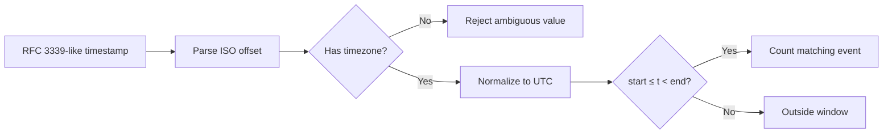

# Q5. Timestamps, Time Zones and Operational Time Windows

> **Interviewer:** From timestamped API errors, report how many errors each service had during a fixed UTC interval. Why can time-zone and boundary mistakes cause incorrect incident reports?

## The dangerous assumptions

Operational events may arrive in UTC, local time or with explicit offsets. Comparing naive datetimes to timezone-aware datetimes raises errors, and assuming all naive timestamps are UTC can silently corrupt counts. Normalize aware values to UTC before comparing.

An interval should define whether endpoints are included. The conventional half-open `[start, end)` excludes exactly `end`, allowing adjacent windows without double counting.



## Working solution

```python
from datetime import datetime, timezone
from collections import Counter

def utc_datetime(text: str) -> datetime:
    if not isinstance(text, str):
        raise ValueError("timestamp must be a string")
    try:
        value = datetime.fromisoformat(text.replace("Z", "+00:00"))
    except ValueError as exc:
        raise ValueError("invalid ISO timestamp") from exc
    if value.tzinfo is None or value.utcoffset() is None:
        raise ValueError("timestamp must include UTC or an offset")
    return value.astimezone(timezone.utc)

def errors_in_window(records: list[dict], start: str, end: str) -> Counter:
    begin, finish = utc_datetime(start), utc_datetime(end)
    if finish <= begin:
        raise ValueError("end must be later than start")
    counts = Counter()
    for record in records:
        if not isinstance(record, dict):
            raise ValueError("event must be an object")
        service = record.get("service")
        if not isinstance(service, str) or not service:
            raise ValueError("invalid service")
        when = utc_datetime(record.get("timestamp"))
        if begin <= when < finish and record.get("level") == "ERROR":
            counts[service] += 1
    return counts

events = [
    {"service":"api", "timestamp":"2026-01-01T10:00:00Z", "level":"ERROR"},
    {"service":"api", "timestamp":"2026-01-01T11:30:00+01:00", "level":"ERROR"},
    {"service":"api", "timestamp":"2026-01-01T11:00:00Z", "level":"ERROR"},
]
print(errors_in_window(events, "2026-01-01T10:00:00Z",
                              "2026-01-01T11:00:00Z"))
# Counter({'api': 2})
```

The second event is 10:30 UTC, so it is counted; the event at 11:00 UTC is excluded.

## What about logs arriving late?

An event's **event time** may differ from ingestion time. For a batch report, define the window based on event timestamps and whether late events are included. For streaming monitors, late-arrival tolerance and when a bucket is considered complete need separate policy. A five-minute processing window is not necessarily the same as five minutes of event time.

### Common interview traps

- `datetime.now()` is typically local/naive. Prefer `datetime.now(timezone.utc)` where a UTC-aware timestamp is required.
- `Z` indicates UTC. Explicit `+02:00` represents another offset; both can refer to the same instant.
- DST transitions can make local clock times ambiguous; UTC comparisons avoid this.
- Unix seconds versus milliseconds differ by a factor of 1000, not a time zone.
- Never sort human-readable non-ISO timestamp strings and assume chronological order.
- Check boundary equality cases in tests.

## Practical tests

```python
assert utc_datetime("2026-01-01T11:00:00+01:00") == \
       utc_datetime("2026-01-01T10:00:00Z")
assert utc_datetime("2026-01-01T10:00:00Z").tzinfo is not None
try:
    utc_datetime("2026-01-01T10:00:00")
except ValueError:
    pass
else:
    raise AssertionError("naive timestamp should fail")
```

## Complexity and trade-offs

For n events, O(n) time and O(s) count storage for s matching service names, independent of whether input is sorted. If input is chronologically sorted, an early exit can help after crossing `end`, but only when the contract guarantees ordering. Don't build a complex windowing engine for a small batch.

## Spoken answer

> “I'd first agree on event time versus ingestion time and whether the time window includes its end. I prefer aware UTC datetimes, reject ambiguous timestamps and use a half-open interval. I'd test offset-equivalent times, exact boundaries and malformed timestamps. The actual counting is a linear scan; the tricky part is the time contract rather than the loop.”

**Reference:** [Python datetime](https://docs.python.org/3/library/datetime.html)
