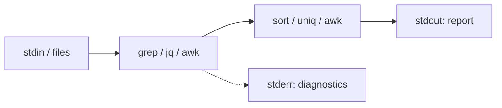

# Q6. Practical Shell and Linux Data Processing

> **Engineering exercise:** Given application logs, newline-delimited JSON and a CSV export, find high-error services and create a reliable, deterministic report using Bash and standard Linux utilities. Explain when a short pipeline is sufficient and when Python is safer.

Shell programs are excellent for orchestrating existing tools. The most important skill is **matching the tool to the input contract**. Use `jq` for JSON, `awk` for simple field-oriented records, `grep` for filtering, and Python or a real CSV-aware program for complex CSV.

## 1. Streams and exit codes



A pipeline connects stdout to the next program's stdin. In Bash, without `pipefail` the overall exit code normally comes from the last program, even if an earlier parser failed.

```bash
#!/usr/bin/env bash
set -euo pipefail

wc -l -- access.log
head -n 5 -- access.log
tail -n 5 -- access.log
```

`set -e` has exceptions in tests, conditionals and pipelines, and does not replace explicit error handling. Quote paths and variables; never use `eval` with untrusted input. Common tools differ across GNU/Linux and macOS, particularly `sed -i`, `date`, `stat` and `sort` flags.

| Tool | Appropriate use | Common trap |
| --- | --- | --- |
| `grep -E` | Find matching lines | No match normally exits 1, not necessarily a broken file |
| `cut` | Fixed delimiter fields | Not a general CSV parser |
| `sort` | Group or order lines | Locale and tie handling affect output |
| `uniq -c` | Count adjacent duplicates | Usually sort first |
| `awk` | Simple fields and counters | Quoted CSV is not handled |
| `sed` | Simple substitutions | Regex and in-place options differ by platform |
| `jq` | Typed JSON parsing | Invalid JSON should not look like an empty success |
| `find -print0`, `xargs -0` | Files with arbitrary spaces/newlines | Check support for zero-item behavior |

## 2. Count errors from fixed-format logs

Input contract:

```text
2026-01-01T10:00:00Z service=api status=200 path=/items
2026-01-01T10:00:01Z service=checkout status=503 path=/pay
2026-01-01T10:00:02Z service=checkout status=502 path=/pay
```

If every line has exactly four whitespace-separated fields, this pipeline reports 5xx counts by service:

```bash
awk '
  NF == 4 &&
  $2 ~ /^service=[[:alnum:]_-]+$/ &&
  $3 ~ /^status=[0-9][0-9][0-9]$/ {
    split($2, service, "=")
    split($3, status, "=")
    if (status[2] >= 500 && status[2] <= 599)
      print service[2]
  }
' access.log |
LC_ALL=C sort |
uniq -c |
awk '{ print $1, $2 }' |
LC_ALL=C sort -k1,1nr -k2,2
```

Expected output: `2 checkout`. The first sort groups equal names so `uniq -c` can count them; the second sorts descending by count then alphabetically by service. This pipeline ignores malformed input. Decide whether to count and report those lines or reject them before claiming a complete operational result.

An `awk` associative-array counter can eliminate the first sort:

```bash
awk '
  NF == 4 && $2 ~ /^service=[[:alnum:]_-]+$/ &&
  $3 ~ /^status=[0-9][0-9][0-9]$/ {
    split($2, s, "="); split($3, code, "=")
    if (code[2] >= 500 && code[2] <= 599) count[s[2]]++
  }
  END { for (s in count) print count[s], s }
' access.log | LC_ALL=C sort -k1,1nr -k2,2
```

Aggregation keeps roughly O(s) counters for s unique services while scanning n lines in O(n), apart from sorting s output records. External `sort` may spill to disk, so do not call a sorting pipeline universally constant-memory.

## 3. JSON Lines with jq

Sample `events.ndjson`:

```json
{"service":"api","status":200,"duration_ms":12}
{"service":"checkout","status":503,"duration_ms":48}
{"service":"checkout","status":502,"duration_ms":63}
```

```bash
jq -r '
  select(type == "object") |
  select((.service | type) == "string" and
         (.status | type) == "number") |
  select(.status >= 500 and .status <= 599) |
  .service
' events.ndjson |
LC_ALL=C sort | uniq -c |
awk '{ print $1, $2 }' |
LC_ALL=C sort -k1,1nr -k2,2
```

`jq` understands JSON string escapes, types and nested fields. A grep for the textual substring `"status":5` is not a JSON parser. With `set -o pipefail`, invalid JSON makes the pipeline fail instead of silently returning a partial empty result.

For a nested API response representing workloads:

```bash
jq -r '
  .items[] |
  select((.status.readyReplicas // 0) < (.spec.replicas // 1)) |
  [(.metadata.namespace // "default"),
   .metadata.name,
   (.status.readyReplicas // 0),
   (.spec.replicas // 1)] | @tsv
' workloads.json
```

For machine-to-machine output, preserve JSON rather than inventing a brittle tab/space delimiter. `jq -s` can group all objects with `group_by`, but it slurps the entire input into memory, so use it only for datasets that fit comfortably.

## 4. CSV is not always delimiter splitting

For strictly unquoted `service,status,latency_ms` records, a simple `awk -F,` script can count requests:

```bash
awk -F, '
  NR == 1 { next }
  NF == 3 && $2 ~ /^[0-9][0-9][0-9]$/ {
    requests[$1]++
    if ($2 >= 500 && $2 <= 599) errors[$1]++
  }
  END {
    for (s in requests) printf "%s,%d,%d\n", s, requests[s], errors[s]+0
  }
' simple.csv | LC_ALL=C sort
```

General CSV supports quoted commas, embedded newlines and escaping. `cut -d,`, shell `IFS=,`, and basic `awk -F,` **do not** correctly parse arbitrary CSV. Use Python's `csv` module or a validated CSV-aware tool when the file contract allows quoted fields.

## 5. Time windows and time zones

Lexical ordering only works for timestamps normalized to the same timezone, precision and fixed representation. Mixed offsets such as `+01:00` and `Z` break naive string comparison.

```bash
# Safe only when field one is fixed-format UTC YYYY-MM-DDTHH:MM:SSZ:
LC_ALL=C awk -v start="2026-01-01T10:00:00Z" \
             -v end="2026-01-01T11:00:00Z" \
  '$1 >= start && $1 < end { print }' access.log
```

This uses a half-open interval. If offsets or fractional-second precision vary, normalize through an actual date parser instead. Distinguish event time from ingestion time.

## 6. Handling filenames, output and failures

```bash
# GNU/Linux; -r is not portable to every BSD/macOS xargs.
find ./logs -type f -name '*.log' -print0 |
  xargs -0 -r grep -n 'status=503'
```

A quick investigative `grep ... || true` also masks unreadable file errors. For automated pipelines inspect the exit status and handle expected no-match separately from real failures.

Use a temporary file and rename to avoid destroying the last good report when validation fails:

```bash
#!/usr/bin/env bash
set -euo pipefail
out='report.txt'
tmp="$(mktemp './.report.XXXXXX')"
trap 'rm -f -- "$tmp"' EXIT
LC_ALL=C sort access.log > "$tmp"
test -s "$tmp"   # Only if an empty report is invalid
mv -- "$tmp" "$out"
```

A rename on the same filesystem is typically atomic as a namespace operation. It does not guarantee crash durability without additional filesystem sync operations.

## 7. Practice and tool choice

1. Count 5xx records by service and validate the result against a small hand-worked fixture.
2. Parse NDJSON with `jq` and demonstrate that invalid JSON returns a nonzero exit status.
3. Deduplicate service IDs using `sort -u`; explain why original order is changed.
4. Process a directory of filenames containing spaces.
5. Compare results from shell and the Python reference implementation on identical records.
6. Explain when streaming `awk` is preferable to `jq -s` and when neither is as safe as a Python parser.

**Spoken engineering answer:** “I would choose a tool that understands the format. `jq` handles structured JSON, `awk` handles well-defined fields, and Python is better for general CSV, timestamps and nuanced validation. I would make pipeline failures visible, quote paths, use deterministic output and test against a known fixture. I wouldn't force a short shell command to parse a complex format just to look clever.”

**References:** [Bash reference](https://www.gnu.org/software/bash/manual/) · [GNU awk](https://www.gnu.org/software/gawk/manual/) · [jq manual](https://jqlang.github.io/jq/manual/)