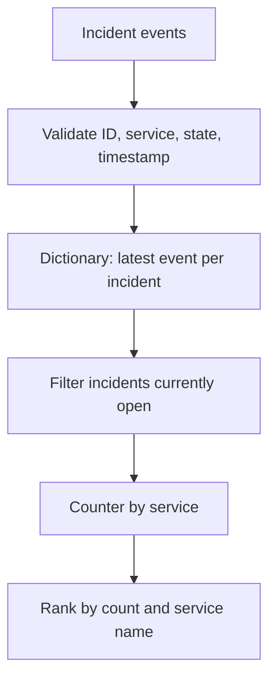

# Q6. Filtering, Grouping, Sorting and Deduplication

> **Interviewer:** A monitoring API sends duplicate incident updates. For each service, keep the latest incident status and return the services with the highest number of still-open incidents. How do you make the result deterministic?

## Define record identity separately from arrival order

If records have an `incident_id`, a later update should replace an earlier update for the **same incident**. A `service` name alone is not a unique incident ID. If timestamps tie, define a deterministic tie-breaking rule rather than letting API page order decide.

This example accepts only valid incident updates. The latest event is selected by timestamp, with status as a tie-breaker for this exercise. Real event sources should instead provide a monotonic revision or event sequence number; two conflicting updates with the same timestamp may be genuinely ambiguous.



## Working solution

```python
from collections import Counter
from datetime import datetime, timezone

def summarize_open_incidents(records: list[dict]) -> list[tuple[str, int]]:
    latest = {}

    for index, record in enumerate(records):
        if not isinstance(record, dict):
            raise ValueError(f"record {index} must be an object")
        ident = record.get("incident_id")
        service = record.get("service")
        state = record.get("state")
        stamp = record.get("updated_at")
        if not isinstance(ident, str) or not ident:
            raise ValueError("missing incident_id")
        if not isinstance(service, str) or not service:
            raise ValueError("missing service")
        if state not in ("open", "resolved"):
            raise ValueError("invalid incident state")
        if not isinstance(stamp, str):
            raise ValueError("invalid timestamp")
        try:
            time = datetime.fromisoformat(stamp.replace("Z", "+00:00"))
        except ValueError as exc:
            raise ValueError("invalid timestamp") from exc
        if time.tzinfo is None or time.utcoffset() is None:
            raise ValueError("timestamp must contain a timezone")
        order = (time.astimezone(timezone.utc), state)
        current = latest.get(ident)
        if current is None or order > current[0]:
            latest[ident] = (order, service, state)

    counts = Counter(
        service for _, service, state in latest.values() if state == "open"
    )
    return sorted(counts.items(), key=lambda item: (-item[1], item[0]))

events = [
    {"incident_id":"i1","service":"api","state":"open",
     "updated_at":"2026-01-01T10:00:00Z"},
    {"incident_id":"i2","service":"worker","state":"open",
     "updated_at":"2026-01-01T10:02:00Z"},
    {"incident_id":"i1","service":"api","state":"resolved",
     "updated_at":"2026-01-01T10:05:00Z"},
]
print(summarize_open_incidents(events))
# [('worker', 1)]
```

### Why use a dictionary?

The dictionary stores only one candidate state per incident, so duplicate updates don't count twice. After the pass, group the currently-open latest states. This avoids repeated O(n) scanning per incident. For n updates and i incidents, the scan is expected O(n), with O(i) memory; sorting s services is O(s log s).

### Validation and semantics

If the API permits a service reassignment, which service owns the incident for historical reporting? For a current-state dashboard, the last event's service is suitable; for chargeback/audit reports the service identity may need to be immutable and validation should reject conflicting owners.

### Edge cases

- Empty records returns an empty list.
- Duplicate identical records do not change counts.
- Out-of-order records still work because selection compares timestamps.
- An older `open` event cannot reopen a newer `resolved` incident.
- Conflicting equal-timestamp events are not reliably resolved by alphabetic state ordering. A real API should supply revision numbers.

## Spoken answer

> “I'd identify an incident by its stable ID, not its service. I would keep the latest update for each incident, filter those still open and count them per service. A dictionary makes deduplication efficient and sorting makes output stable. I'd ask what defines latest when timestamps tie and whether incident ownership can change, because those details determine correctness more than the Python syntax.”

**Reference:** [Python sorting how-to](https://docs.python.org/3/howto/sorting.html)
