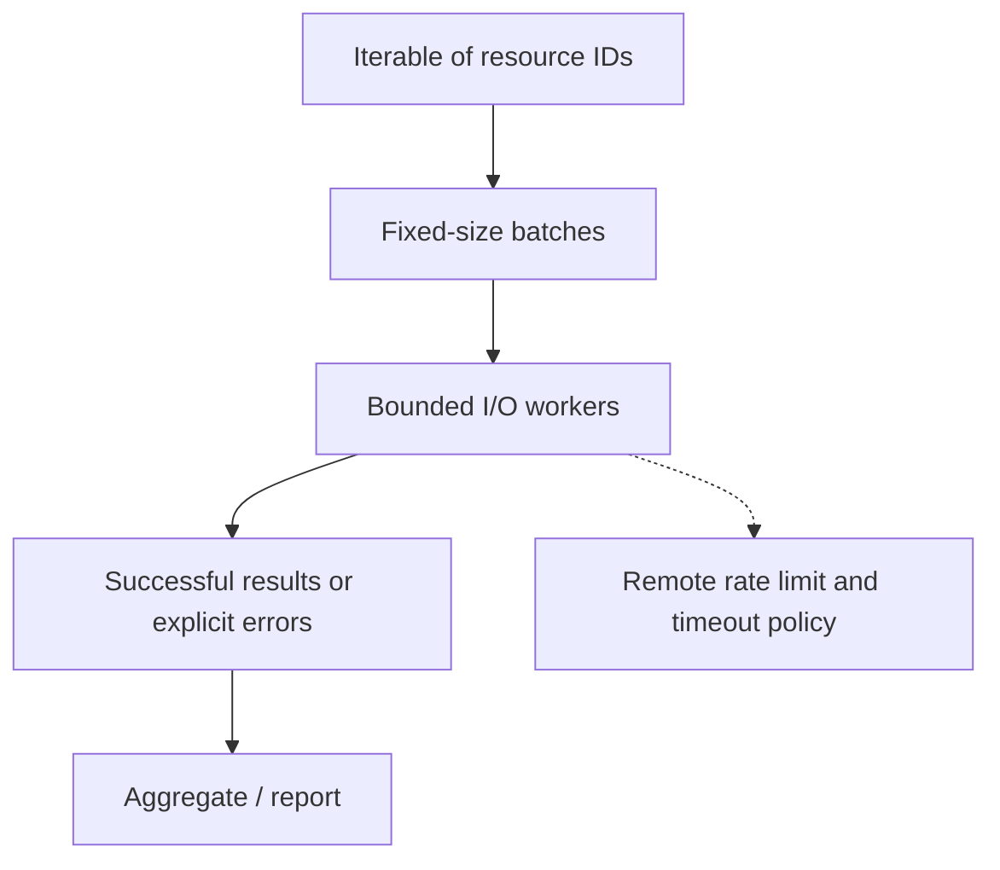

# Q8. Generators, Batch Processing and Safe Concurrency

> **Interviewer:** You have 10,000 resource IDs and need to query a rate-limited service. Would you use async Python, threads or a simple loop? Explain your choice and show safe bounded processing.

## Match concurrency to the workload

A basic loop is often good enough for hundreds of calls. Generators let a script produce items without materializing the entire input. Threads can reduce wall-clock time for independent blocking I/O, but the concurrency limit must respect remote rate limits and downstream capacity. The GIL and thread overhead mean a thread pool isn't automatically faster for CPU-heavy Python.



## Build a streaming batcher

```python
from itertools import islice
from collections.abc import Iterable, Iterator

def batches(items: Iterable[str], size: int) -> Iterator[list[str]]:
    if size < 1:
        raise ValueError("batch size must be positive")
    it = iter(items)
    while batch := list(islice(it, size)):
        yield batch

assert list(batches(["a", "b", "c", "d", "e"], 2)) == [
    ["a", "b"], ["c", "d"], ["e"]
]
```

This holds only one batch at a time if the caller consumes the iterator incrementally. The input iterable may itself be a large list or lazy generator.

## Simple bounded thread pool

```python
from concurrent.futures import ThreadPoolExecutor

def query_status(resource_id: str) -> dict:
    # Simulated blocking I/O. Replace with an injected API client in real use.
    return {"id": resource_id, "healthy": resource_id != "b"}

def collect_statuses(resource_ids: list[str], workers: int = 4) -> list[dict]:
    if not 1 <= workers <= 16:
        raise ValueError("workers must be between 1 and 16")
    output = []
    with ThreadPoolExecutor(max_workers=workers) as pool:
        for group in batches(resource_ids, 20):
            # Process one bounded batch before submitting more work.
            output.extend(pool.map(query_status, group))
    return output

assert [x["id"] for x in collect_statuses(["a", "b"])] == ["a", "b"]
```

Unlike submitting thousands of futures at once, processing fixed batches caps work submitted at one time. `Executor.map` yields results in input order; if the first operation stalls, a later completed result can wait for it. Ensure individual API operations have timeouts and cancellation policies. In newer Python versions, `map` offers additional buffering controls, but an explicit batch remains easy to explain.

### Rate limits are not concurrency limits

Four workers can still exceed 60 requests/minute if each call is fast. A token bucket or central rate limiter controls *rate*; the thread pool caps *in-flight count*. When the service responds 429, honor its retry policy and use backoff. Ten independent requests cannot assume they will all be successful just because they were started concurrently.

## Trade-offs

| Approach | Best fit | Limit |
| --- | --- | --- |
| Sequential loop | Small tasks, easy debugging | Latency adds per call |
| Generator + batch | Large data, bounded memory | May not shorten I/O time |
| Thread pool | Blocking independent I/O | Ordering, exceptions, rate limits |
| `asyncio` | Large-scale supported async I/O | More complex control flow |
| Multiprocessing | CPU-bound work | Process startup, serialization |

Do not introduce `asyncio` solely to demonstrate sophistication in a basic platform automation task. Choose the simplest approach meeting throughput and reliability targets.

## Production scenario

A fleet collector suddenly doubles its worker count and triggers 429 responses, then retries every failure immediately. More threads make progress slower. Fix by lowering concurrency, using a shared rate budget, honoring the API retry instructions and recording per-page errors. Verify that partial results aren't misreported as a complete inventory.

## Spoken answer

> “I'd start sequentially to prove correctness, then measure whether calls are limited by I/O. If latency matters, a small thread pool works for blocking independent requests. I'd limit submitted work in batches, add per-request timeouts, rate-limit separately and make failures visible. I'd prefer this over a complex async architecture unless measurements show it is needed.”

**Reference:** [concurrent.futures](https://docs.python.org/3/library/concurrent.futures.html)
