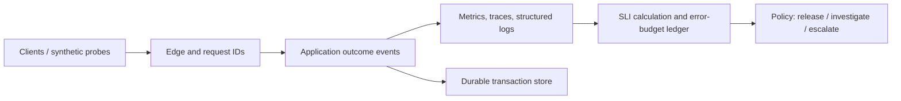
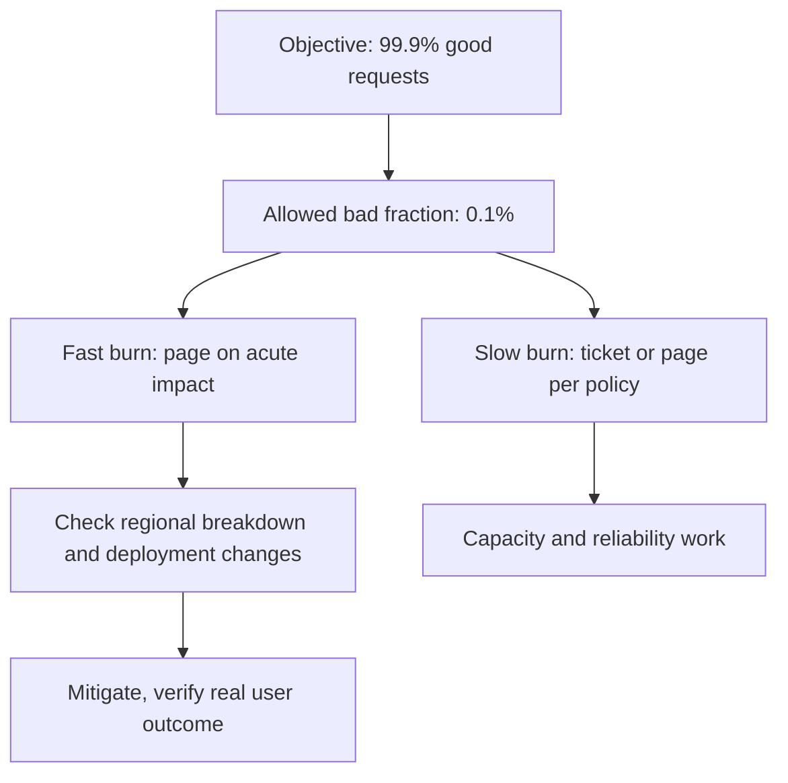

# SLIs, SLOs, Error Budgets and Reliability Governance

> **Engineering focus:** Define meaningful reliability objectives for a multi-service marketplace. How do you measure reliability without hiding failed business transactions behind HTTP 200 responses? What should a team do when the error budget is nearly exhausted?

## First principles

Reliability is the probability that a system performs its intended function under stated conditions during a time interval. Availability, latency, durability, correctness and freshness are different qualities. A Kubernetes Pod being Ready is an infrastructure signal, not proof that an auction bid was accepted correctly.

An **SLI** is a quantitative measure. An **SLO** is the target for that measure over an explicit window. An **SLA** is a contractual commitment with consequences. An **error budget** is the allowed amount of SLO misses, not a license to ignore failures.

### User-journey SLIs

| Journey | Eligible events | Good events |
| --- | --- | --- |
| View listing | Valid listing-view attempts at edge | Correct response under latency threshold |
| Place bid | Authenticated valid bid submissions | Exactly one authorized durable outcome within deadline |
| Checkout | Eligible checkout initiations | Correct accepted or explained outcome within deadline |
| Search freshness | Recently updated items | Changes visible within agreed lag |

Clearly define denominators, exclusions, client cancellations, duplicate retries and low-traffic behavior. A synthetic GET /health should never be the only SLI for a transaction API.



## Availability and budget arithmetic

For a 30-day rolling window, 99.9% request availability permits approximately 0.1% bad eligible requests. If measured as time, 0.1% of 30 days is 43.2 minutes, but time and request-based budgets are not interchangeable. A heavy traffic outage can consume a request budget in minutes.

```text
error_ratio = bad_eligible_events / all_eligible_events
budget = 1 - SLO_target
remaining_budget = budget - observed_error_ratio
burn_rate = observed_error_ratio / budget
```

Example: with a 99.95% request SLO, the allowed bad fraction is 0.0005. Over one million eligible requests the budget is 500 bad requests. A burst with 600 errors exhausts that budget, even if it lasted only two minutes. Define the window and denominator before reporting burn.

### PromQL example

Assume application instrumentation exports **mutually exclusive** counters for eligible requests and correct successful outcomes:

```promql
sum(rate(api_requests_total{route="/bid",eligible="true",outcome="good"}[5m]))
/
clamp_min(
  sum(rate(api_requests_total{route="/bid",eligible="true"}[5m])),
  1e-9
)
```

This query is illustrative. The label contract is owned by the instrumentation and must avoid duplicated counting, unbounded user IDs and accidental omission of failures that never reached the application. For latency SLOs, use histogram buckets aggregated with the appropriate threshold rather than averaging per-Pod percentiles.

## Alerting

Prefer multiwindow, multi-burn-rate paging: fast burn on short and longer windows catches acute incidents, slow burn catches sustained degradation. Alerting on raw CPU alone is less directly linked to the user experience. Separate page-level actionability from tickets for capacity trends. Account for low-volume routes so a single request does not create misleading statistical certainty.



## Production failure exercise

A gateway returns 200 to 100% of calls, while the bid-processing worker silently drops 3% of accepted messages. The HTTP availability chart is green. The business-correctness SLI must track accepted bid IDs through a durable outcome and alert on missing transitions past a bounded deadline. Reconciliation should detect missing records and correct them idempotently. A frontend response cannot establish business completion unless the contract specifically guarantees it.

### Commands and evidence

```bash
kubectl get deploy,pods -n marketplace
kubectl rollout history deploy/bidding-api -n marketplace
kubectl top pods -n marketplace
# Query request-success and business-outcome counters through monitoring
```

## Trade-offs and Key takeaways

An unattainable 100% SLO increases cost and encourages hiding failures; a permissive SLO ignores real harm. Negotiate targets by user journey, impact and cost. Segment by operation and region without creating hundreds of unowned objectives. Tie budget policy to release risk, not an automatic blanket release freeze.

> Define reliability from the user's successful operation, not infrastructure health. For a bid API, measure eligible accepted-and-durable outcomes within a deadline, plus latency. Set a rolling-window SLO, derive the allowed error budget, and page on meaningful burn rates. If the budget falls, teams can investigate the source of bad events, reduce risky changes where justified and invest in prevention. Verify instrumentation can detect incorrect 200 responses and lost asynchronous work. An SLO is a decision tool as well as a dashboard.

**References:** [Google SRE SLOs](https://sre.google/sre-book/service-level-objectives/) · [Alerting on SLOs](https://sre.google/workbook/alerting-on-slos/)
