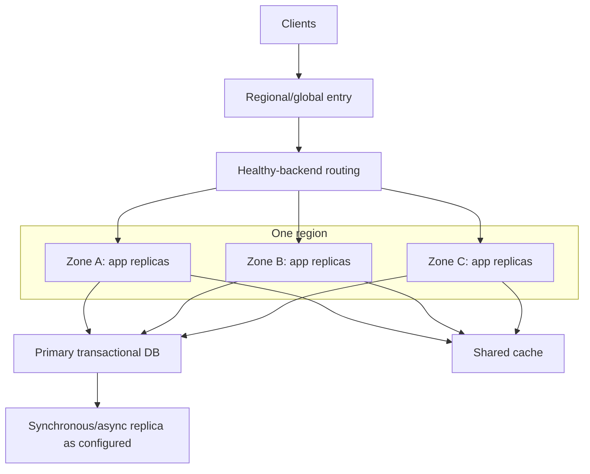

# Q2 · High Availability, Failure Domains and Dependency Mapping

> **Interviewer:** Design an available catalog and checkout API within one cloud region. What survives a node or availability-zone failure? Which parts of a three-zone Kubernetes design remain single points of failure?

## Define the failure model

High availability means satisfying a defined service objective despite specified failures. Enumerate risks before adding replicas: process crash, node loss, rack/zone loss, regional network disruption, certificate expiry, bad deployment, shared database outage, credential failure and control-plane impairment. Independent replicas do not remove common-mode dependencies.



The diagram is hypothetical. A database primary in one zone is a failure dependency even if its compute clients span three zones. Managed databases may automate failover, but the RPO/RTO and application reconnection behavior must be tested.

### Availability math: not all failures are independent

If two independent components both must be up and each has availability 99.9%, their simple series availability is 0.999 × 0.999 = 99.8001%. If two genuinely independent redundant instances can each serve the full workload, the probability both fail under the simplified model is (0.001)^2. Real zones share region-wide networks, IAM, DNS, deployments and operator actions. Correlated failure invalidates naive multiplication.

### Deployment and topology controls

```yaml
apiVersion: apps/v1
kind: Deployment
metadata: {name: catalog-api, namespace: marketplace}
spec:
  replicas: 6
  selector:
    matchLabels: {app: catalog-api}
  template:
    metadata:
      labels: {app: catalog-api}
    spec:
      topologySpreadConstraints:
        - maxSkew: 1
          topologyKey: topology.kubernetes.io/zone
          whenUnsatisfiable: DoNotSchedule
          labelSelector:
            matchLabels: {app: catalog-api}
      containers:
        - name: app
          image: registry.example.com/catalog@sha256:REPLACE_WITH_REAL_DIGEST
          resources:
            requests: {cpu: 250m, memory: 256Mi}
          readinessProbe:
            httpGet: {path: /ready, port: 8080}
            periodSeconds: 5
```

Illustrative image digest placeholder is not deployable. Hard spread constraints can leave Pods Pending if a zone lacks eligible nodes. Balance strict spread against available capacity. Use PDBs for voluntary evictions; they do not prevent involuntary zone loss or guarantee deployment rollout availability.

### Dependency and blast-radius inventory

Record for each dependency: ownership, zones/regions, write/read semantics, maximum tolerable outage, backup, failover trigger, recovery path, and whether it shares credentials or control plane with the primary service. For checkout, include payment-provider connectivity, idempotency storage, queue and fraud service. A cached listing may serve stale data; a final monetary transaction needs a stricter correctness contract.

```bash
kubectl get pods -n marketplace -o wide
kubectl get pdb -n marketplace
kubectl describe deploy catalog-api -n marketplace
kubectl get endpointslices -n marketplace
kubectl get nodes -L topology.kubernetes.io/zone
```

## Failure scenario: zone A disappears

Check endpoints removed from routing, database primary failover, surviving-zone headroom and rate of retries from displaced clients. Do not shift 100% of regional traffic to two zones if they were provisioned with zero spare capacity. A failed node's application sessions disappear; the replacement needs reconnect/resume logic. Test failure *while* a deployment is rolling, not only during steady state.

### Senior trade-offs

Single-region multi-zone is simpler and usually has lower write latency than multi-region active-active. Multi-region introduces conflict handling, replication lag, global routing and substantially greater operational cost. Use explicit business recovery requirements to justify it.

> “I'd begin with the failure domains the service must withstand. Multiple zones remove individual node and zone dependency only if routing, replicas, storage and remaining capacity are independently viable. I'd map shared databases, identity, DNS and rollout pipelines as common failure points. Then I'd prove the design with controlled zone failure tests and measure customer success, not just Pod readiness.”

**References:** [Google SRE addressing cascading failures](https://sre.google/sre-book/addressing-cascading-failures/) · [Kubernetes topology spread](https://kubernetes.io/docs/concepts/scheduling-eviction/topology-spread-constraints/)
