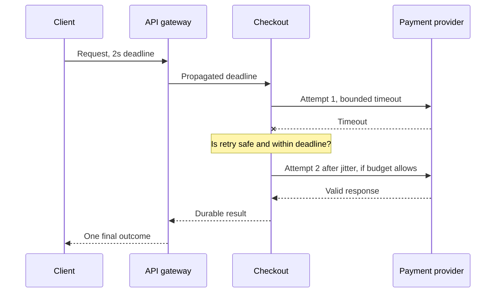
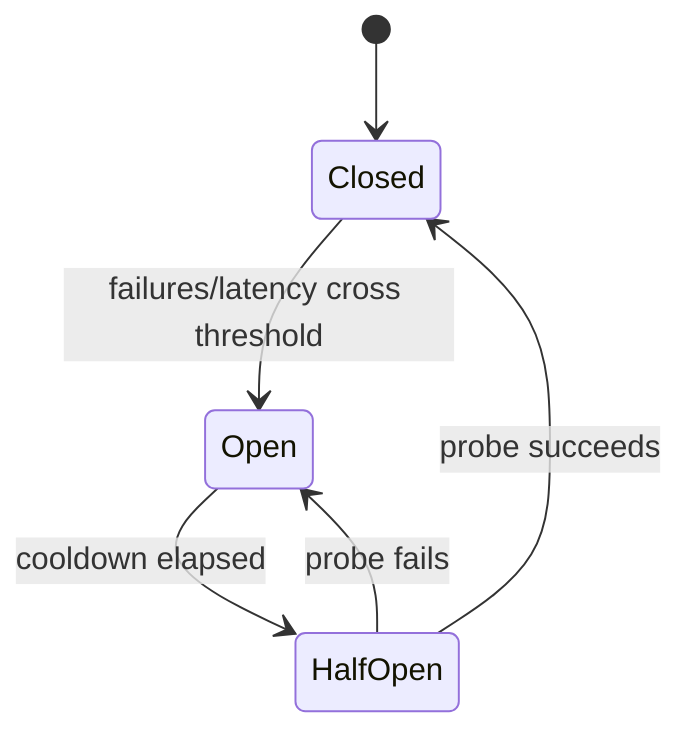

# Q3 · Timeouts, Retries, Circuit Breakers, Backpressure and Bulkheads

> **Interviewer:** A downstream payment provider becomes slow. Explain how bad timeout and retry policies can take down otherwise healthy APIs. Design a bounded failure-handling strategy.

## Budget the request end to end

A 2-second client deadline is not compatible with four synchronous internal calls each configured with a 2-second timeout and three retries. Specify absolute request deadlines, reserve time for serialization and response, and propagate cancellation through all components. Not every library propagates deadline or cancellation automatically.



### Timeouts by phase

Connection timeout covers establishment; TLS/handshake has its own behavior; read/header/body timeouts govern later phases; total deadline governs the overall operation. Idle connection timeout is different from end-to-end request deadline. Set them to reflect latency distributions and resource budgets, not arbitrary copied constants.

### Retry math

If every original request can make three attempts, 2,000 incoming RPS can become 6,000 upstream attempts at peak. Nested retries multiply further. Retry *only* transient, recoverable failure classes, with exponential backoff and full jitter, per-hop attempt caps, a shared deadline and a global retry budget. A timeout after sending a payment is ambiguous: the remote side may have committed it. Use a persisted idempotency key and reconcile outcomes before replaying.

```python
import random
def next_delay(attempt: int, base: float = 0.1, cap: float = 3.0) -> float:
    return random.uniform(0.0, min(cap, base * 2 ** attempt))
```

This illustrates delay generation only. Production retry code also needs a deadline, retryable-error predicate, idempotency policy and cancellation.

### Circuit breakers and bulkheads

A breaker uses closed/open/half-open states to avoid repeatedly calling an unhealthy dependency. It protects resources but can reject real customers. A bulkhead isolates concurrency pools or queues so a failing dependency cannot consume all request workers. Queue length must be bounded, with deliberate overload responses.



### Retry storms, load shedding and fairness

When a payment provider recovers, queued work plus client retries may re-saturate it. Apply admission control before expensive processing and return explicit overload status with retry hints where protocol supports it. Preserve fairness between tenants or workloads if one caller can consume shared capacity. Rate limits protect one layer; concurrency limits protect in-flight work.

## Incident drill

Checkout p99 moves from 150 ms to 7 seconds while CPU is low. Distributed traces show 90% of time in external calls, thread pools near capacity, retry attempts tripled. Mitigate by reducing attempts, enforcing a bulkhead and preserving idempotent finalization. Evaluate whether temporarily degrading a noncritical fraud enrichment is legally/business permissible before bypassing anything.

```bash
kubectl top pods -n checkout
kubectl logs deploy/checkout-api -n checkout --since=10m
# Examine upstream requests, retries, deadlines and queue metrics
# Sample correlation using request IDs in a tracing backend
```

**Observability:** attempts per original operation, breaker state transitions, pending/active call count, rejected concurrency, deadline exceeded, server-side committed outcome, and downstream latency distribution.

> “I'd give each request a total deadline and partition it among dependencies. Retrying a failed call is a new load event, so I'd use bounded budgets, jitter and retryable error classification. For checkout I'd also require idempotency keys because a timeout doesn't prove the side effect failed. Bulkheads, bounded queues and circuit breakers limit cascading failure, while metrics show whether we're protecting or merely shifting the bottleneck.”

**References:** [Google SRE overload and cascading failures](https://sre.google/sre-book/addressing-cascading-failures/) · [AWS Builders Library timeouts and retries](https://aws.amazon.com/builders-library/timeouts-retries-and-backoff-with-jitter/)
