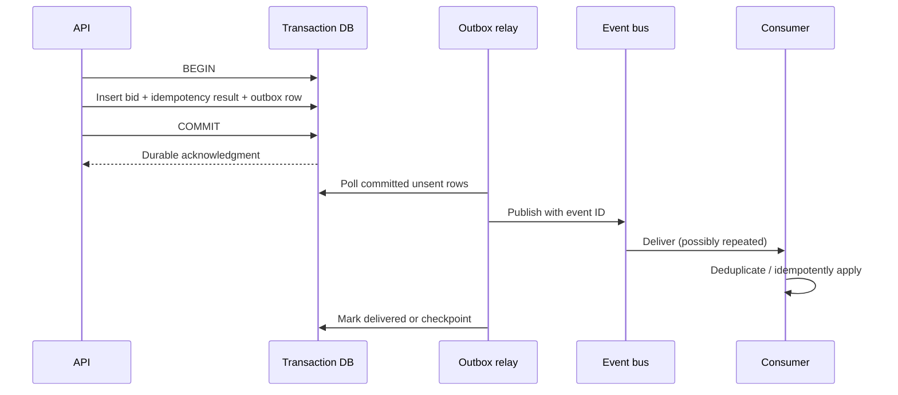

# Q4 · Transaction Correctness, Consistency and Event Delivery

> **Interviewer:** A bidder clicks Submit twice after a timeout. The API, database and event queue disagree briefly. Design a system that avoids double-processing and can recover from ambiguous outcomes.

## Availability is not correctness

A system may be available for reads while writes need consensus or a single authoritative owner. Business correctness includes preventing duplicate effects, preserving order where required, and returning truthful status to callers. Clarify invariants before choosing technology: e.g. each unique bid request ID has one durable result, only valid bids participate, and the winner is computed from committed history.

### Idempotent write pattern

Require a client-generated or server-issued operation ID, store its result alongside the business transaction under a unique constraint, and return the same result on replay. Enforce the uniqueness at the authoritative transactional boundary rather than only in a best-effort cache.

```sql
CREATE TABLE bid_requests (
  idempotency_key TEXT PRIMARY KEY,
  listing_id BIGINT NOT NULL,
  outcome TEXT NOT NULL,
  committed_at TIMESTAMPTZ NOT NULL DEFAULT now()
);
-- This table is schematic; actual bid validation and transaction
-- isolation must be designed together with ledger writes.
```

### Transactional outbox

Without an outbox, this sequence is unsafe: commit database change, crash before publishing event. Publishing first is also unsafe: event delivered but database transaction rolls back. Write the business mutation and outbox record in *one database transaction*, then asynchronously publish and mark delivery progress. Consumers must deduplicate because publication can repeat.



### Ordering, concurrency and isolation

Two concurrent bids on one listing may need serialization at a per-listing authority, an optimistic version check or a suitable database transaction isolation/locking strategy. Global event ordering is expensive and not usually required. Partition order by aggregate ID only if the broker guarantees it and the business operation needs it. “Exactly once” can refer to a narrow broker processing model but is not a universal end-to-end business guarantee across a database and external services.

### Consistency design choices

- Strong writes with one owner simplify bid correctness but create a write availability trade-off during partition.
- Eventually consistent caches/search indexes improve read scale but must expose freshness bounds and not decide authoritative winners.
- Sagas coordinate multi-service workflows with compensations, but not every side effect is reversible (e.g. money movement).
- Replication lag affects reads after writes; route critical confirmation to authoritative committed state or enforce read-your-writes semantics where supported.

## Incident simulation

A broker outage lasts 10 minutes; bidding API commits successfully and outbox backlog grows. Customers see accepted results; downstream notifications are delayed. SLOs must separately capture durable acceptance and event freshness. On recovery, the relay uses bounded concurrency, deduplication and backlog-aware autoscaling. Do not publish uncommitted rows or replay blindly.

```bash
kubectl get pods -n marketplace -l app=outbox-relay
kubectl logs -n marketplace deploy/outbox-relay --since=20m
# DB: query committed pending outbox count, oldest age, duplicate IDs
# Broker: inspect lag, retry and dead-letter metrics
```

> “I'd write down the transaction invariants before selecting a queue. For repeated bid submissions I'd use an idempotency key backed by a database uniqueness constraint and store the final outcome. I'd use a transactional outbox to close the commit-versus-publish gap, and make consumers idempotent because delivery is at least once in many practical setups. Caches and events can be eventually consistent, but the authoritative bid decision needs a well-defined consistency boundary.”

**References:** [Microservices.io transactional outbox](https://microservices.io/patterns/data/transactional-outbox.html) · [PostgreSQL transaction isolation](https://www.postgresql.org/docs/current/transaction-iso.html)
