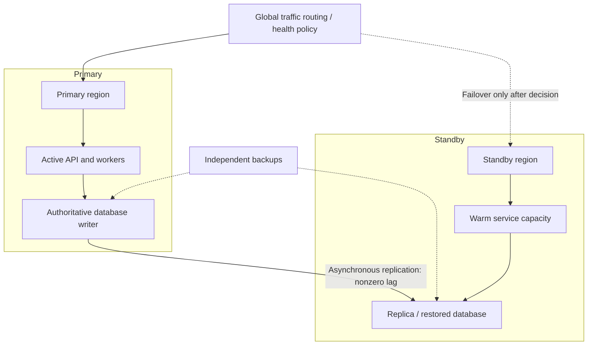
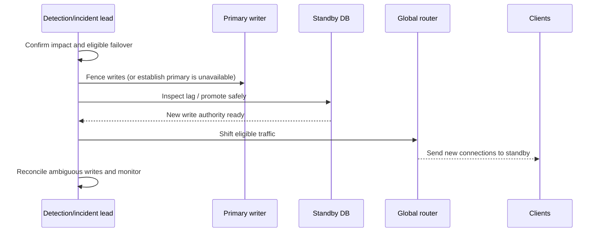

# Multi-Region Design, Disaster Recovery and RPO/RTO

> **Engineering focus:** Your marketplace runs in one European region and product leadership wants regional-failure protection. Compare active-passive and active-active designs. How do you establish a realistic RPO and RTO and rehearse failover?

## Begin with business continuity objectives

**RTO** is the target maximum time to restore a service after a qualifying disruption. **RPO** is the target maximum acceptable age of recoverable data, often expressed as time. Neither guarantees recovery unless regularly verified. Distinguish restoration of the UI, read-only catalog, checkout authorization and authoritative bid submission because business requirements may differ.

A failure taxonomy matters: zonal failure, full region outage, operator deletion, corrupted database, credential compromise and globally deployed defective code. Multi-region compute alone cannot repair corruption replicated to both regions.

## Architecture choices

| Pattern | Strength | Trade-offs |
| --- | --- | --- |
| Single region, multiple zones | Simpler, usually low write latency | Region remains failure domain |
| Active-passive, warm standby | Clear primary for writes, controllable failover | Standby cost, readiness/replication lag, failover time |
| Active-active reads, primary writes | Low-latency regional reads | Consistency and read freshness choices |
| Multi-writer active-active | Regional write availability | Conflict handling, fencing, global consistency, cost |



The diagram is illustrative. A standby replica is not a reliable backup against logical corruption or accidental deletion that replicates.

## Failover is a coordinated state transition

1. Detect and confirm genuine primary failure using multiple signals.
2. Decide who is authorized to initiate failover and how to avoid false positives.
3. **Fence old writers** or otherwise guarantee there is only one authoritative writer.
4. Confirm standby data consistency and measured lag.
5. Promote the standby if permitted by database semantics.
6. Switch client routing, secrets/configuration and supporting workers.
7. Resume idempotent processing; reconcile ambiguous transactions.
8. Verify real customer journeys and data invariants.
9. Document return-to-primary plan and avoid automatic failback without data reconciliation.



### Split-brain danger

Two regions independently accepting writes against the same logical listing can produce incompatible accepted bids. DNS failover isn't a consensus algorithm: DNS TTLs, caches and existing sessions also delay traffic shifts. If the old region returns, it must not resume writes until leadership is explicitly resolved. A multi-writer database demands a proven conflict/ordering model; last-write-wins is usually inappropriate for financial or auction invariants.

## Recovery testing

Create a game day in a sandbox or preapproved production slice: isolate one region, inject DNS/routing failure, simulate a dead primary, verify backup restore to a new environment and measure outcome. Report separately **detection time, decision time, database promotion, routing, application warmup and business reconciliation**. Test credential/KMS reachability from the standby region.

```bash
# Read-only investigation examples; replace synthetic names
kubectl get deploy,pods -A -o wide
kubectl get events -A --sort-by=.lastTimestamp
# Query provider database replication lag and backup status
# Verify DNS resolution from multiple networks and client regions
dig api.example.com A
```

### When *not* to choose multi-region

If the stated RTO is hours and the product tolerates some stale catalog data, expensive active-active operation may add more failure modes than it solves. RPO zero plus low-latency global writes demands an architecture with corresponding consensus/coordination costs. Establish recovery economics instead of promising “zero downtime” from adding a second region.

> “Start with per-journey RTO and RPO and name the failures we must survive. A warm standby with one authoritative writer is often easier to reason about than multi-writer active-active. Account for replication lag, fencing, route convergence, dependencies and ambiguous writes. Then rehearse promotion and restoration, measure actual recovery against targets and verify transaction correctness, not just that both regions contain running Pods.”

**References:** [Google SRE disaster recovery](https://sre.google/sre-book/availability-table/) · [AWS reliability pillar](https://docs.aws.amazon.com/wellarchitected/latest/reliability-pillar/welcome.html)
