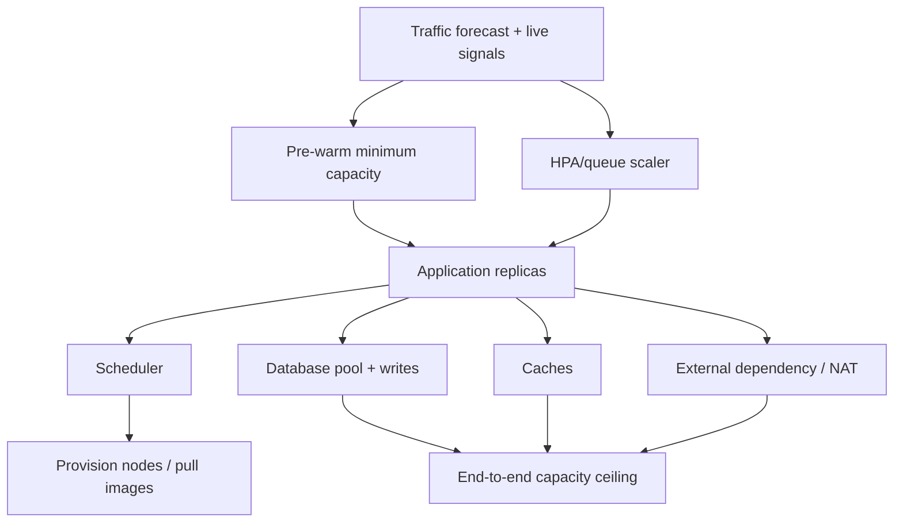

# Capacity Planning, Load Testing, Queues and Peak Events

> **Engineering focus:** Traffic quadruples in the last minute of a time-bounded event. How do you capacity plan an API and workers when autoscaling and new nodes both take time?

## Model demand instead of picking replica counts

Capture ordinary, peak and pathological conditions: request rate, concurrency, per-request CPU time, memory working set, downstream calls, new connections, file descriptors, queue backlog and data growth. For synchronous services apply Little's Law, L = λ × W, only where throughput and residence time are measured consistently in stable conditions. E.g. 2,000 RPS at 0.1 seconds mean about 200 average in-flight requests, *not* 200 pods.

### Resource budget

```text
capacity_per_pod = sustainable RPS at target p99 and error rate
steady_replicas = ceil(expected_RPS / capacity_per_pod)
failure_headroom = enough replicas/nodes to survive stated zone loss
effective_capacity = min(API, DB, cache, queue, NAT, upstream provider)
```

One bottleneck governs the useful end-to-end capacity. Doubling Pods can exhaust a database connection pool and worsen throughput. CPU HPA is reactive and may miss waiting/blocked workflows; queue-depth scaling can miss variation in processing cost.



## Autoscaling latency budget

Scale-out includes metric sample age, controller sync, ReplicaSet creation, scheduling, cloud node provisioning, image pull, initialization, readiness and load-balancer registration. For known deadline-based traffic peaks, scheduled pre-scaling and node headroom may be justified. Preserve an intentional scale-down stabilization window to avoid oscillating before the next burst.

### Load test dimensions

- Baseline steady state: sustained representative mix.
- Step load: detect saturation knee and transient queues.
- Spike: sudden arrivals and TLS/connect churn.
- Soak: memory/FD leaks and cache growth.
- Failure under load: zone loss or database restart.
- Recovery: backlog drain and retry storm.
- Write correctness: unique accepted operations, idempotency replays, consumer lag.

A load test that sends only GET /health or runs from one source IP may miss the true workload. Use synthetic safe data and a production-like dependency topology without generating real financial effects.

## Queue mathematics and fairness

For a queue with arrival rate λ and service capacity μ, backlog grows while λ > μ. More workers help only if downstream capacity permits. Bound queue size, set message age SLOs, allocate dead-letter paths, and use backpressure. A fair scheduler can prevent a single tenant's large export from starving interactive purchases.

```promql
# Illustrative backlog time: queued_items / processed_items_per_second
sum(worker_queue_depth)
/
clamp_min(sum(rate(worker_processed_total[5m])), 0.001)
```

This is an *approximation* that assumes roughly constant arrival and processing cost; it is not a guaranteed time-to-drain during changing traffic. For different message classes, split by queue and measure oldest-item age directly.

## Practical validation

```bash
kubectl get hpa -A
kubectl describe hpa catalog-api -n marketplace
kubectl top pods -n marketplace
kubectl get pods -A --field-selector=status.phase=Pending
kubectl get nodes -L topology.kubernetes.io/zone
```

Correlate request p99, success rate, queue depth, accepted/rejected connections, database saturation and node provisioning latency. Validate with traffic that matches your event profile.

> “Load-test sustainable throughput at the required p99, then budget for dependent systems and failure headroom. For a predictable spike pre-provision enough nodes and warm application replicas rather than expect HPA to react instantly. Add admission control and bounded queues to prevent overload, watch the next bottleneck such as database or NAT, and test both spike onset and recovery with business-correctness assertions.”

**References:** [Kubernetes HPA](https://kubernetes.io/docs/tasks/run-application/horizontal-pod-autoscale/) · [Google SRE handling overload](https://sre.google/sre-book/handling-overload/)
