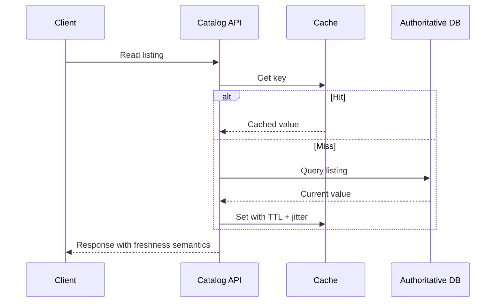
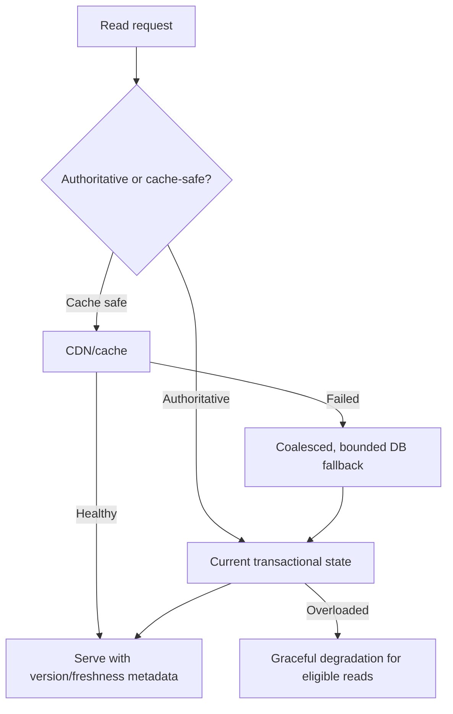

# Data-Layer Reliability, Caching and Graceful Degradation

> **Engineering focus:** The cache cluster fails during peak catalog browsing, then the database's primary restarts. How do you avoid a thundering herd and preserve correct writes while keeping noncritical read paths useful?

## Map consistency by operation

| Operation | Possible consistency | Key failure concern |
| --- | --- | --- |
| Product image/static asset | CDN eventual refresh | Stale/missing content |
| Catalog search | Eventually consistent index | Freshness lag |
| Listing read | Cache backed by authoritative store | Stale TTL, stampede |
| Bid acceptance | Transactionally authoritative | Concurrent writes, duplicate effects |
| Payment state | Strong idempotent state machine | Ambiguous external outcomes |

The correct cache strategy depends on acceptable staleness and failure semantics. A cache must not become the sole source of authoritative transaction history without a durability design.

## Cache-aside request flow



### Stampede controls

If one popular key expires during an auction event, thousands of requests may hit the DB. Prefer suitable combination of TTL jitter, singleflight/request coalescing, stale-while-revalidate for safely stale content, bounded cache fills and prewarming. These mechanisms have failure trade-offs: a distributed lock service might become another bottleneck; excessive stale serving can violate bid correctness.

### Database saturation and failover

Database failover can invalidate connections, rotate writer endpoints and trigger pool reconnection bursts. Set client reconnect jitter, pool ceilings and query deadlines. Reader replicas may lag and should not answer read-after-write-critical operations without an explicit consistency mechanism. Transactions need appropriate isolation and retry semantics when a leader changes.



## Graceful degradation examples

- Catalog images: serve an appropriate cached variant.
- Search: show cached results with clear freshness expectations.
- Recommendations: skip personalization if nonessential.
- Bid submission: reject clearly or queue only if the product contract supports delayed acceptance; never falsely return accepted when not committed.
- Checkout: don't fake a successful payment because an upstream timed out.

### Operational proof

```bash
kubectl get endpointslices -n marketplace
kubectl top pods -n marketplace
# Inspect application connection-pool busy/wait metrics
# Compare DB primary/replica lag and failover events
# Inspect cache hit/miss, hot-key and eviction patterns
```

### Failure scenario

A Redis-like cache restarts; cache miss ratio approaches 100%, DB pool fills, API p99 rises, retries increase work. First contain blast radius: shed optional read load, cap DB concurrency and enable safe stale content while cache warms. Validate that committed bidding remains authoritative. In the postmortem assess TTL policy, cache-warm strategy, dependent pool sizes and disaster tests.

> “Define which data may be stale and which must be authoritative. A cache failure shouldn't make every reader stampede onto the database; use coalescing, jitter and bounded fallback, with stale responses only for operations where correctness permits it. During database failover protect connection pools and retry only safe operations. Rather return a clear temporary failure for an uncommitted bid than a misleading success.”

**References:** [Google SRE data integrity](https://sre.google/sre-book/data-integrity/) · [PostgreSQL high availability](https://www.postgresql.org/docs/current/high-availability.html)
