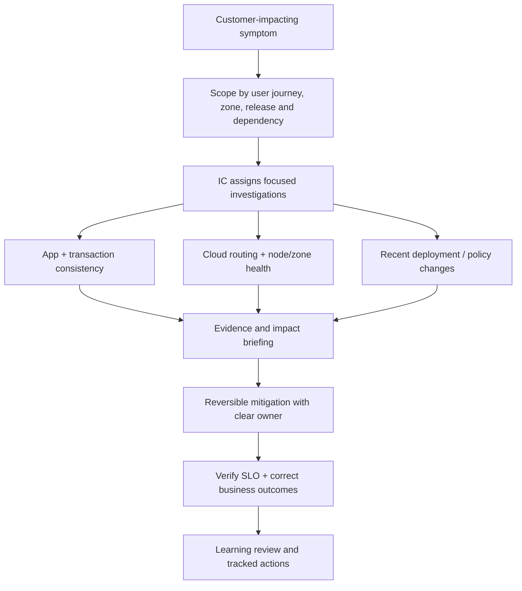

# Incident Command, Game Days, Error-Budget Policy and Cost Trade-offs

> **Engineering focus:** A rollout and a cloud-zone disturbance happen together. The platform is intermittently failing and three teams want different fixes. How do you lead the incident, prove recovery, and make the system safer?

## Incident leadership model

Identify incident commander (IC), operations/technical lead, communications owner and scribe according to team size. One person may combine roles in a small incident, but decision rights should remain clear. Declare severity from customer/business impact rather than a universal CPU threshold. Preserve an event timeline, decisions and mitigation owners.



### Triage sequence

1. Confirm actual blast radius and correctness risks. Can users submit bids twice? Are accepted results durable?
2. Compare current errors and p95/p99 by route, region, release, pod and dependency.
3. Correlate feature flags, Git/rollout events, cloud advisories and recent changes.
4. Make the smallest reversible mitigation: halt promotion, revert a known-bad release, isolate unhealthy endpoints, shed optional work.
5. Ensure surviving zones can serve redirected traffic before shifting load.
6. Verify user journey, data reconciliation and recovery of queue lag.
7. Avoid random simultaneous changes that destroy the ability to attribute improvement.

### Emergency rollback may not reverse data mutations

An image rollback does not roll back schema migrations, external payments, Terraform applies or published events. Record the cutback procedure per dependency. Prefer expand-and-contract schema evolution and idempotent recovery. Re-run testing with a realistic mixed-version state.

## Sample read-only runbook

```bash
kubectl rollout status deploy/catalog-api -n marketplace
kubectl rollout history deploy/catalog-api -n marketplace
kubectl get pods -n marketplace -o wide
kubectl get events -n marketplace --sort-by=.lastTimestamp
kubectl get endpointslices -n marketplace
kubectl get pdb -n marketplace
# Review tracing, LB target health, database and cloud region signals
```

### Game days

Experiment on one failure assumption at a time: kill a node, refuse database connections, disable a zone in a disposable environment, expire a test certificate, simulate partial network partition, and restore from backup. A passing experiment must include SLO outcome, time-to-detect, time-to-mitigate, rollback, safety guardrails and corrected documentation. Never initiate destructive tests in production without explicit authorization and a tested stop mechanism.

## Learning review versus blame

A high-quality review includes impact, timeline, contributing technical and organizational factors, why safeguards didn't detect it earlier, which assumptions failed and prioritized follow-ups with owners and due dates. “Engineer should be more careful” is not a useful system improvement. Examples: rollout controller should block on elevated error budget burn; restore tests should run quarterly; tenant retry budget should be enforced in SDK defaults.

## Reliability and cost

Availability improvements have diminishing returns and opportunity costs. Evaluate cost per unit of risk reduction, engineering maintenance, failure correlation and data correctness. A second region may be unjustified if the required RTO is hours; a multi-zone database failover test may reduce more risk at lower cost. Present trade-offs, not “always multi-region”.

> “Appoint clear incident roles, define the affected user operation and assign investigations by failure boundary. Stabilize with a narrow reversible change, track ambiguous transactions separately, and verify success at the user and data layer. After recovery conduct a blameless technical review, identify which assumptions and guardrails failed, and test the preventive actions through game days. Architecture changes need to earn their operational cost against agreed RTO, RPO and SLO objectives.”

**References:** [Google SRE incident management](https://sre.google/sre-book/managing-incidents/) · [Google SRE postmortem culture](https://sre.google/sre-book/postmortem-culture/)
