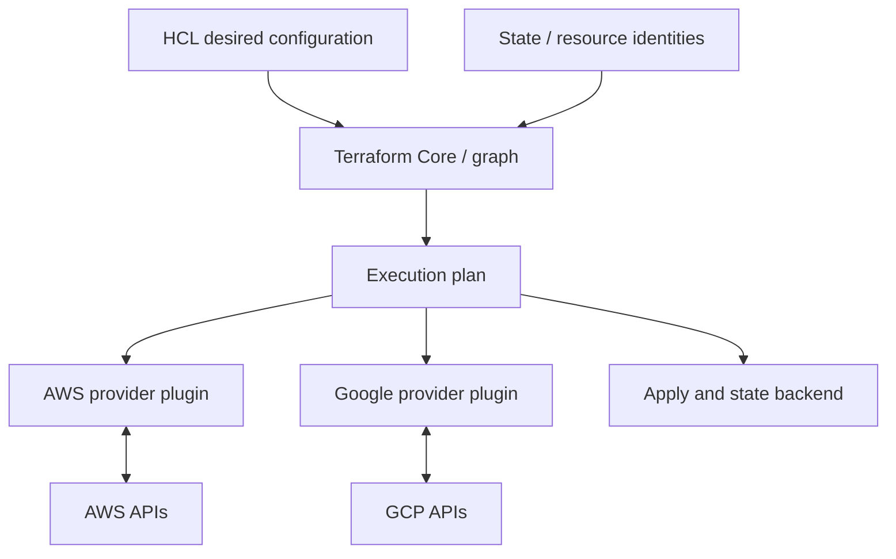
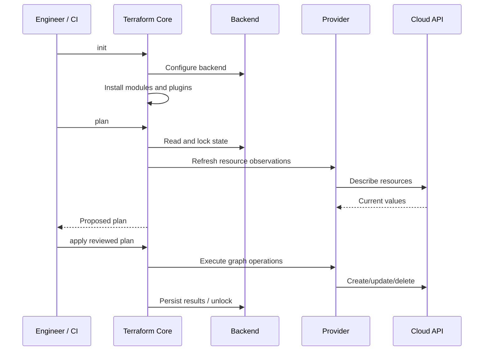

# Terraform Fundamentals and Execution Architecture

> **Engineering focus:** Explain Terraform, its architecture, and what happens from HCL through init, plan, apply and state persistence. Why not just use Bash?

## Desired state, state, provider observations

Terraform describes intended infrastructure, derives a dependency graph and invokes provider APIs to converge managed objects toward configuration. Its configuration is declarative; API operations are not atomic.



Core parses/evaluates HCL, manages addresses and planning. Providers publish schemas and implement remote API reads, creates, updates and deletes. Backends store state and may implement locking. Providers and backends are independent: a state backend in an infrastructure account can support providers managing other accounts/projects.

## First resource

```hcl
terraform {
  required_providers {
    aws = { source = "hashicorp/aws", version = "~> 6.0" }
  }
}
provider "aws" { region = "eu-west-1" }
resource "aws_vpc" "marketplace" {
  cidr_block = "10.40.0.0/16"
  enable_dns_support = true
  enable_dns_hostnames = true
  tags = { Name = "marketplace-prod" }
}
output "vpc_id" { value = aws_vpc.marketplace.id }
```

`aws_vpc.marketplace` is an HCL address; the AWS-assigned VPC ID is a distinct remote identity recorded in state.

## Full command lifecycle

```bash
terraform fmt -check -recursive
terraform init
terraform validate
terraform plan -out=reviewed.tfplan
terraform show reviewed.tfplan
terraform apply reviewed.tfplan
```

`init` initializes the backend, installs modules and resolves provider plugins according to `required_providers`, recording checksums and selected versions in `.terraform.lock.hcl`. This is a **dependency** lockfile, not a state lock.

`validate` checks syntax/schema and expression validity but not cloud quota, permissions, safety or application correctness.

`plan` generally refreshes observed remote resources, compares HCL, state and observations, then calculates create (+), update (~), delete (-) and replacement (-/+ or +/-) actions. Unknown values appear as `(known after apply)`.

`apply` executes the dependency graph. A saved plan binds execution to previously reviewed intent but can become stale, can contain secrets and does not guarantee remote cloud conditions stay unchanged.



Terraform can persist intermediate state during application. A failure can leave successful earlier resources running.

## Bash, CloudFormation and GitOps

Bash is useful for procedural tasks but would need custom implementation of resource identity, dependency discovery, change planning, drift analysis and failure recovery. CloudFormation has a cloud-native stack/changeset model for AWS. Terraform provides a common multi-provider interface, at the operational cost of maintaining provider versions, states and integration. Continuously changing Kubernetes application manifests often fit a GitOps reconciler better than a Terraform apply job.

## Production investigation

A valid plan fails because EKS creation was rejected by IAM. Verify effective runner identity, IAM role trust and policy, quotas, provider error, and which prerequisite resources succeeded. Do not expect automatic rollback or blindly run apply again.

## Key takeaways

> Terraform is declarative infrastructure orchestration backed by state. Core evaluates HCL and a dependency graph, providers translate the plan to cloud APIs, and the backend stores managed resource bindings. Its strengths are repeatability, review and controlled convergence, not cloud-wide atomicity. Use it for durable infrastructure, protect state and privileges, and keep continuously reconciled application delivery under a suitable controller.

[Official Terraform language](https://developer.hashicorp.com/terraform/language) · [CLI plan](https://developer.hashicorp.com/terraform/cli/commands/plan)
