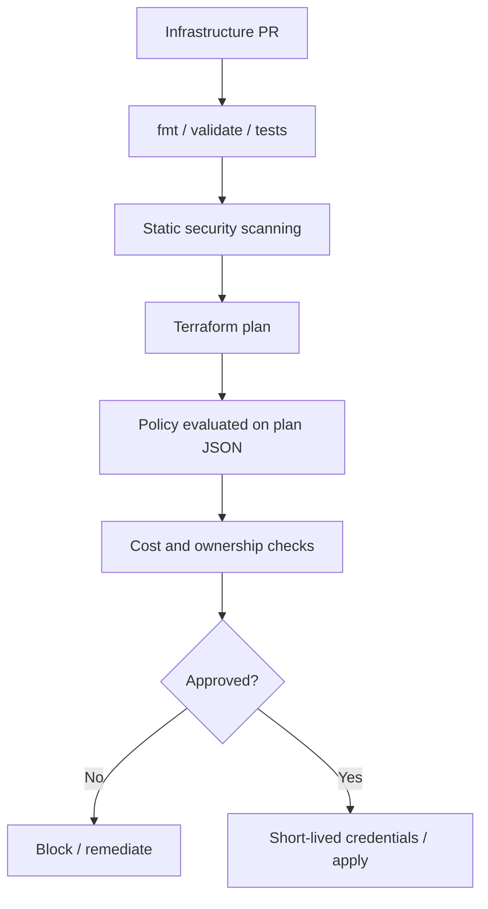

# Security, Secrets, Policy-as-Code and Cost Governance

> **Engineering focus:** How do you protect highly privileged Terraform execution? Prevent public databases, unrestricted IAM and unexpected costs. Explain secrets in state and policy enforcement.

## Terraform is privileged automation

Provider plugins and execution runners can create networks, IAM, clusters, databases and encryption keys. Treat cloud credentials, plan JSON, state backups and plugin dependencies as privileged assets.



## Federation instead of static keys

AWS CI commonly uses an OIDC trust relationship with STS and tightly scoped IAM roles. GCP CI can use Workload Identity Federation and authorized service account impersonation or direct principal access. Restrict issuers, audiences, repository/workflow or principal attributes, target accounts/projects and allowed actions. Avoid long-lived AdministratorAccess/Owner keys.

## Secrets: sensitive is not encryption-at-rest in state

```hcl
variable "database_password" {
  type = string
  sensitive = true
}
```

Sensitive input/output metadata controls some display behavior, **not** whether a value is stored in plan/state. Protect remote backends. Terraform's modern ephemeral inputs and provider-supported write-only arguments can avoid persisting some secrets; support is version/provider/resource specific.

Illustrative provider feature:

```hcl
ephemeral "random_password" "db" {
  length = 24
  special = true
}
# In a provider resource supporting a write-only password:
# password_wo         = ephemeral.random_password.db.result
# password_wo_version = 1
```

Don't claim a non-write-only resource argument becomes safe merely by passing a sensitive variable.

## Policy as code

Common controls:
- Public RDS/Cloud SQL forbidden without exception.
- Encryption, deletion protection and backups required.
- Restrict regions and public ingress.
- IAM privilege escalation reviewed.
- Resource ownership labels mandatory.
- Destructive replacements require elevated approval.
- Expensive instance classes/cost deltas require review.

Example Rego policy shape on Terraform plan JSON:

```rego
package terraform.security

deny contains msg if {
  some r in input.resource_changes
  r.type == "aws_db_instance"
  r.change.after.publicly_accessible == true
  msg := sprintf("Public RDS disallowed: %s", [r.address])
}
```

Production policy must explicitly handle **unknown** and missing values, deletes and schema variation. Silently allowing an unknown public-exposure field is risky. Plan JSON may contain sensitive data, so access to it is restricted.

## Provider supply-chain risk

Plugins are executable software with access to runner credentials and Terraform inputs. Pin versions, commit checksums, install from trusted sources, test upgrades and restrict runner permissions. A lockfile is not a substitute for source trust.

## Cost trade-offs

Resource instance types and provisioned disk size are easier to estimate than NAT egress, variable node hours or request traffic. Use approved templates, cost estimation, budgets, periodic cleanup, review of cross-zone traffic and explicit cost owners. Policy feedback should name the offending resource and actionable remediation, not a generic deny.

## Incident

A policy-enabled PR proposes `publicly_accessible = true` for RDS. Reject before apply and direct author to a private subnet/VPC-access pattern. If the plan value is unknown, require clarification or elevated approval rather than inferring false.

## Key takeaways

> Terraform has broad cloud authority, so run it with short-lived restricted credentials, protected state and vetted provider plugins. Enforce risky configurations both statically and on the evaluated plan. Sensitive values may still enter state, so use supported non-persistent secret mechanisms and protect artifacts. Policies should explain safe alternatives. Cost guardrails must account for dynamic usage, not just infrastructure list prices.

[Terraform sensitive data](https://developer.hashicorp.com/terraform/language/manage-sensitive-data) · [Policy](https://developer.hashicorp.com/terraform/cloud-docs/policy-enforcement) · [Terraform testing](https://developer.hashicorp.com/terraform/language/tests)
