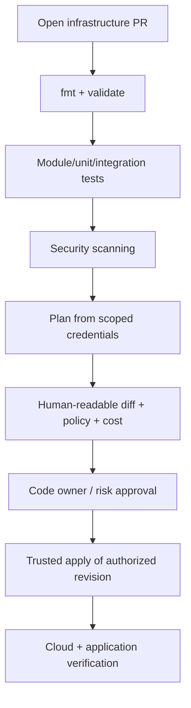
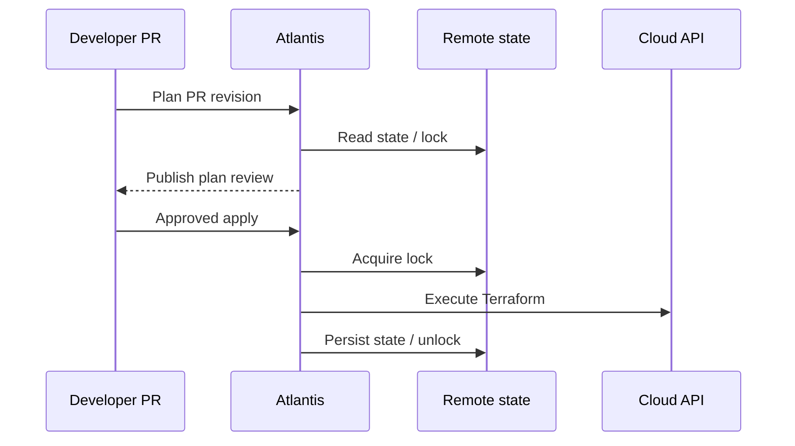

# Q11 · CI/CD, Atlantis, GitOps and Terraform Testing

> **Interviewer:** Design a safe Terraform PR-to-apply pipeline for many teams. How do you handle state locking, stale plans, Atlantis, approvals, tests and GitOps overlap?

## Reviewed infrastructure delivery



The critical property is **authorized code revision + appropriately reviewed plan + controlled execution identity**. Do not merge an unreviewed destructive plan merely because fmt passed.

```bash
terraform fmt -check -recursive
terraform init -backend=false
terraform validate
terraform test
terraform plan -detailed-exitcode
```

Detailed exit codes are 0 (no changes), 1 (error) and 2 (changes present).

## Native Terraform tests

```hcl
# tests/network.tftest.hcl
run "network_contract" {
  command = plan
  variables {
    environment = "production"
    vpc_cidr = "10.40.0.0/16"
  }
  assert {
    condition = output.vpc_cidr == "10.40.0.0/16"
    error_message = "Unexpected VPC CIDR"
  }
}
```

This assumes the module declares these inputs and output. Terraform tests can use plan/apply and mock providers according to test configuration; tests that create live infrastructure must run in disposable accounts/projects and clean up.

## Atlantis locks and backend locks

Atlantis coordinates PR projects and plans/applies. Its project lock is distinct from backend state locking. A second runner can bypass Atlantis, so backend locking still matters. Atlantis cannot lock independent states managing the same external IAM policy. Define single ownership.



## Stale plans

Plans can become stale after changes to HCL, tracked state, remote resources or provider behavior. Associate plans with exact commits/run IDs, serialize applies per state, use short-lived approvals, replan if relevant state/code changes, and inspect new destructive diffs. A saved plan isn't a permanent permission to apply.

## GitOps separation

Terraform commonly owns VPCs, IAM, managed Kubernetes cluster foundations and some bootstrap resources. Argo CD or a comparable GitOps controller owns frequently updated Kubernetes application resources. Don't let both independently reconcile the same object fields. Define clear handoff for bootstrapped add-ons.

## AI-assisted infrastructure drafting

AI-generated HCL can reduce developer toil, but generation and production authority should be separated:

```text
Developer intent → supported module selection → generated PR
→ fmt/validate/test/scan/plan → approval → trusted runner apply
```

Never grant a drafting agent unrestricted production credentials merely to make onboarding frictionless.

## Failure scenario

An approved PR plan is held for a day while another change modifies the VPC state. Re-check revision and state serial, generate a new plan if required, and avoid applying an artifact based on stale assumptions. After any targeted recovery, run a complete plan to restore normal convergence.

## Spoken interview answer

> “I build Terraform around PR-based review, scoped execution identities, remote state locks, security/cost gates and tests. Atlantis adds project workflow coordination but doesn't replace backend locking. Apply must correspond to an approved revision and current assumptions. I'd clearly separate Terraform-owned cloud foundations from GitOps-owned app resources. Automation should make low-risk changes easy while preserving explicit controls around destructive changes.”

[Terraform test](https://developer.hashicorp.com/terraform/language/tests) · [Atlantis documentation](https://www.runatlantis.io/docs/)
