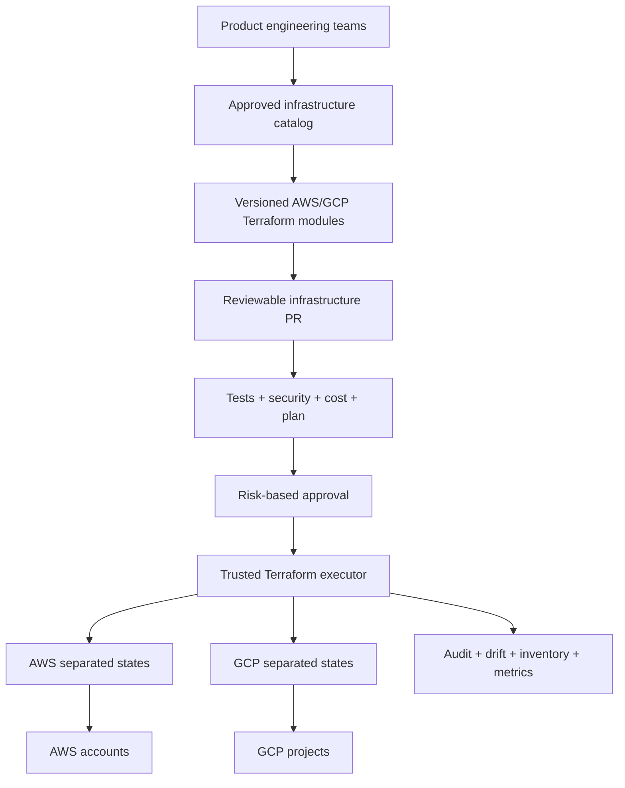
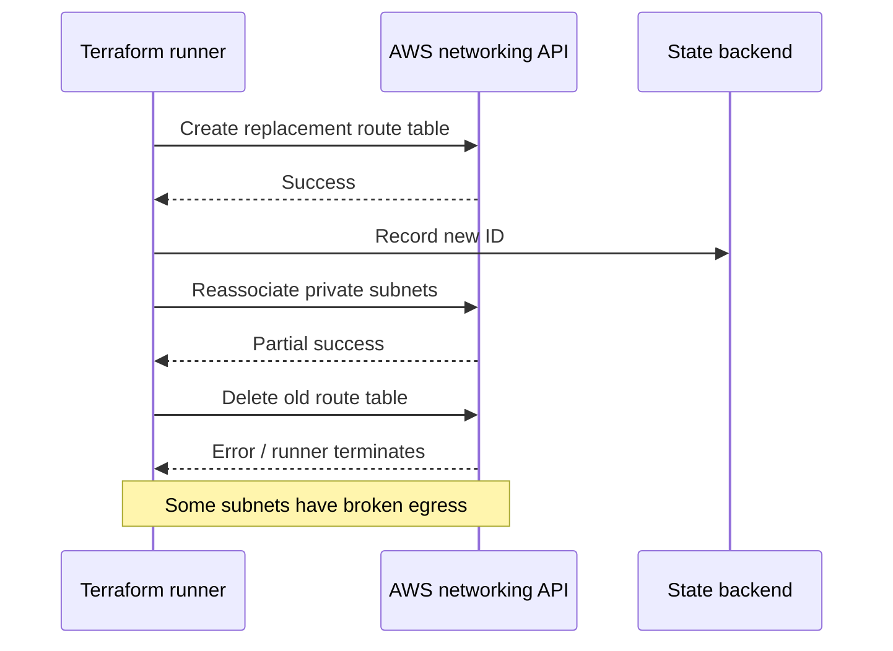

# Q12 · Enterprise Terraform Platform and Incident Leadership

> **Interviewer:** Design a multi-team AWS/GCP Terraform platform. Then recover from a partial production network apply that broke egress.

## First inventory the system

Before introducing new modules, understand cloud accounts/projects, state ownership, execution identities, current CI, module duplication, unmanaged resources, failure history and developer support requests. Standardizing a broken workflow without solving its underlying safety or usability problems adds complexity.

## Reference platform architecture



**Principles:** Single ownership for each resource/field; independently operable states; versioned modules with secure defaults; short-lived credentials; least privilege; documented recovery; explicit interfaces between roots.

A possible repository:

```text
modules/
  aws-vpc/ aws-eks/ aws-workload-identity/
  gcp-network/ gcp-gke/ gcp-workload-identity/
live/
  aws/prod/network/ aws/prod/identity/ aws/prod/eks/ aws/prod/data/
  gcp/prod/network/ gcp/prod/iam/ gcp/prod/gke/
policies/
  security/ cost/ change-protection/
```

Use separate module implementation for EKS and GKE. Their networking, workload identity and upgrade semantics differ. A shared developer-facing platform capability can hide routine complexity, but a single “universal cloud” module with hundreds of conditionals erases important differences.

## Service self-service contract

```yaml
service:
  name: inventory-api
  environment: production
  runtime: kubernetes
  exposure: internal
  storage_read: true
  standard_slo: true
```

This is an **illustrative platform API**, not Terraform-native HCL. Generate approved module inputs and PRs from it, not unrestricted ad hoc cloud administration.

## Incident: partial route-table migration



**First actions:** Stop all runs affecting network state, establish customer impact and identify actual route associations, NAT gateways, destination prefixes and effective paths. Preserve state and logs. If a safe known-good association can be restored, prioritize connectivity. Emergency console edits become intentional drift and must be reconciled back into Terraform after stabilization.

```bash
aws ec2 describe-route-tables --filters Name=vpc-id,Values=vpc-0123456789abcdef0
terraform state list
terraform state show aws_route_table.private
terraform plan -out=recovery-review.tfplan
```

The VPC ID is synthetic. Do not immediately rerun apply, force-unlock or delete a route resource; first determine which API calls succeeded.

## Risk is blast radius, not plan size

“One replacement” could mean a shared route table, KMS key, database or Kubernetes cluster. Review downstream resources, availability zones, external users, data preservation, recovery time and rollback assumptions. Distinguish HCL revert, infrastructure cutback and application-data restore.

## Success metrics

Measure infrastructure lead time, apply success rate, stale locks, detected destructive changes, drift time-to-reconcile, ownership coverage, adoption of approved modules, security exceptions, cloud cost and repeat support requests. High module count alone isn't success.

## Spoken interview answer

> “I'd begin with resource ownership and where teams experience friction. Then I'd create well-supported infrastructure capabilities behind versioned modules, independent states, least-privilege execution and PR approvals. I'd expose a consistent developer experience where useful, without pretending AWS and GCP operate identically. During an incident I'd first restore customer service, freeze conflicting Terraform writes, establish which cloud calls succeeded and reconcile actual objects to state. The platform is successful when safe changes are routine and high-risk changes are visible, constrained and recoverable.”

[Terraform architecture](https://developer.hashicorp.com/terraform/language) · [AWS provider](https://registry.terraform.io/providers/hashicorp/aws/latest/docs) · [Google provider](https://registry.terraform.io/providers/hashicorp/google/latest/docs)
