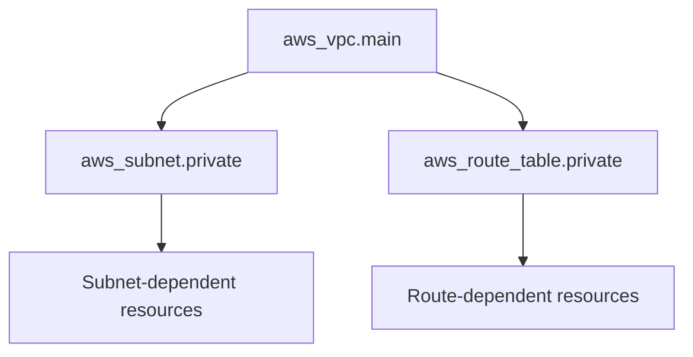
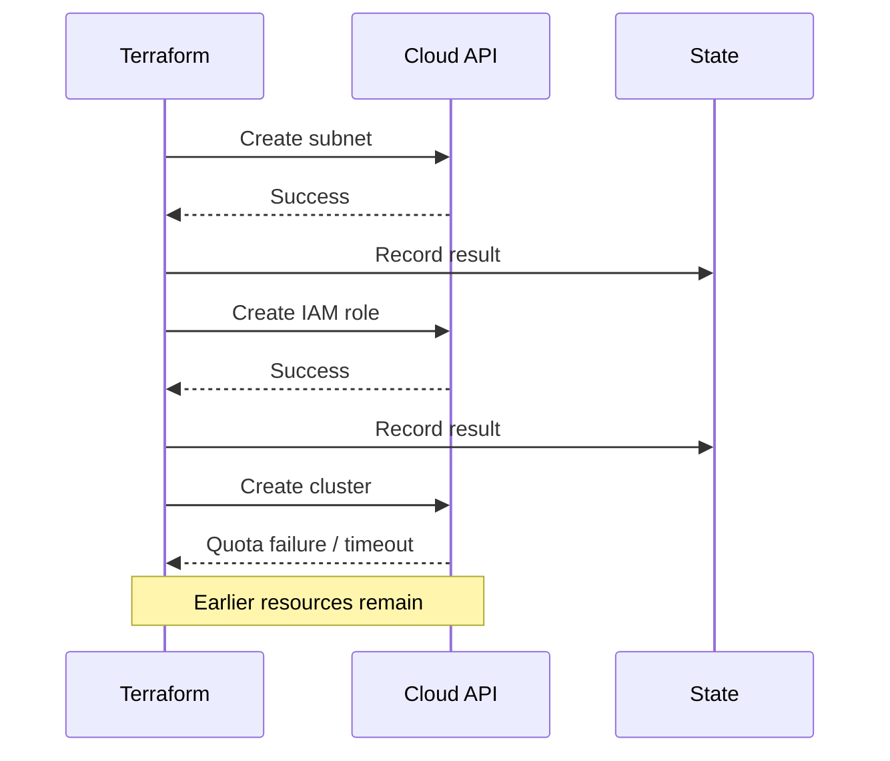

# Dependency Graph, Unknown Values and Apply Internals

> **Engineering focus:** How does Terraform choose creation order? Explain implicit/explicit dependencies, parallelism, unknown values, replacements and partial applies.

## Graph and order

```hcl
resource "aws_vpc" "main" { cidr_block = "10.40.0.0/16" }
resource "aws_subnet" "private" {
  vpc_id = aws_vpc.main.id
  cidr_block = "10.40.1.0/24"
}
resource "aws_route_table" "private" { vpc_id = aws_vpc.main.id }
```



References create implicit dependency edges. The subnet and route table may be created concurrently; file order is irrelevant. Use `depends_on` when no attribute reference expresses an ordering prerequisite, such as waiting for IAM policy attachment before creating an EKS node group. Overusing it reduces parallelism and may defer expression evaluation.

```hcl
resource "aws_iam_role_policy_attachment" "node" {
  role = aws_iam_role.node.name
  policy_arn = "arn:aws:iam::aws:policy/AmazonEKSWorkerNodePolicy"
}
resource "aws_eks_node_group" "general" {
  cluster_name = aws_eks_cluster.main.name
  node_group_name = "general"
  node_role_arn = aws_iam_role.node.arn
  subnet_ids = [aws_subnet.private.id]
  scaling_config { min_size = 2, max_size = 6, desired_size = 2 }
  depends_on = [aws_iam_role_policy_attachment.node]
}
```

This fragment assumes the named cluster, role and subnet resources exist. The dependency on the policy attachment isn't inferred just from the role ARN.

## Unknown values

A new VPC ID doesn't exist during plan: it is `(known after apply)`. Terraform can carry unknown attributes but **must know the set of instance addresses** for `for_each` and `count` at planning time. Use stable keys from configuration, not provider-generated resource IDs.

```hcl
locals {
  zones = {
    a = { az = "eu-west-1a", cidr = "10.40.1.0/24" }
    b = { az = "eu-west-1b", cidr = "10.40.2.0/24" }
  }
}
resource "aws_subnet" "private" {
  for_each = local.zones
  vpc_id = aws_vpc.main.id
  availability_zone = each.value.az
  cidr_block = each.value.cidr
}
```

## Parallel execution and replacement

`terraform apply -parallelism=10` caps Terraform graph-operation concurrency; it is not a cloud API transaction or guarantee of 10 remote calls. Lowering parallelism may help rate-limit pressure but won't resolve missing graph edges or independent states sharing ownership.

Provider schemas and API immutability determine whether an attribute update forces replacement. `create_before_destroy` asks for create-first replacement when possible, but unique names, attachments, quotas and traffic cutovers can make coexistence impossible. It cannot guarantee zero downtime.

## Partial apply and recovery



A timeout does not establish that resource creation failed. The cloud may have created it while the provider lost the response. Inspect remote IDs and current state, import any valid orphaned object, correct the cause and run a fresh complete plan.

Useful diagnostics:

```bash
terraform graph
terraform plan -out=reviewed.tfplan
terraform show reviewed.tfplan
TF_LOG=DEBUG terraform plan 2>restricted-debug.log
```

Protect debug logs and plan files as sensitive artifacts.

## Key takeaways

> Terraform executes a directed graph inferred from resource references, lifecycle and explicit dependencies. Independent operations can run in parallel. Unknown values are fine for computed attributes, not for instance keys. Apply isn't atomic, so successful calls survive later errors. I review replace actions and their downstream blast radius and reconcile remote reality with state after failures rather than assuming a retry is safe.

[Dependency meta-argument](https://developer.hashicorp.com/terraform/language/meta-arguments/depends_on) · [for_each](https://developer.hashicorp.com/terraform/language/meta-arguments/for_each)
