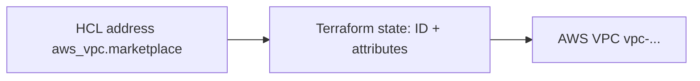
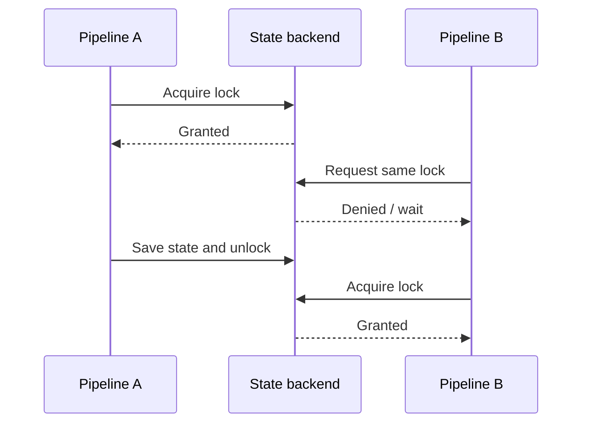

# Q4 · Terraform State, Remote Backends, Locking and Concurrency

> **Interviewer:** What does state store, why is it required, and how would you safely manage it for AWS and GCP?

## State is an identity map



State stores resource addresses, provider associations, remote IDs, attributes, outputs, lineage, serial and lifecycle metadata. It is not an application data backup or a complete history of cloud activity.

```text
HCL:   what should exist
State: what Terraform last recorded
Cloud: what actually exists
```

A normal refresh/plan compares these perspectives.

## AWS S3 state backend

```hcl
terraform {
  backend "s3" {
    bucket = "example-platform-tfstate-euw1"
    key = "prod/network/terraform.tfstate"
    region = "eu-west-1"
    encrypt = true
    use_lockfile = true
  }
}
```

Pre-create the bucket; apply versioning, encryption/KMS, least-privilege IAM, access logging and protection from accidental deletion. The S3 lockfile feature `use_lockfile` is supported in modern Terraform; DynamoDB-based backend locking is deprecated. State and `.tflock` object permissions differ.

## GCP Cloud Storage state backend

```hcl
terraform {
  backend "gcs" {
    bucket = "example-platform-terraform-state"
    prefix = "production/network"
  }
}
```

The GCS backend supports locking; enable Object Versioning, restrict IAM and manage encryption according to policy. Separate backend credentials from broad workload administration.

## Concurrent applies



Locks protect writes through **the same state**. Separate states can still conflict over the same IAM policy; cloud console changes bypass Terraform locks.

```bash
terraform plan -lock-timeout=5m
terraform state list
terraform state show aws_vpc.marketplace
terraform state pull > restricted-state.json
```

State may contain secrets in cleartext; store pulled copies and saved plans securely. Do not use `-lock=false` to resolve a production conflict.

## Stale state lock

Before `terraform force-unlock LOCK_ID`, verify whether the prior execution still runs, inspect CI logs, identify the lock owner and preserve state backups. An unlock performed while another apply is active can cause conflicting mutations.

## State boundaries and cross-state references

Prefer separate roots such as `aws/prod/network`, `aws/prod/eks`, `aws/prod/data`, `gcp/prod/network`, `gcp/prod/gke`. One giant state has excessive blast radius/lock contention; too many tiny states make dependency coordination difficult.

`terraform_remote_state` may require access to the entire underlying state snapshot, not only its outputs. Publish approved identifiers through SSM Parameter Store or another permissioned interface when stricter separation is needed.

## Recovery scenario

A versioned state object is accidentally deleted. Freeze all writers, examine audit trails and storage versions, restore an appropriate snapshot, inventory resources created since that version and run a refreshed full plan. Restoring state does not revert cloud objects to that point in time.

## Spoken interview answer

> “State maps Terraform addresses to actual cloud objects. I keep it encrypted and versioned in a remote backend with locking, restricted identities and auditability. I'd isolate states by ownership and blast radius. State locks are important but aren't global cloud transactions. Recovery starts by stopping writers, verifying real cloud resources and restoring correct resource identities before applying any new plan.”

[Terraform state](https://developer.hashicorp.com/terraform/language/state) · [S3 backend](https://developer.hashicorp.com/terraform/language/backend/s3) · [GCS backend](https://developer.hashicorp.com/terraform/language/backend/gcs)
