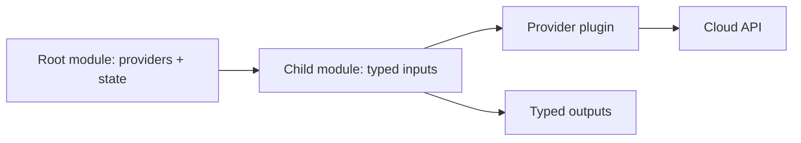

# Q5 · Providers, Modules, Versioning and Environments

> **Interviewer:** Design Terraform for 20 teams across AWS and GCP. How do provider aliases, root/child modules, versioning, account isolation and workspaces differ?

## Provider requirements versus configuration

```hcl
terraform {
  required_providers {
    aws = { source = "hashicorp/aws", version = "~> 6.0" }
    google = { source = "hashicorp/google", version = "~> 8.0" }
  }
}
provider "aws" { region = "eu-west-1" }
provider "google" { project = "marketplace-prod", region = "europe-west1" }
```

Requirements identify plugin sources and allowed versions; provider blocks configure target account/project, region and credentials. The provider is a separately versioned executable plugin that publishes resource schemas and implements Read, Plan and Apply operations. Schema/behavior upgrades can unexpectedly change replacement semantics, so treat provider upgrades as infrastructure changes.



## Multi-region and multi-project aliases

```hcl
provider "aws" { alias = "ireland", region = "eu-west-1" }
provider "aws" { alias = "frankfurt", region = "eu-central-1" }
provider "google" { alias = "analytics", project = "marketplace-analytics", region = "europe-west1" }
module "analytics_bucket" {
  source = "./modules/storage"
  providers = { google = google.analytics }
  bucket_name = "example-marketplace-analytics-eu"
}
```

Child modules normally declare `required_providers` but let roots configure credentials and provider aliases. Aliases used by child resources should be declared as required configuration aliases and passed explicitly.

## Child module contract

```hcl
variable "bucket_name" { type = string }
resource "google_storage_bucket" "this" {
  name = var.bucket_name
  location = "EU"
  uniform_bucket_level_access = true
  public_access_prevention = "enforced"
}
output "bucket_id" { value = google_storage_bucket.this.id }
```

Modules should represent a supported platform capability, with documented inputs, outputs, security defaults, examples, tests and a compatibility/migration policy. Avoid both duplicated raw resources across teams and one enormous universal module with hundreds of switches.

## Versioning and upgrades

Pin module source tags or registry versions and commit `.terraform.lock.hcl` for provider selection. A module major version change may alter inputs, outputs, resource addresses, defaults and replacement behavior. Always run a state-aware plan against real existing consumers.

## Workspaces versus independent roots

Terraform CLI workspaces separate states for one configuration but **do not** automatically separate IAM credentials, cloud accounts, project boundaries or approvals. Explicit production root/backend identities make trust and lifecycle boundaries clearer. Workspaces can be appropriate for temporary homogeneous environments.

## Incident: provider upgrade changes resource behavior

A Google provider upgrade normalizes IAM bindings differently; the plan proposes revoking several principals. Stop, inspect release notes and competing ownership, test on a separate project, and review resource schema/state migration before production. Never approve simply because the HCL diff looks small.

## Spoken interview answer

> “I keep provider identity and credentials in root configurations, use aliases explicitly and build child modules around stable platform contracts. I pin provider and module versions, test upgrades and treat resource-address changes as migrations. I prefer separate production roots and cloud identities to using workspaces as an imaginary security boundary. AWS and GCP may expose the same platform capability through different implementation modules.”

[Provider configuration](https://developer.hashicorp.com/terraform/language/providers/configuration) · [Module development](https://developer.hashicorp.com/terraform/language/modules/develop)
