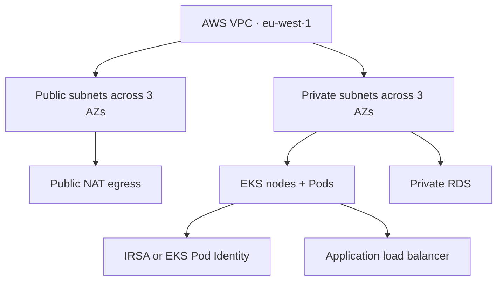

# AWS Terraform: VPC, IAM, EKS, RDS and Ownership

> **Engineering focus:** Design a secure AWS marketplace platform in Terraform. Explain subnetting, egress, IAM trust, EKS lifecycle, database protection and controller ownership.

## Cloud architecture



Private/public subnet naming is a convention; effective route tables, IGW/NAT, addresses and security rules determine reachability.

## VPC and stable subnet addresses

```hcl
resource "aws_vpc" "marketplace" {
  cidr_block = "10.40.0.0/16"
  enable_dns_hostnames = true
  enable_dns_support = true
}
locals {
  subnets = {
    public_a = { cidr = "10.40.0.0/24", az = "eu-west-1a" }
    public_b = { cidr = "10.40.1.0/24", az = "eu-west-1b" }
    private_a = { cidr = "10.40.16.0/20", az = "eu-west-1a" }
    private_b = { cidr = "10.40.32.0/20", az = "eu-west-1b" }
  }
}
resource "aws_subnet" "subnets" {
  for_each = local.subnets
  vpc_id = aws_vpc.marketplace.id
  availability_zone = each.value.az
  cidr_block = each.value.cidr
}
```

This is an address-allocation fragment, not a complete routable VPC: add IGW, routes, associations, NACLs/security groups and proper NAT before expecting egress.

## Public NAT pattern

```hcl
resource "aws_internet_gateway" "main" { vpc_id = aws_vpc.marketplace.id }
resource "aws_eip" "nat" { domain = "vpc" }
resource "aws_nat_gateway" "example" {
  allocation_id = aws_eip.nat.id
  subnet_id = aws_subnet.subnets["public_a"].id
  depends_on = [aws_internet_gateway.main]
}
```

A traditional multi-AZ design can provision public NAT gateways per zone and route each private subnet to local zonal egress. AWS also offers regional NAT capabilities. Choose based on availability, destination port capacity, routing, cross-zone charges and operating model; a single zonal gateway is not inherently highly available.

## IAM trust versus permissions

A role trust policy answers **who can assume it**. Attached permissions policies answer **what actions it may perform**.

For EKS OIDC-based IRSA, restrict the issuer, `aud=sts.amazonaws.com` and exact `system:serviceaccount:namespace:name` subject. A generic trust policy shape:

```hcl
data "aws_iam_policy_document" "trust" {
  statement {
    actions = ["sts:AssumeRoleWithWebIdentity"]
    principals {
      type = "Federated"
      identifiers = [var.oidc_provider_arn]
    }
    condition {
      test = "StringEquals"
      variable = "${var.oidc_issuer_hostpath}:sub"
      values = ["system:serviceaccount:marketplace:catalog-api"]
    }
    condition {
      test = "StringEquals"
      variable = "${var.oidc_issuer_hostpath}:aud"
      values = ["sts.amazonaws.com"]
    }
  }
}
resource "aws_iam_role" "catalog" {
  name = "marketplace-catalog-reader"
  assume_role_policy = data.aws_iam_policy_document.trust.json
}
```

Pass the actual cluster OIDC ARN/issuer through typed inputs. Attach a narrowly scoped S3 GetObject policy separately. **IRSA and EKS Pod Identity are different mechanisms**; don't confuse their role trust and association models.

## EKS and worker lifecycle

A tested maintained EKS module can reduce repetition of cluster IAM, networking and node-group config, but must be pinned and version-tested. Separate cluster and node-pool lifecycle. Node pool scaling, AMI/OS changes and Spot strategies should not imply rebuilding the control plane. An EKS node group may need explicit ordering after worker role policy attachments even when the role ARN is already known.

## RDS protection

Combine database backups, PITR, encryption, Multi-AZ where appropriate, tested restore, IAM restrictions, cloud deletion protection and Terraform `prevent_destroy`. A Git revert does not recover destroyed data.

## Production failures

- EKS nodes fail to join: inspect IAM trust/policies, subnets, CNI IP supply, launch template and node bootstrap logs.
- NAT egress fails: inspect route tables, per-zone/regional design, source-port pressure and CloudWatch metrics.
- ASG desired capacity drifts: determine whether autoscaler owns it; use narrow `ignore_changes` if appropriate.
- AWS Load Balancer Controller changes ALB tags/rules: don't let independent Terraform states and Kubernetes controllers claim the same attributes.

## Key takeaways

> For AWS, I separate network, identity, cluster and data states. I define VPC routing and egress with multi-AZ failure modes in mind, use least-privilege workload identity, and isolate EKS control-plane lifecycle from nodes. RDS data needs independent protection and recovery. Terraform must not fight runtime controllers over autoscaling or cloud load balancers. I review replacement risk based on what the resource connects, not the number of plan actions.

[AWS provider](https://registry.terraform.io/providers/hashicorp/aws/latest/docs) · [EKS](https://docs.aws.amazon.com/eks/latest/userguide/what-is-eks.html)
