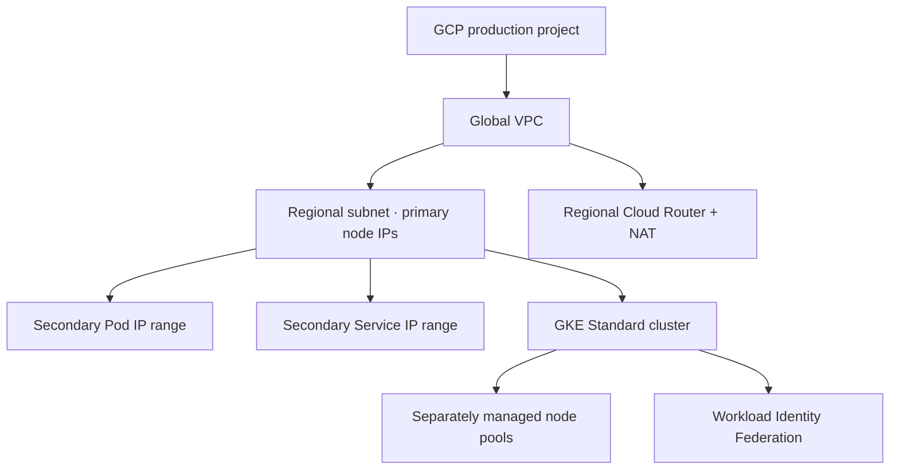

# GCP Terraform: VPC, Cloud NAT, IAM and GKE

> **Engineering focus:** Translate the platform to Google Cloud. How do project hierarchy, global VPC, subnet ranges, Cloud NAT, GKE node pools, IAM and workload identity differ from AWS?

## AWS versus GCP foundations

GCP resource hierarchy includes organization, folders and projects. GCP VPC networks are global resources with regional subnets; AWS VPCs are regional and subnets zonal. AWS IAM roles/trust differ from Google IAM principals, bindings and policies.



## VPC-native GKE address plan

```hcl
resource "google_compute_network" "main" {
  name = "marketplace-prod"
  auto_create_subnetworks = false
}
resource "google_compute_subnetwork" "gke" {
  name = "marketplace-gke"
  region = "europe-west1"
  network = google_compute_network.main.id
  ip_cidr_range = "10.40.0.0/20"
  private_ip_google_access = true
  secondary_ip_range {
    range_name = "gke-pods"
    ip_cidr_range = "10.48.0.0/16"
  }
  secondary_ip_range {
    range_name = "gke-services"
    ip_cidr_range = "10.49.0.0/20"
  }
}
```

Node addressing uses the primary range and VPC-native Pod networking uses secondary alias-IP allocation. Pod IP range sizing must account for per-node CIDR reservations, not only live Pod count. Modern GKE can also use GKE-managed Service addressing, so validate cluster version and mode.

## Cloud Router and Cloud NAT

```hcl
resource "google_compute_router" "main" {
  name = "marketplace-router"
  region = "europe-west1"
  network = google_compute_network.main.id
}
resource "google_compute_router_nat" "main" {
  name = "marketplace-nat"
  router = google_compute_router.main.name
  region = google_compute_router.main.region
  nat_ip_allocate_option = "AUTO_ONLY"
  source_subnetwork_ip_ranges_to_nat = "LIST_OF_SUBNETWORKS"
  subnetwork {
    name = google_compute_subnetwork.gke.id
    source_ip_ranges_to_nat = ["ALL_IP_RANGES"]
  }
  log_config { enable = true, filter = "ERRORS_ONLY" }
}
```

Cloud NAT implements managed distributed translation; it is not a conventional proxy VM. Port allocation depends on VM/source-IP behavior, static/dynamic allocation and translated destination patterns. Check whether GKE Pods SNAT to node IPs before Cloud NAT.

## Cluster and node pool

```hcl
resource "google_container_cluster" "main" {
  name = "marketplace-prod"
  location = "europe-west1"
  network = google_compute_network.main.id
  subnetwork = google_compute_subnetwork.gke.id
  initial_node_count = 1
  remove_default_node_pool = true
  deletion_protection = true
  ip_allocation_policy {
    cluster_secondary_range_name = "gke-pods"
    services_secondary_range_name = "gke-services"
  }
  release_channel { channel = "REGULAR" }
}
resource "google_service_account" "nodes" {
  account_id = "marketplace-gke-nodes"
}
resource "google_container_node_pool" "general" {
  name = "general"
  cluster = google_container_cluster.main.id
  location = "europe-west1"
  autoscaling { min_node_count = 1, max_node_count = 5 }
  node_config {
    machine_type = "e2-standard-4"
    service_account = google_service_account.nodes.email
    oauth_scopes = ["https://www.googleapis.com/auth/cloud-platform"]
  }
  management { auto_repair = true, auto_upgrade = true }
}
```

This is a foundation example, not a complete hardened deployment. Assign suitable node-service-account IAM, private access policy, monitoring and cluster policy separately. Separate node pools from the cluster to allow independent worker replacement. Don't set a fixed `node_count` that fights cluster autoscaling. GKE Autopilot has a different node management model.

## IAM authoritative ownership trap

- `google_project_iam_policy`: authoritative entire project IAM policy.
- `google_project_iam_binding`: authoritative membership of a role binding.
- `google_project_iam_member`: additive individual role membership.

```hcl
resource "google_project_iam_member" "logging" {
  project = "marketplace-prod"
  role = "roles/logging.logWriter"
  member = "serviceAccount:${google_service_account.nodes.email}"
}
```

Independent states claiming the same authoritative binding may revoke one another's permissions. Decide ownership at resource/role scope.

## Workload identity

GKE Workload Identity Federation connects Kubernetes workload identity to authorized Google Cloud IAM principals or service-account impersonation without distributing long-lived JSON keys. Kubernetes RBAC and Google IAM are independent.

## Incident scenarios

- GKE scale-out fails despite free quota: inspect Pod secondary range and per-node allocation.
- New nodes fail registration: node SA IAM and API/network access.
- Partner API rejects egress: inspect public Cloud NAT IP, subnet range coverage and Pod masquerading.
- An IAM `policy` resource removes unrelated team bindings: restore correct ownership and prefer additive resources for independent team access.

## Key takeaways

> The Terraform engine is the same, but GCP's resource hierarchy and networking differ. Model projects and IAM carefully, use global VPC with regional subnets and VPC-native GKE ranges, separate node pools from cluster lifecycle, and configure Cloud NAT based on actual source-IP behavior. Especially avoid mixing authoritative project IAM policy resources with unrelated member owners. For both providers, safe state boundaries and real failure-mode testing matter more than forcing identical module APIs.

[Google provider](https://registry.terraform.io/providers/hashicorp/google/latest/docs) · [GKE networking](https://cloud.google.com/kubernetes-engine/docs/concepts/alias-ips) · [Cloud NAT](https://cloud.google.com/nat/docs/overview)
