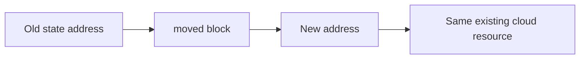
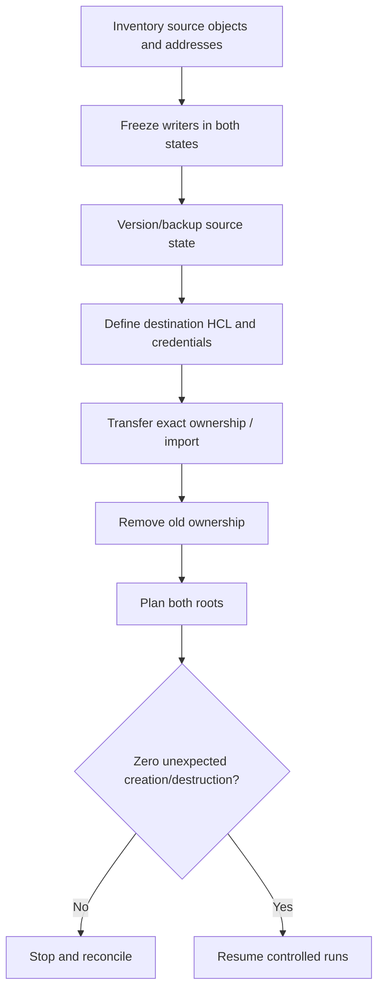

# Q8 · Import, Moved/Removed Blocks and State Refactoring

> **Interviewer:** Adopt manually created production infrastructure, rename resources, move objects into modules and split large state safely without recreating infrastructure.

## Import existing objects

Terraform config declares intent; import attaches a real object to a Terraform address. Existing S3 bucket example:

```hcl
resource "aws_s3_bucket" "catalog" {
  bucket = "example-marketplace-catalog"
}
import {
  to = aws_s3_bucket.catalog
  id = "example-marketplace-catalog"
}
```

Run `terraform plan` and review whether post-import HCL would modify the object. Import does not automatically reconstruct every remote property or import related AWS resources. Don't manage the same object from multiple state addresses.

A GKE import uses a provider-defined project/location/name identity; reconstruct cluster and node-pool configuration before any apply. Generated configuration with `terraform plan -generate-config-out=generated.tf` is only a draft, not a safe final declaration.

## Renames and module moves

```hcl
moved {
  from = aws_s3_bucket.logs
  to = aws_s3_bucket.application_logs
}
```



For moving the resource under a module:

```hcl
moved {
  from = aws_s3_bucket.logs
  to = module.logging.aws_s3_bucket.logs
}
```

The new module must declare the target. Keep historical move mappings in versioned modules to support upgrades from older releases. A code-only rename may otherwise plan old destroy plus new create.

Manual `terraform state mv` can achieve specialized moves, but requires coordination and has weaker review traceability than declarative refactoring.

## Stop managing without deletion

```hcl
removed {
  from = aws_s3_bucket.catalog
  lifecycle { destroy = false }
}
```

A removed block with `destroy = false` deliberately relinquishes Terraform ownership while retaining the cloud object. Simply deleting the resource block ordinarily signals destruction.

## Cross-state split

A moved block doesn't migrate an object between two independent backends. Plan an explicit transfer/import-and-handoff:



Ensure only one state can mutate each resource at any moment. Cross-state input/output dependencies must be converted into stable published interfaces, not informal dependency on another team's internal addresses.

## Failure modes and commands

```bash
terraform state list
terraform state show aws_s3_bucket.catalog
terraform state mv 'aws_s3_bucket.logs' 'module.logging.aws_s3_bucket.logs'
terraform plan -out=after-refactor.tfplan
```

Before state edits: protect snapshots, stop automation, identify cloud IDs and document rollback. Never apply if the migration unexpectedly proposes replacing the live network, database or cluster.

## Spoken interview answer

> “Import associates an existing object with Terraform state; moved changes its resource address without recreating it; removed relinquishes ownership. These are different operations. I'd inventory cloud objects, preserve state, declare address changes in version-controlled files, and use a cross-state migration procedure only under exclusive access. The proof of a successful refactor is a reviewed plan that preserves remote identities.”

[Import](https://developer.hashicorp.com/terraform/language/import) · [Refactoring](https://developer.hashicorp.com/terraform/language/modules/develop/refactoring) · [Removed](https://developer.hashicorp.com/terraform/language/block/removed)
