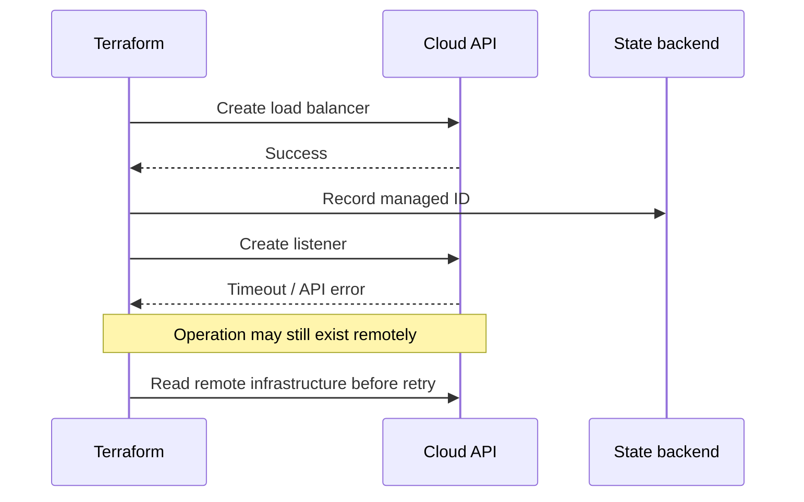

# Q9 · Drift, Lifecycle, Partial Failures and State Recovery

> **Interviewer:** A cloud engineer modifies production manually, and Terraform detects drift. Must it revert the change? How do you diagnose partial failures, replacements and state recovery?

## Drift is an ownership question

```text
HCL configuration: desired state
Terraform state: last recorded bindings and attributes
Cloud APIs: currently observed infrastructure
```

A refreshed plan reconciles them. Distinguish unauthorized changes from emergency fixes and fields deliberately owned by other controllers. Not all drift should be instantly reverted.

```bash
terraform plan -detailed-exitcode
terraform plan -refresh-only
terraform apply -refresh-only
```

Refresh-only can update Terraform's recorded view to observed remote resources without enforcing HCL desired changes. It is **not** an infrastructure rollback and does not approve the security posture of the changed resource.

## Field ownership and ignore_changes

```hcl
resource "aws_autoscaling_group" "workers" {
  name = "example-workers"
  min_size = 2
  max_size = 20
  desired_capacity = 4
  vpc_zone_identifier = var.private_subnet_ids
  launch_template {
    id = aws_launch_template.worker.id
    version = "$Latest"
  }
  lifecycle {
    ignore_changes = [desired_capacity]
  }
}
```

This illustrates a field intentionally owned by autoscaling. Narrow ignores are safer than `ignore_changes = all`, which may hide unauthorized changes. If Terraform and an external controller are both authoritative for the same field, change ownership rather than suppress all differences.

## Unexpected replacement

```text
-/+ aws_db_instance.orders
```

Before approval, identify the forcing attribute, dependency blast radius, data preservation, snapshot freshness, cutover, client endpoints and possibility of coexistence. `create_before_destroy` does not migrate stateful data automatically. Terraform `prevent_destroy` is a configuration guard, not cloud deletion protection.

## Partial failure



A timeout may occur after cloud-side creation succeeded. Do not assume failed apply means no infrastructure was changed or that Terraform rolled back previous operations. Inventory cloud objects and exact IDs, inspect state, import or reconcile orphaned objects, fix error, then replan.

```bash
terraform state list
terraform state show aws_lb.example
terraform state pull > restricted-backup.json
terraform plan -out=reviewed-recovery.tfplan
```

## State restore procedure

1. Freeze automation and independent writers.
2. Retrieve versioned state backups and relevant audit logs.
3. Select a consistent snapshot and identify its lineage/serial.
4. Compare each critical state binding with the live cloud object.
5. Import/rebind objects created after the snapshot; remove obsolete bindings appropriately.
6. Run a full refreshed plan and inspect every destructive action.
7. Resume normal execution only after validation.

A Git revert is only a configuration change; it does not restore deleted databases or disks. Code rollback, infrastructure rollback and data recovery are separate.

## Targeted operations

`terraform plan -target=...` and `terraform plan -replace=...` can help exceptional recovery but aren't replacements for normal complete planning. A targeted apply can leave unrelated desired changes unreconciled; follow with a full plan.

## Spoken interview answer

> “Drift is a signal to investigate ownership, not a command to overwrite reality. Emergency console changes and autoscaler-managed fields need different responses. A Terraform apply can partially succeed and a timed-out provider call may have created the resource. I'd freeze writers, compare live IDs to state, preserve backups and run a complete reviewable plan. A Git revert isn't a database recovery plan.”

[State refresh](https://developer.hashicorp.com/terraform/cli/commands/plan) · [Lifecycle](https://developer.hashicorp.com/terraform/language/meta-arguments/lifecycle)
